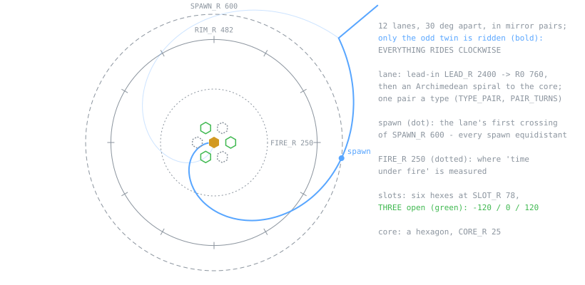
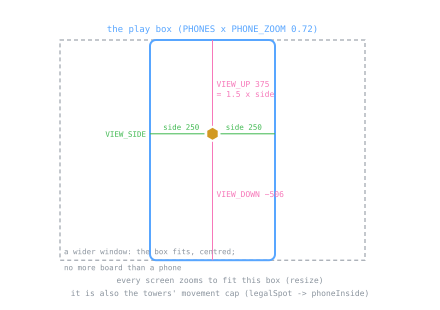
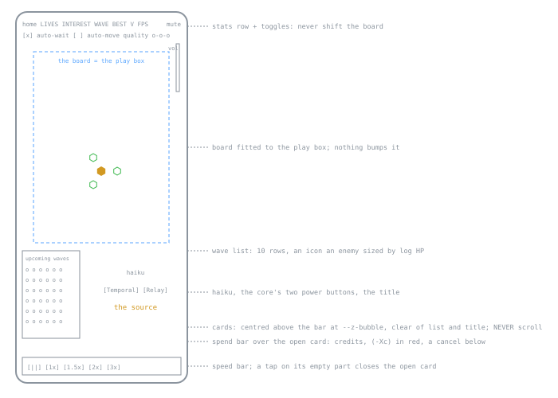

# THE SPIRE - game design

Spiral tower defence at `wai-lau.net/spire`, phone first. The CURRENT design, verified
against the code at 5.1.32 (2026-10-16); the header, the pillars, §2.1, §4.1, §4.2 and the named constants re-checked at 6.18.36
(2026-10-30). **The code holds the numbers.** The tuned values at
4.4.2 (its §12, with the later changes noted there), every superseded one, the measurements and the incidents behind the
traps are in **ARCHAEOLOGY.md** (same section numbers). The pre-rewrite text:
`git show f00d730:ARCHITECTURE.md`.

| Reading note | |
|---|---|
| "the owner" | Wai (she/her); a quoted owner rule is the reason for a design |
| `ARCHITECTURE.md §22` in code, the sim README, the parent's CLAUDE.md | this whole file (the game lived in exec-fn's §22 until 2026-10-14) |
| a bare `§N` in an exec-fn context | exec-fn's ARCHITECTURE.md (its §1e serves this app) |
| names | files and ids `aspira-*`; players see THE SPIRE; the title reads `the source`, `ascendant` after a win, or the boss's name |
| units | world units = the 1000 x 1000 chart; "s" = real seconds at 1x; "game s" follows the speed setting |

## 1. Overview and pillars

| # | Pillar (an owner rule) | What it fixes | Where |
|---|---|---|---|
| 1 | **Phone first** | one fixed play box every standard phone shares; no pan, and no zoom but a desktop wheel's (the view only, §2.2); verify at 430x932 and 382x700 | §2.2, §7.1 |
| 2 | **Three towers, seven kinds** | `MAX_TOWERS` 3 on three open slots; every trio of kinds must be winnable except the designed deaths (§4.6d) ("for every combination of 3 towers, it is possible to win"), so no kind is required | §4, §10.4 |
| 3 | **Towers move by hand** | drag any tower any time inside its leash, firing all the while; nothing moves itself except Auto-move (a win unlocks it; it disqualifies the game) | §4.3 |
| 4 | **Every upgrade is a choice** | three axes a tower, five buys an axis (tiers I-V), 13 buys a tower, ONE capstone (V) a tower; no tier lowers a stat | §4.2 |
| 5 | **Only behaviour is told** | card words change only when behaviour changes; a number moving changes the stat row | §7.3 |
| 6 | **Counters, not a best tower** | each enemy type has two main counters and two helpers | §4.6 |
| 7 | **3D is a view, never a rule** | ranges, hits and timing are 2D; 3D only draws the same game | §8.1 |
| 8 | **Waves are fixed** | type, lane split and drops hash from the wave number; what stays random is crits, stun chance, swarm jitter (size, speed, wander) and the visuals (sparks, spin, number scatter) | §5 |
| 9 | **Honour-system leaderboard** | a browser game proves nothing; TOP PLAYERS guards shape and rate only | §9.1 |

## 2. Board

### 2.1 Geometry (fixed, never random)

| Rule | Design |
|---|---|
| one pair a type | `TYPE_PAIR` / `PAIR_TURNS`: armor the most direct, swarm almost straight, fast a curve, shield and boss ellipses (`ELLIPSE` 0.7); the type fixes the path, every enemy walks it at one base speed. The chart's dotted 250 u ring is where the pairs' "time under fire" was measured when they were solved (`FIRE_R` in `aspira-defs.js`: declared, read by nothing, kept as the record) |
| winding | pitch-driven (`TANGENT_Q`, `LANE_SOFT_R`): no hook off the lead-in, a gentle coil at the core; plus the CORE TWIST (owner, 2026-10-22, in place of auto-wait): extra winding at rate `(1 - r/TWIST_R)^TWIST_P / r` inside `TWIST_R` 420 (softened at the core by `TWIST_SOFT`), tightest at the core, each lane `TWIST_S` 3.5 s x its rider's speed longer (`PAIR_RIDER`, `PAIR_V`; solved by bisection), sampled `TWIST_SUB` x finer there; the per-section twist sets the difficulty curve (§5.6); the drawn lane runs on under the core, the walked path ends at `CORE_R` |
| copies | a wave rides rotated copies of its lane: swarm 20/24, fast 3/5, shield 2/3, armor 2, boss 1 (Lovers 2 opposite, Devil 6 on 3, her host on the same 3), **never exactly four** (`NO_LANES`); the set is turned by `laneBestTurn` (rule in §2.2: most even copies, then most total lane, then nearest the usual turn; turned 90 degrees in landscape) |
| lit | a lane lights only with live enemies (`alive / sent`, `LANE_FADE_IN_MS`); a boss lane is wider, haloed, and waits for the sky (§5.5); Roman numerals on `LABEL_R` 430 never overlap (`placeLabels`); lit layers rebuild at most every `LIT_MIN_MS`; in 3D the lit lanes are drawn by the bell shader (§8.2), the 2D layers only off it; a finished wave's lanes go dark the frame its last enemy dies, whatever wave is up next (`laneHold` keeps a lane only while a live lane of its wave `u.n` runs) |
| footprint | a tower is a hex of `TOWER_K` cells, `towerGap()` from another, blocked by the core only where outlines touch (`coreKeep`); building on a lane is allowed (towers and enemies never collide); `CORNER_SLOTS` is empty (dormant, §4.8) |

### 2.2 The play box (pillar 1)

`PHONES` lists standard phone page sizes; at `PHONE_ZOOM` 0.72 the tightest gives the
box (`aspira-positioning.js`). **Every screen zooms to fit it** (`resize`, centred on the
other axis) and it is the towers' **movement cap** (`legalSpot` -> `phoneInside`): a
desktop gets no more board than a phone. Its outline shows only as three thin lines on an
edge holding a tower back for no visible reason.

| Rule | What |
|------|------|
| centred core | the core sits in the middle of the box: `BOX_SHORT` either side across the short axis, `BOX_LONG` along the long one |
| two shapes | portrait (`BOX_HX` short, `BOX_HY` long) and landscape, the same box turned 90 degrees; `boxWanted()` follows the window, `setPlayBox(wide)` applies it and `turnSlots(wide)` turns the cells and built towers with it |
| switch | only on a clear field with no lane preview (`boxSwitchIfIdle`, checked before each step), so a turn never lands under live enemies |
| lane copies | a wave's lanes turn to the angle whose copies are on screen about equally long (`laneBestTurn`, within `LANE_EVEN_SLACK`), then the most lane on screen, then nearest the usual turn (the usual turn is itself turned 90 degrees in landscape, so a landscape pick is the portrait pick plus a quarter turn) |
| wave list | `fitWaveList` drops trailing rows until the list clears the core and the open starting slots; phone rows are `WAVE_ROW_H_PHONE` high |
| desktop zoom | a fine pointer's wheel zooms the VIEW (`viewZoom` x the fit, 0.5-1.5, start 0.7, about the core's fitted spot, no pan; `zoomApply`, aspira-draw.js; a resize keeps it); touch stays at 1. The GAMEPLAY box is the fit's at any zoom: `phoneInside` runs under `fitView` (the fit camera + `warp.pFit`, made once a frame), so enemySeen, `legalSpot`, flings, lane turns and the boss bar never move; the outline draws that box's floor footprint through the zoomed view (`fitMap`) |
| landscape tilt | the 3D box is a screen rectangle, so the floor it covers grows with the camera tilt: landscape solves `tiltWide` (bisect, `fitTiltWide`, after a switch or resize) so `boxFloorArea()` equals `portraitFloorGoal()` (tilt 0.2-0.7, settled 200 ms after a resize) (the floor portrait covers on this screen turned, at tilt 0.55); every reader of the tilt uses `warpTilt()` |

### 2.3 Shields as segments

One segment a point in the shape's own outline, ring r holding `sides x r` (a hex core: 6,
12, 18 ...; `LIFE_RINGS` 5). Lose one: a random segment goes; gain one: enters innermost
and pushes the rest out. Rings dim outward, breathe with the core (`shieldPulse`), and a
lost core segment flashes the boss red.

## 3. Economy and flow

| Lever | Design |
|---|---|
| start | `START_MONEY` 120, **18 lives** (two full rings of 6), interest 2% |
| interest | `floor(money x rate)` on the credits held when a wave is SENT, **uncapped**; a boss drop may add +0.5% (lives back, below); the owner keeps tuning it down ("97% of a run's money was interest") |
| bounty | `bountyBase(w) x type bounty x BOUNTY_MUL`, `w` the 10-cycle equivalent wave (§5.2): linear to eq 30, a gentler slope after, x1.1 early; fractional, shown floored; a kill's credits **fly home** as a gold dot and bank on landing |
| prices | a tower `cost` 40, **x1.5 per tower standing** (40, 60, 90), shown in each free slot; upgrades are multiples of the build price (§4.2); **sell** returns 95%, on a second tap |
| leaks | an enemy costs its `leak`: swarm 2, boss 10 (= game over, the boss named in the title), others 1 |
| lives back | a boss drop ONLY: +3 lives OR +0.5% interest (half and half by `fixedRand`). **No score** (owner, 2026-10-29: "remove anything based around score"; its +6 lives per 100,000 went with it); BEST = the furthest wave |
| speeds | 1 / 1.5 / 2 / 3x (keys 1-4), 10x for the owner (5); the sim steps 0.02 s; Temporal Drive always runs at 1x |

**Wave gating** (`bossUp` includes `G.fleetQ`):

**No auto-wait** (owner, 2026-10-22): the checkbox and the game slowdown are gone, and the per-enemy wait that briefly replaced them
too. The lanes' CORE TWIST (§2.1) gives the same time to the core instead. The threat ring keeps its 1 s line (`AUTO_WAIT3_S`).

| Pauses (`towersFrozen` while paused and while the sky turns) | Pauses | On close |
|---|---|---|
| tower card, core card, upgrade chooser, an armed Relay | yes | restores the previous pause |
| build dialog | yes | restores the previous pause - **unpauses only at game start** (the first build, `G.started` unset; owner 2026-10-27) |
| focus loss | no | a hidden tab just gets no frames; the slow logs ignore it |

## 4. Towers

### 4.1 The seven kinds

| | ARC | FRZ | SOL | ACD | GRV | CRR | IFR |
|---|---|---|---|---|---|---|---|
| design | hit-scan chain lightning | an aura, no shots | a ray that splits from enemy to enemy | continuous jets and pools | a void a shot, with novas and an aura (§4.6b) | a carrier launching interceptors (§4.6c) | a homing meteor bursting into a fan of straight shards, fires and eight-beamed flares (§4.6e) |
| colour | yellow | cyan | pink | green | violet | blue | orange |
| default targeting | Near | Near | Near | Near | Near | Near | Near |
| main counter of (`GOOD_VS`: a +2 in the mark target, §7.2) | armor | swarms, fast | armor, bosses | bosses | nothing | fast, shields | swarms, shields |
| helps against (`HELPS_VS`: a +1) | fast | nothing | shields | swarms, shields, armor | swarms, fast, armor | nothing | nothing |
| weak to (a -1 or worse) | swarms, shields | shields, armor | swarms, fast | fast | shields | swarms, armor | fast, armor |
| leash (`MOVE_BASE`) | medium (200) | long (240) | medium (222) | longest (280) | medium (200) | long (240) | short (120) |

Ids `arc frz sol acd grv crr ifr` (`KINDS`; `crr` was `car` until 6.18.4, renamed 2026-10-29). The seven hues sit 360/7 OKLCH degrees apart (§10.1); range x `RANGE_BONUS`. The legacy path/form tree
(`aspira-upgrades.js`) is dormant: every kind `hasSkills`.

### 4.2 The chart (pillar 4)

Three axes a kind, each a ladder of **five purchases** (`SKILL_TIERS`, tier redesign 2026-10-24,
spec `docs/superpowers/specs/2026-10-24-tier-redesign-design.md`); an axis level IS the tier
shown, and every per-tier table holds exactly those six values:

| shown on card, board, title = table index | 0 | I | II | III | IV | V = capstone (`CAPSTONE_TIER`) |
|---|---|---|---|---|---|---|
| what it is | the plain tower | the axis's first hint | the old I | the old II | the old III | the old IV |

- A tower's `lvl` is 1 + its purchases: **13 a tower** (`SKILL_POINTS`: one axis to V, two to
  IV), one step of `SKILL_STEP_COST` each (13 steps, a placeholder until the balance battery).
- Tables are written 0 + the old I..III; `aspira-capstone.js` appends V (`CAPSTONE_NUM`) and
  inserts tier I (`tierMid`); `aspira-tier01.js` then writes each tower's real tier 0 and tier I.
- An old save is read once one tier up (`SKILL_SCALE` 3; `skillScaleFix`, `OLD_TIER` for older).
- **One capstone a tower** (`axisCap`, `capstoneHolder`; the card says "One capstone per
  tower · X V holds it"). A tower's shown level is its purchases (`shownLevel`).
- **The basket**: a tap pulls an axis to its next (or last) tier, the card previews the
  result, one priced button locks it in. Below the locked tier is refused with a note; the
  bank never limits a pull (unaffordable = red cost, disabled button); a card closed
  unbought drops its pull.

### 4.2b The stat curve, tier 0 and tier I (`web/aspira-curve.js`, `web/aspira-tier01.js`)

A tower's damage, rate and range come from its **total level** (every purchase, any axis) on
one geometric curve per kind (`STAT_CURVE`, `curveAt`, `curveBase`): `lo` at 0 (below the old
bare tower), `hi` at 13 - placeholders measured on the old tables, fitted by the balance
battery. The axes add MECHANICS; one may nudge a stat up, never down, at most `NUDGE_MAX` 1.2 in
all (`nudge`: ARC Conductivity's rate; no axis moves range since 2026-10-26, `skillMove` gone). SOL's curve rate
is flat (its rate never rises). Per-axis raw damage tables are gone; a sub-attack's factor is
one constant (`FRZ_RIME_BITE0`, `ACD_POOL_HEAT`,
`GRV_INNER_K0`, `IFR_ROUTE_K0`, `IFR_TICK_K0`; GRV's pellets are a per-tier table again, `GRV_PELLET_K`, and CRR's tether deals no damage), and so is any factor on the tower's own damage, on from its first tier
(`SOL_CRIT_K`, `SOL_SCORCH_TOTAL`, `IFR_FIRE_HK`, `IFR_HF_FK`, ARC's `ARC_DMG_K`). A whole-tower RATE factor on the curve is one constant too: SOL `SOL_RATE_K` (with `SOL_DMG_K`, fewer, harder shots), FRZ's aura `FRZ_TICK_RATE_K` (fewer, harder ticks: the same damage a second, fewer shield pops), IFR's charge `IFR_RATE_K` (a plain rate cut, no damage back). Per-tier tables that stay hold counts, shapes, reaches and
debuffs on the enemy (FRZ Fracture, slows, armor strips). `towerLevel` counts the tower's own axes only. Each stats function sets `dmgCurve` /
`rateCurve` (the curve plus nudges) before a mechanic splits the hit.

**ARC's damage is geometric in the level** (7.1.0; owner, 2026-11-01: "Right now ARC is so insanely steep it doesnt make sense" /
"no level damage steps above 2x"): `STAT_CURVE.arc.geo` [base, step] = [1.10868, 1.9], damage = base x 1.9^level from tier 0 up to the `knee` (level 7),
x `late` 1.35 a level past it; no set-apart tier-0 hit (`curveAt` reads `geo` where a kind has it; ARC's `dmg0` is gone). **Two number rules** (owner, 2026-10-31 /
11-01): no level step multiplies damage by more than 2x, and nothing a card or table shows passes about 800% (8x the tower's damage).
Smoke pins them where a table carries them (`tiers.mjs`, ACD's goo: each value <= 8x, each step <= 2x, rising); the curve's own
steps (1.9 ARC, 1.35 past its knee) sit under 2x by construction.

**Every curve rises and each level's hit is BELOW 2x the one before** (owner, 2026-11-01: "get the early damage even lower and allow
the curve to not be exactly 1.5x / just keep it below 2x for any level" - the only curve rule; 2026-10-28's "slightly steepening" pin is
gone). SOL, GRV and IFR keep the power curve but start GEOMETRIC: `geoCap` [base, step], hit = min(base x step^level, the power curve) -
SOL [3.0616, 1.9] (a fifth of its old tier-0 hit; meets the curve at level 6), GRV [0.256, 1.9] (level 4), IFR [0.1047, 1.9] (level 6).
CRR is GEOMETRIC too: `geo` [0.8565, 1.4444], boosted early and tapering to the same level-9 hit. Smoke (`tiers.mjs`) checks every kind; its
`PENDING` list is empty and only ever shrinks.

**The card's damage unit** (`td`): ACD, FRZ and GRV count theirs `TD_UNIT` {acd 8, frz 3, grv 4} x bigger (`tdOf`, aspira-stats.js; the
card reads it through `tdU`, aspira-desc.js) - a LABEL only, the damage dealt is unchanged - so no share on a card passes 800% (FRZ's chill
top 2260% -> 753%, now capped at 800% by `FRZ_BITE_TD`, GRV Void V 3000% -> 750%, the void's crush capped at 800% by `GRV_CRUSH_TD`, ACD's ramp 1/8 to 8 td). Smoke: no card sentence names a
number over 800%, every axis of every tower at tiers 0-V, and every axis MIX 0-V (a Void V + Nova V GRV read 2325% before the cap). Burns read their share A SECOND, a CRR sortie its share A BOLT (`docs/spire-wording.md` rule 3).

| tower | tier 0 | axis 1, tier I | axis 2, tier I | axis 3, tier I |
|---|---|---|---|---|
| ARC | one hard bolt whose chain jumps twice (three enemies hit) | Conductivity (id `conductivity`): each jump keeps more of the hit (`ARC_AMP_FALL`) | Voltage: a longer chain and a farther jump (`ARC_VOLT_JUMPS`, `ARC_VOLT_REACH`); one fork from I | Shock (id `capacitance`): every hit strips armor and marks its target Shocked |
| SOL | one tracking beam held on its first target, hitting only it (`SOL_SPLIT[0]` 0) | Scorch (id `focus`): the stacking burn | Reflection (id `refraction`): one split, piercing | Breach: armor stripped a tick, the splits' carry |
| CRR | eight interceptors, one bolt a volley, four volleys a sortie (`CRR_HANGAR`, `CRR_AMMO`) | Hangar: twelve launched, two stored in orbit | Tether: the first interceptor out tethers its target (`CRR_TETHER_N`, `carTethered`) | Armament: a harder bolt (`CRR_BOLTS_BY`, x0.65 at 0 .. x3) and more volleys |
| FRZ | a slowing circle with a light flat nip | Fracture: the real tick, more the slower | Permafrost: frost pulses (a stacking slow; no armor) | Moons: one moon |
| ACD | one ray, no pools | Corrosion: eats armor | Flow: two rays + carry | Spill: ray pools that burn, no slow; kill pools gone |
| GRV | a void a shot that crushes as it grows, shedding pellets as it decays | Void: a heavier void | Nova (id `supernova`): one nova before each void, harder by tier (`GRV_NOVA_RATE`), stripping armor | Gravity Well (id `radiation`): the aura (pull, slow) and harder pellets |
| IFR | a meteor that bursts into a fan of six (`IFR_FAN_N`) | Meteor: meteors stored in orbit | Hellfire: a wall of fire lighting flares | Flare: a bright flare at each impact |

Tier I names: `TIER_I_NAMES` (`aspira-capstone.js`). Checks: `scripts/spire-smoke/tiers.mjs`.

### 4.3 Moving (pillar 3)

| Rule | Design |
|---|---|
| drag | follows the finger at once, firing; not while placing, with the Relay armed, paused, or during the sky turn; two fingers move two towers |
| leash | a circle round its own slot (`MOVE_BASE x slide`, slide capped `SLIDE_MAX`), clear of the core, other towers and the play box; no legal spot = it stays put; shown 4 s after a build or a growth |
| coast (`aspira-fling.js`) | released with speed it coasts and bounces off leash, neighbours, core and box; a tower that cannot stay glides home |
| home slot | a moved tower leaves a faint hex there; a slot another tower sits on cannot be built (`canPlace`) |
| pick | by the whole drawn shape at `PICK_GROW` (3D: the prism's screen outline, `aspira-pick.js`) |
| tiers | slide tiers grow the leash, range tiers the range (`SKILL_MOVE`) |
| **Auto-move** | a checkbox **only after a win** (`best.ascended`): `bestSpot` picks, the tower glides at `HUMAN_V` in GAME time; a second tap arms it; **any time on = "(DQ)" from TOP PLAYERS** |

**Targeting** (a card slider; ties go to the furthest along the spiral; ARC's jumps
and SOL's hops use the tower's own mode, `chainPick`): **Fresh** = no debuff first, then
nearest the core · **Biggest** = most HP left (a boss always) · **Near** = nearest the CORE,
not the tower.

**Positioning** (`bestSpot`; the simulator and Auto-move): every half second score 36 spots
(3 rings x 12 angles) on predicted positions 5 s ahead, weighted by urgency (x1 at entry ..
x7 at the core) and the tower's targeting; move only for a spot 10% better.

**Look**: the level is the hex's glow and rings; the stat triangle on the hex grows a ring a
purchase; an affordable buy flashes an up-chevron; labels are three letters.

### 4.4 What each axis buys

**ARC** - THE ARC REDESIGN (owner, 2026-10-29: "Hits hard, big chain, forks are limited to 1 fork per node, doesn't refork after 1
fork, cannot hit same target twice"): ONE hard strike a shot, then a chain of jumps, each leaping from the enemy it hit to the next
within its own reach (`arcRange`, not ARC's small range: close zap, conducts to a few units nearby). From Voltage I (`ARC_FORK_FROM`) the strike forks
ONCE into two chains, and nothing forks after. **One hit set an attack**: no enemy is struck twice by one attack (`fire` shares
`seen`; `skillHop`). No charges, no bursts. The axis ids stay (saves, sims, smoke); only the names changed. How it got here:
ARCHAEOLOGY §4.

| axis | buys |
|---|---|
| Conductivity (id `conductivity`) | the carry: what each jump keeps of the hit before it (`ARC_AMP_FALL`, above 1 from tier III: jumps out-hit the strike) |
| Voltage | the chain: more jumps (`ARC_VOLT_JUMPS`) and a farther reach a jump (`ARC_VOLT_REACH`); the one fork from `ARC_FORK_FROM` |
| Shock (id `capacitance`) | never slows (`ARC_RES_SLOW` all 0: the owner's ARC brief, ARCHAEOLOGY §12.t); every hit strips a share of the armor left (`ARC_RES_STRIP`, `shredPct`); from II its bolts hit harder (`ARC_RES_DMG` x1.05-1.2, on the card "Its bolts hit xN harder."); **Shocked** (owner, 2026-11-01, "1": "Shock makes shocked enemies take more damage from ARC"): each hit marks its target for `STAT_SLOW_T` (0.6 s; `shockT`, refreshed on hit), and a marked enemy takes x(1 + `ARC_SHOCK_AMP` 0/.3/.7/1.6/1.8/2) from ARC's hits (not the burn); the mark shows as a thin triangle in ARC's colour round the die (aspira-enemies.js), the card says "Shocked enemies take X% more damage from ARC."; no area zap |

**FRZ** - everything inside the aura is slowed (only while inside) and takes a quiet tick;
**armor bites the tick**, and it hurts by the speed the slow takes (`frzBite`: `FRZ_CHILL_K` x slow x the enemy's own speed / `ENEMY_BASE_SPEED`, owner
2026-11-06 "1 yes"; it reads speed, never type, so fast enemies take most), never over `FRZ_BITE_TD` (8) x td. **No armor reduction** (owner, 2026-10-29: "no armor reduction effects, more slow").
**Weakness: shields and armor** - a shielded enemy cannot be slowed (no chill, no Fracture, a Permafrost pulse does nothing);
a tick on it pops one charge.

| axis | buys |
|---|---|
| Fracture (id `temp`; Brittle until 2026-11-06, owner: "rename it to Fracture") | a colder aura, a faster tick, more **damage taken** (a slowed enemy takes more from EVERY tower, credited to the FRZ; the card row "Damage taken"); range |
| Permafrost (id `rime`) | rings pulsing to the aura's edge, each leaving a permanent stacking slow (its armor crack `FRZ_RIME_CRACK` is 0 at every tier); at full frost the rime spreads to the nearest enemy; slide |
| Moons | copies of the aura orbiting the tower (separate slow sources, so they multiply), with satellites at the top tiers |

**SOL** - one TRACKING BEAM, held on its first target while that target lives and stays in range (owner, 2026-11-04: "SOL 0: fire a
single tracking beam at a target ... It lasts as long as the first target is alive, the first target must be in range"). Armor cuts it like any
other tower. Its checks and weak spots are measured, not designed: the build card's marks (`VS_MARKS`, §4.6). The code: `web/aspira-sol.js`
(`stepSolTrack`); the look: `solTrackBeams` (aspira-effects.js); how it got here: ARCHAEOLOGY §4 (the band model it replaced).

| part | principle |
|---|---|
| lock | the first enemy `pickTargets` gives; the beam holds it until it dies or leaves `st.range`, then locks again. A NEW lock aims `SOL_AIM` s before it may fire (a lock that struck at once killed a swarmer a frame) |
| pulses | damage per second = the curve's (`st.dmg` x `st.rate` x `SOL_TRACK_DMG`), dealt as PULSES (owner, 2026-11-05: "fire, pause, fire, pause"): a shot every 1 / (`st.rate` x `SOL_PULSE_K`) s carrying that second's share, through `damage()` - a number a shot, one shield charge a shot |
| first beam | hits only its target - it never pierces (owner: "SOL 0 no pierce") |
| splits (Reflection) | as a volley starts, `st.split` splits from the first target to the nearest enemies within `st.range` OF THAT TARGET; each split is a line from the first target THROUGH its own enemy on to the play box's edge (`solLinkHits`, `solOutLen` - the same in the sim; owner: "all secondary beams fly off to edge of screen"), PIERCING every enemy on it in order, and ends when its own enemy dies |
| carry (Breach) | a split's damage x `SOL_TRACK_HOP[Breach]` at each enemy it reaches, compounding (the swarm weakness: owner, "pierce damage reduction is applied each time it passes through an enemy") |
| breach (Breach) | every hit takes a fixed % of the armor left (`bleed` -> `shredPct`, `SOL_BREACH_ARMOR`); no parallel beams (owner: "no parallel beams") |
| scorch (Scorch) | a pulse lays `SOL_SCORCH_M` / `SOL_PULSE_K` burn stacks at once (4) on every enemy it hits, each a share of its hit (`solTickHit`, `pulse`; owner, 2026-11-05: "scorch is what pops shields" - the stacks a second held), each stack on its own clock, one pop a tick (`solScorchTick`); every live stack slows its enemy `SOL_SCORCH_SLOW`, summed and capped at `TOWER_SLOW_MAX`, never a shielded one (`solScorchTick`, `applySlow` tag `scorch`; owner, 2026-10-31: "Make SOL scorch slow"); Scorch V doubles a stack's ticks at half each - a longer burn, more shield pops (`v`: the doubled ring) |
| drawing | `t.solB` at its live ends, never an fx entry: a pulse's FLASH (`SOL_PULSE_FLASH` 0.15 s, fading; dark between shots), the splits a segment an enemy, each dimmer by its carry. A beam that stops at its enemy (the main, a split without Breach) is THIN (`SOL_THIN_W` 0.3 x its hit's width); one that PIERCES (the main at Reflection 0 + Breach, a split with Breach, on to the edge: `solShowLen`) is full width (`SOL_PIERCE_W`) - owner, 2026-11-05: "primary beam way thinner (thicker with pierce)". Between shots the AIM LINE: a thin plain line to the lock, alpha 0.4 -> 0.8 as the next shot comes (over a new lock's `SOL_AIM` or the gap; "I want the aiming visual effect back"). No prism, no rod |

| axis | buys |
|---|---|
| Scorch (id `focus`) | a LONGER burn (`SOL_SCORCH_N` ticks), never a hotter one; at V twice the ticks at half each |
| Reflection (id `refraction`) | the splits (`SOL_SPLIT`, none at tier 0) |
| Breach | the armor a hit strips (`SOL_BREACH_ARMOR`, none at tier 0) and the splits' carry (`SOL_TRACK_HOP`) |

**ACD** - jets whose burn ramps while held (doubling, capped), each tick a real hit; jets never share an enemy; a jet resets
when its enemy dies or leaves, unless Flow carries its ramp on. Tier 0 is one jet and no pools. Its checks and weak spots: the build
card's marks (`VS_MARKS`, §4.6). The code: `web/aspira-acid.js`, the look `aspira-acid-draw.js`; how it got here: ARCHAEOLOGY §4.

| axis | buys |
|---|---|
| Corrosion | a tick takes a fixed % of the armor left (`shredPct`, `ACD_CORRODE` per tier; the jets only); eaten armor drips as **goo** that homes on the next enemy; a picked-up drop strips `ACD_GOO_STRIP` of the picker's CURRENT armor (15-75% at I-V) and deals `ACD_GOO_DMG` x the dropping ACD's td (2-8x) (7.1.4, owner 2026-11-01 picked "1"; it was the armor lost x 2.6-9.2) |
| Flow (id `spray`) | more jets (`ACD_LINES`); a jet keeps part of its ramp when its enemy dies **or escapes** (`ACD_FLOW_CARRY`, the fast answer); range |
| Spill | the jets drip slimy acid pools that burn and do NOT slow (owner, 2026-10-29: "Increase ACD pools so that swarm gets caught, no slows"; `ACD_POOL_SLOW` 0) - bigger and more often by tier; a kill leaves no pool; slide |

### 4.5 Rules every axis obeys

| Rule | |
|---|---|
| no tier lowers a stat | pillar 4; `ACD_SPRAY_MUL` floored at 1 |
| a tier's words | change only when behaviour changes (§7.3) |
| debuff credit | damage a debuff adds goes to the tower that caused it (`damageCredit`) |
| armor shred | EVERY strip is a % of the CURRENT armor (owner 2026-10-28: "all strip should be changed to a % not a flat number"; `shredPct`, per-tier tables, the same at every wave), so strips multiply toward 0, never below; `SHRED_MAX` 0.9 stays as a safety. The goo keeps `shredArmor` (its drop is a fixed share of the wave's armor reference). No negative armor, no "shredded takes extra" |
| 10 s at most | no effect on the board outlives `EFFECT_MAX_S` 10 s - GRV holes, the Orbital Relay; ACD pools `POOL_MAX_S` 5 s, goo `GOO_MAX_S` 30 s (owner, 2026-10-18). Debuffs ON an enemy (Breach, Corrosion's strip) are outside the rule |
| tier names | one a tier (Transfer .. Hyperstorm, Chill .. Zero Point, ...), used on the end screen, never on the card; ARCHAEOLOGY §12 |

### 4.6 The counter matrix (pillar 6)

**OLD - the design matrix below is superseded** (owner, 2026-10-29: "ignore all designs except mark"; "delete all other mark plans, or mark them OLD"): the towers are balanced to the mark target, `scripts/aspira-sim/mark-target.json` (§7.2 has its rows), and the table is kept only for its levers.

| enemy \ tower | ARC | FRZ | SOL | ACD | GRV | CRR | the lever |
|---|---|---|---|---|---|---|---|
| **swarm** | MAIN | help | weak (one lock) | help | MAIN | weak (one target a volley) | branching hits; bursts; a void that feeds on a crowd |
| **fast** | help | MAIN | help | weak (cold jets) | weak (no time to feed) | MAIN | the chill bite doubles on fast; interceptors outrun them |
| **armor** | weak (grounds the arc) | help | MAIN | help | MAIN | weak (small bolts) | strip multiplies armor down (never below 0); armor scales with HP |
| **shield** | help | weak (no slow) | help | MAIN | weak (the slow skips them) | MAIN | pops a hit: ACD one a tick, SOL by Focus, CRR one a bolt |

The matrix is DATA: `COUNTERS` in `aspira-defs.js`: each type has a `main` that is a LIST of two kinds and a `help` list of two, DERIVED FROM THE MARK TARGET (main = a +2, help = a +1;
swarm `[frz, ifr]` / `[acd, grv]`, fast `[frz, crr]` / `[arc, grv]`, armor `[arc, sol]` / `[acd, grv]`, shield `[crr, ifr]` / `[sol, acd]`). The build card derives from it: `GOOD_VS` / `HELPS_VS` (SOL and ACD add bosses,
`BOSS_KILLERS`), and the symbol marks (`VS_MARKS`, §7.2) come from a `countermx` run (SPREAD_ONLY, 9 points, waves 101-109 and 111-119 since 6.16.0 - CLAUDE.md has the command), so the card can never disagree with it. `scripts/aspira-sim/countermx.mjs`
measures it.

### 4.6b GRV, the gravity tower (`web/aspira-grv.js`, the look `aspira-grv-draw.js`)

Its target (the mark target, §7.2): a help against swarm, fast and armor, weak to shields; mid reach (about ARC's); its measured checks and weak spots are the build card's marks (`VS_MARKS`,
§4.6). Palette: a violet aura and outline, a yellow nova (`--asp-violet-*`, `--asp-bh-*`). There is no projectile: everything
happens where it fires. The numbers and how it got here: ARCHAEOLOGY §4.6b.

| part | principle |
|---|---|
| void (tier 0) | every shot leaves a VOID where its target will be a moment on (`GRV_LEAD_S`, along its lane at its pace, slows counted), so the enemy walks into it; the void crushes what is inside, harder the heavier it is, as it grows, never over `GRV_CRUSH_TD` (8) x td (the Nova factor rides on the void) |
| mass | a void IS its mass: its size is the root of its mass; it gains mass from the damage it deals (a crowd feeds it, a shield soaks hits and feeds it little, fast enemies pass before it feeds), up to a cap |
| decay | it evaporates by its circumference - a big or merged void burns out sooner - and it is gone by `EFFECT_MAX_S` from its oldest part's birth whatever it eats |
| pellets (tier 0) | a void sheds pellets as it decays, paced by the mass it loses: each flies out at random and hits the first enemy it touches or nothing; each pops one shield charge; past `GRV_PEL_SOFT` in flight they bundle (perf) |
| pull and merge | open voids (any GRV's) drift toward each other by the other's mass; touching, the bigger takes the other in (`grvMerge`) - masses, caps and areas add |
| novas (Nova) | ONE nova (`GRV_NOVA_N` 1, owner 2026-11-06; three until then) implodes on the best spot before each void (`grvNovaSpot`: the reach holding the most enemies) over `GRV_NOVA_T` 0.8 game s - the three's time, so at the base rate two rings overlap briefly - its front hitting what it passes once (x `GRV_NOVA_RATE` by tier) and stripping armor; it sets the void's size |
| aura (Gravity Well) | an aura round the void, never past twice its size: it slows (never the shielded), harder inside the void and on an enemy already past it, and every enemy in it glides across its lane toward the lane's centre line (`GRV_LAT_V`, easing back after); it deals no damage |
| look | the void's black centre is logarithmic in its size (`grvCoreR`), touching disks join; the aura is a radial band clear at both ends; every GRV damage number flies into its void (`grvFloat`) |

| axis | buys | capstone |
|---|---|---|
| **Void** | a bigger void, a harder crush, more pellets | **Singularity**: a void twice as heavy |
| **Nova** (id `supernova`) | the novas before each void, faster by tier, their armor strip (`GRV_NOVA_STRIP`) | **Hypernova**: the most strip |
| **Gravity Well** (id `radiation`) | the aura (pull and slow), its size and strength; the pellets' damage and range | **Event Horizon**: the whole aura slows as hard as its inside |

### 4.6c CRR (id `crr`), the carrier (`web/aspira-crr.js`)

The owner's StarCraft carrier, electric blue (`--asp-blue-hsl`), its target (the mark target, §7.2) checks on fast and shield; its measured checks and weak
spots are the build card's marks (`VS_MARKS`, §4.6). It never fires itself; its **interceptors** do. The constants (wing sizes,
speeds, volley counts, reloads) and every superseded number are in ARCHAEOLOGY §4.6c.

| Part | Rule |
|---|---|
| launch | the tower's range only LAUNCHES: an enemy inside it sends out every ready interceptor at once, the longest-waiting (`i.heldAt`, FIFO) taking the first target |
| target | each interceptor then picks its own from everything within the interceptors' reach (`CRR_LEASH` x the range, about 960), in the tower's targeting order. `carTarget` sends enough: the first enemy whose HP (and shield) outweighs the damage already committed to it by interceptors on it. The carrier itself moves inside a leash of 240 |
| hold | EVERY ready interceptor waits in orbit round the carrier (`s.hold` = the whole wing at every tier), at a jittered distance and size, carried with the carrier as if fixed to it, and launches from where it circles |
| flight | ONE speed out, back and home (`CRR_SPEED_V` 500; owner, 2026-11-02), circling at `CRR_ORBIT_V`; a heading with a capped turn rate, steered onto an orbit circle round the target (`CRR_ORBIT`, each interceptor's radius breathing by `CRR_ORBIT_JIT`); it steers round the core and the towers (`carAvoid`) and leads nothing. On arrival it makes a strafing pass (the ram) |
| volleys | `CRR_AMMO` volleys a sortie (never above 30), each ONE bolt carrying the volley's damage, x `CRR_BOLTS_BY` by Armament (owner, 2026-11-05, "C10"; it was the bolts fired at once until then - the history: ARCHAEOLOGY §4), then `CRR_VOLLEY_K` / rate to the next volley. A volley's bolt goes at the ONE enemy it began on, even if it dies; a bolt whose target is gone flies on only `CRR_BOLT_ON` s, hitting the first enemy it touches or nothing. An interceptor fires ONLY once on the circle round its target (`i.orb`), never on the way out. Bolts do not slow; only tethers do |
| tether | with Tether, the first interceptors out (`CRR_TETHER_N`: one at I, all from II) tether their target: slowed, and taking more damage per tether (`CRR_TETHER_SLOW` x `CRR_TETHER_K`, at most `CRR_TETHER_MAX` a tether; `CRR_TETHER_AMP`), tethers STACKING on one target (each slow modest, so several matter); from tier II (`CRR_CHAIN_FROM`) a tether runs on to one more enemy nearby. Drawn as a thin ARC-style chain of links in CRR's light blue (`fxGlChain` / `drawChain2D`, links `CRR_TETHER_W` 0.6 of ARC's), never under `CRR_TETHER_A0` 0.7 alpha; a pulse flashes it brighter and wider |
| after a kill | no leash: an interceptor stays on its target till it dies or its ammo runs out; then `carHop` (`CRR_HOP`) picks again or sends it home. Home, it reloads in proportion to the ammo it used (`i.used`, the PARTIAL RELOAD) |
| numbers | a bolt's damage goes to `dmgSum` with CRR's own window, `CRR_NUM_WIN` 0.1 s (every other tower's stream sums over `DMG_SUM_S` 0.5): an enemy under a volley shows a number every ~0.1 s, not every half second; a number a bolt was ~65x as many, unreadable (`carNum`, `CRR_NUM_HITS` 1) |
| draw | a volley flies as a V (`carBoltV`, draw only): each wing bolt `CRR_V_W` out and `CRR_V_B` back of its game spot, opening over `CRR_V_IN` and closing inside `CRR_V_SHUT` of its target; a carrier's darts are ONE path, one fill and one stroke; trails stay ROUND-joined - bevel + butt drew them ~3x slower in WebKit (2.5 -> 7.5 ms at 3 x 17); trails are the CRR's draw cost (~60 segments an interceptor) |
| look | hairline trails (`carTrails`); darts sized by Armament, drawn at `CRR_DART_DRAW` 0.5 (owner, 2026-11-05: "Halve interceptor sizes"; the draw only); the tether a thin ARC-style chain in light blue, never under 0.7 alpha; drawn in `skyKeep` so a boss sky does not invert them. No new 3D primitives: darts are filled triangles, firing lines and pellets single strokes (the board's path context takes no gradient stroke, §11) |

| Axis | Buys | Capstone (V) |
|---|---|---|
| Hangar | WIDTH: more interceptors (`CRR_HANGAR`), all waiting in orbit | **Full Wing**: the biggest wing |
| Tether (id `launch`) | the tether: more interceptors tethering, a harder slow, more damage per tether | **Anchor**: the hardest slow and most damage per tether |
| Armament | DEPTH: a harder bolt (`CRR_BOLTS_BY`), more volleys a sortie | **Autopilot**: out of volleys, an interceptor bursts into pellets that hit the first enemy they touch or miss, and is rebuilt at home after the normal reload |

The Orbital Relay multiplies the wing by `RELAY_MUL` (`relayStats`).

### 4.6e IFR, Ifrit (`web/aspira-ifrit.js`, the look `aspira-ifrit-draw.js`)

The fire aeon of FFX (the owner's design), orange, designed for **swarm + shield**; its measured checks and weak spots are the
build card's marks (`VS_MARKS`, §4.6). **Each axis owns one part of the meteor's life and its own damage** - every hit is
`TOWERS.ifr.dmg` x that axis's table, none multiplies another's. Design and reasons:
`docs/superpowers/specs/2026-10-20-ifrit-axes-redesign-design.md` (on the 2026-10-19 spec); the numbers: the code.

| Part | Rule |
|---|---|
| charge | ONE charge at the tower's centre, drawn before the prism (the tower always covers it); fills over the charge time and waits; Meteor keeps more meteors stored in orbit (`IFR_STORE`) |
| launch | full + an enemy in range: ONE meteor, LOCKED onto that enemy from any distance, steering at its LED spot (`ifrLead`) - never culled by the view while it hunts, and out of time it bursts where it is (it never goes silently); if the enemy dies it flies on to the CORPSE (its last spot) and bursts there as if it had hit - a fan meteor whose enemy dies just goes when it gets there |
| first impact | the first enemy its body touches takes the meteor's hit; there a FLARE (as every meteor's landing), the FIRE (Hellfire), and a 360-degree FAN of meteors (`IFR_FAN_N`; `IFR_FAN_CAP` at Meteor's capstone), evenly spread, each released after a bell-curve delay that spreads wider with a bigger fan |
| fan meteors | smaller and slower than the meteor (`IFR_FAN_R`, `IFR_FAN_V`; a yellow core), each with a FUSE - unspent by then it bursts mid-flight; they NEVER home (owner, 2026-11-04: "Non-homing shards"): straight in their fan at full speed, so fast enemies dodge them while swarm and armor walk in, and they hit nothing until they have flown `IFR_ARM_HIT_U`; their hit is damage only; where each lands, a FLARE (three at Flare's capstone); nothing splits again |
| fire (Hellfire) | its RING hits each enemy it reaches once; no burn of its own: an area opening at the meteor's size and growing to its max (never under `IFR_FIRE_FLOOR` x the meteor) that lights short-lived FLARES inside it, more by Hellfire's density, all soon after the impact; its circle is drawn faint until its last flare is out |
| flare | a big + over a tiny x, a random size; every tick burns what touches a spoke; its glow brightens with its hit (`ifrFlareI`), a meteor's brighter than the fire's (`IFR_FLARE_MAIN_K`) |
| look | the meteor: a black disc, an inner glow from 30% at the outline to 0 at 30% of the radius in, the outline glow - drawn x1.25 a Meteor tier in flight, with its trail and shards (`IFR_METEOR_DRAW_K`; the orbiting charges at x1); in 3D the spokes are GPU glow lines (`fxGlGlowLine`); no gradients on the board context. Flares GLOW LIKE FIRE (owner, 2026-11-05): a meteor's white-hot core, orange round it, an ember-red halo (`IFR_MAIN_COL`; the fire's own flares stay red), each flickering on its own (`ifrFlick`: brightness +-22%, size +-6%, phase hashed from its spot). In 2D (the card demo, the 2D view) a flare is a STAMP (`ifrSpriteDraw`): each look stroked once, then one drawImage (§11). Hellfire's circle: x3 alpha while it rides its enemy, fading out over 0.4 s once grown when it rides nothing (the fire lives on to light its flares) |

| axis | buys | good against (owner) | capstone (V) |
|---|---|---|---|
| Meteor | charge time, speed, the meteor's hit; meteors stored in orbit | all-rounder | **Impact**: a bigger fan (`IFR_FAN_CAP`) |
| Hellfire | the fire: max size, growth speed, flare density | shield and swarm | a fire six towers across |
| Flare (id `firaga`) | the flares: size, damage, burn time (`IFR_BURN_S`; a flare's ticks never step over 2x a tier); the flare tick (`IFR_TICK_K0`) carries most of IFR's damage, the meteor's hit (`IFR_ROUTE_K0`, IFR's td) the rest | shield and swarm | two flares a landing (`IFR_CAP_FLARES`; owner, 2026-10-31) |

### 4.6d Trio scale and the designed deaths

Every trio is played to wave 120 by the smart saver (perfect play, both powers, a few seeds: `tribal.mjs`); a trio's score = 120 +
lives left on a win, else the wave reached. A **designed death** is a trio MISSING A COUNTER: no tower in it has a check (a
build-card mark above 0, `VS_MARKS`) on some enemy type. `triscale.py` reads the list off the marks, so it moves with every marks
refresh. One that DIES is neutral; one that wins counts like any other. A kind's factor = the geometric mean, over the trios it is
in, of (mean score / trio score), applied to `TOWERS[k].dmg` and squared to converge faster. **Every other trio is winnable; the
designed deaths are the exception** (pillar 2). `triodiag.mjs` shows why a trio loses (per enemy type: lives lost and closest
approach). The rounds, their numbers and the dated lists: ARCHAEOLOGY §4.6d; the tooling, §10.4.

The list, read off the marks (`VS_MARKS`, `aspira-chooser.js`) as they stand after FRZ's chill by speed (9bc3e76) (recompute after every marks refresh; the older lists: ARCHAEOLOGY §4.6d) - seven, four of them fast:

| Missing | Trios |
|---|---|
| fast | ARC+ACD+GRV, ARC+ACD+IFR, ARC+GRV+IFR, ACD+GRV+IFR |
| shield | ARC+FRZ+GRV |
| swarm | SOL+ACD+CRR |
| armor | FRZ+CRR+IFR |

### 4.7 The core and its two powers

The core is **free**: no price, no tiers. Bosses hand its powers out outright at full
strength (`CORE_GRANTS`); the pick flow is dormant. Buttons bottom-left above the speed bar, in their own
`.asp-powerdock` (`aspira-powers.js`; owner, 2026-10-31: "Move ability buttons to bottom left"), each with a recharge bar; the dock
inverts with the boss sky, lifts the tower card and passes a press on a tower through like the other overlays; **cooldowns count waves sent**.

| Power | Granted | Use | Effect | Rules |
|---|---|---|---|---|
| **Temporal Drive** | 2nd boss (wave 24) | hold the core, or the button | every enemy stops dead (a 100% slow, `core:time`) for 6 game s; cooldown 3 waves | holds the wave clock and spawns; needs a live board and ends when it empties; Strength ignores it; stacks with the Relay (either fires while the other runs) |
| **Orbital Relay** | 4th boss (wave 48) | the button then a tower, or drag the core onto one | that tower acts as five (`RELAY_MUL`, `relayStats`: x`RELAY_MUL` each: ARC its attacks, SOL its targets, ACD its jets, FRZ its moons, targets and tick, GRV its rate, CRR its wing, IFR its charge and rate) for 10 s (`EFFECT_MAX_S`); cooldown 4 waves | **stays on that tower**; arming pauses the game |

### 4.8 Dormant code (kept on purpose; nothing reaches it)

| What | Where |
|---|---|
| the path/form tree | `aspira-upgrades.js`, `LVL_*`, `STEP_COST`, the `UPGRADES` chooser branch (`sim.mjs` still builds on `UPGRADES`) |
| corner slots | `CORNER_SLOTS`, `G.opened`, `drawSlotFlash` |
| the core's pick flow | `CORE_PICKS`, `grantPick`, `pickPower` |
| the old power bar | `POWERS`, `usePower`, `G.charge` |
| Kepler moon orbit | `MOON_ECC` 0 = a circle |
| boss trait tables | `BOSS_ARMOR` / `BOSS_SPEED` / `BOSS_SHIELD*`, neutral except Justice's speed |

## 5. Enemies and waves

### 5.1 Types (dice)

| type | die | pace | leak | design |
|---|---|---|---|---|
| swarm | d6 | fast-ish | 2 | many small bodies; wanders; HP, size and speed jittered per body |
| shield | d8 | slow | 1 | charges that each eat one hit whatever its size; **holds off every slow** |
| armor | d10 | slowest | 1 | the most armor (every type has some - `ARMOR_ALL`), scaling with HP |
| fast | d4 | fastest | 1 | a long tracer; takes every slow double |
| boss | d20 | base | 10 = game over | §5.4 |

Globals `ENEMY_HP_MUL` and `BOUNTY_MUL` scale the table (ARCHAEOLOGY §12). An enemy shrinks
with its HP and grows with log HP; dead enemies become invisible **ghosts** that drift on
so beams can follow them, removed at the core with no life lost.

### 5.1b The suits (design, 2026-10-16)

The bosses are the Major Arcana (§5.4); the four ordinary types are the four MINOR suits, read from Rachel Pollack's
*78 Degrees of Wisdom* (exec-fn `api/tarot/book/suits/`). The colours do NOT follow the elements: fast green, armor pink (owner, 2026-11-05: "swap armor and fast colors to match suits", then "swap fast and amor colors back, it doesn't look right" - the swap stood an hour, 7.6.23). Not yet shown in the game otherwise - where they surface (wave names,
the build-card symbols, the enemies' look) is open.

| type | suit | element | colour | why (Pollack) |
|---|---|---|---|---|
| armor | **Pentacles** | earth | pink | "the body ... the slow real things", "the discipline of years", building what lasts: slow, solid, worn down only with patience; the pentagon echoes the pentacle |
| shield | **Cups** | water | cyan | a vessel that holds, soaks and refills; conflicts "tender, slow, and inward", "soft erosions" - a shield eaten charge by charge |
| fast | **Wands** | fire | green | "will, drive, vitality", "carried by force of personal energy", "which direction to throw oneself" - a charge at the core |
| swarm | **Swords** | air | white | "struggle ... anxiety ... doubt", where "words and thoughts ... do their damage" - death by a thousand small cuts, too many thoughts at once |

### 5.2 Scaling (the curves)

Most curves read a wave as its **10-cycle equivalent** `eqWave(n) = n x 10/12` (the boss
cycle was 10 when they were tuned); `WAVE_COUNT_MUL` keys are real waves.

| Curve | Shape |
|---|---|
| HP | geometric growth to a knee at eq 20 (`HP_GROWTH`), on at `HP_LATE`, easing past eq 80 (`HP_END`: towers are built by then); x the type's hp |
| plain HP | steps up at waves 12 and 24 (`plainHpMul`), divided by the speed curve, with a **mid-game hump** on waves 48-72 (`MID_HP`); early shields lighter, early armor heavier, both x1 by eq 30; swarm waves x1.5 total |
| speed | an S-curve over waves 12..84 (`speedGrow`), a slow ramp after; every enemy +0.2% a wave past 49 (`speedRamp`) |
| shields / armor | charges a steep curve to a small power (`SHIELD_EXP`), HP compensating; armor the HP curve to a power (`ARMOR_EXP`), then tracking HP growth past 49 |
| late traits (49+) | swarms bring more bodies, fast run faster; **hybrids** from 97: swarms carry a little shield, fast a little armor (`e.aug`: the wave card's "late trait" row only - every enemy's outline is its own type's colour, owner 2026-11-05) |
| counts | a base of `10 + eqWave/2`, swarm x6, all /2, x `WAVE_COUNT_MUL` (waves 1-11 hand-tuned so one L1 tower clears them) x `TYPE_COUNT_MUL`; swarms double from eq 11 and again over eq 11-60; a swarm WAVE never under `SWARM_WAVE_MIN` 12; rounded to whole formations. EARLY: /`EARLY_X` 4 the bodies at x4 HP and x4 bounty through wave 24, easing to x1 by 36 (`earlyX`, `earlyHpX` - a wave the formations round back up gets that much less HP each); bosses untouched. WAVES 1-12 on top (`EASE_TO` 12): the count divisor x `EASE_N` 0.7 (under 1, so MORE bodies than the plain count, each at the early HP), the pay x `EASE_PAY` 2.912 instead (`earlyPay`: the old total over the new bodies), shield charges x `EASE_SH` 0.1, and no non-boss body under `EARLY_FLOOR` 45 HP (`spawnEnemy`; over the biggest non-SOL tier-0 hit, so none is one-shot) |
| order | swarm, shield, armor, fast on waves 1-4; from 5 a type by hash, never the same as the wave before |

### 5.3 Spawning and formations

Each lane copy spawns in order (swarm bodies close together, fast Vs `FAST_PAIR` apart, shield blocks `SHIELD_POD_GAP` a member,
armor's lattice at once); a boss arrives 2 s into its wave with its voice line. A formation is a
sideways offset and a head start laid across the lane at its heading, fading inside
`FORM_FADE_R` of the core.

| type | formation |
|---|---|
| fast | **Vs** of 5 (`V_N`: a leader, then pairs fanned back and out), then a V of 3, then singles - any count fits; the V **weaves** across its lane as it flies (`FORM_WEAVE`) (owner, 2026-10-29, the swap with the shields: "so that it makes it really hard for SOL to hit multiple") |
| shield | **2x2 square blocks** (`SHIELD_W` abreast, `SHIELD_N` a block, `SHIELD_PITCH` apart both ways); a lane's last block short and centred (owner, 2026-10-29: "shield becomes 2x2 lattice") |
| armor | one square lattice `ARMOR_W` 3 abreast, `ARMOR_PITCH` apart both ways (a boss's armor fleet `ARMOR_FLEET_PITCH`), a short last row centred; always whole rows over the lane copies |
| swarm | none: a wander (`e.jit`) that funnels in near the core |

### 5.4 Bosses

Waves 12, 24 .. 120 (`ARCANA`, each with a haiku above the title): the boss plus its fleet,
a little shield, armor 0, a size a step bigger than the last. HP = the wave's bonus HP x
`bossHpMul` (`BOSS_HP` x `BOSS_HP_K` x `BOSS_FAR`, Death x `BOSS_DEATH_K`) x the lane x `BOSS_HEFT` (ARCHAEOLOGY §12); the wave list
shows that same number. **Balance runs one way** (owner, 2026-10-28): the bosses to the towers, the towers to the waves (waves not
counting bosses). **The boss rule** (owner, 2026-11-03: "The answer to this is whatever makes the game more fun and engaging";
replaces the old "strongest / median trio needs 30 of 39 points" windows, which `trioplan` could not measure): the bosses-on good
model (`players3b.mjs`, 8 seeds) wins at least 15%, and no boss ends more than ~20% of the runs that reach it; a boss that leaks
costs lives without ending the run in 10-30% of them is the target, reported by `bossrep.py`, not a gate. A boss at the core costs
its HP% left in lives (a Lover half, a Devil copy a sixth, rounded up; owner, 2026-11-03), so with 18 lives a boss with more
than ~18% left still ends it.

THE BOSS REDESIGN (owner, 2026-11-05: Wai's spec, verbatim in the 7.6.24-7.6.35 commits; "yes the boss mechanics should stay /
strength only takes 10% of any slow"). "A wave" = `typeWaveCount(type, n)`: a plain wave of that type at the boss's wave number, as
`wavePlan` sends it (the count taper included). The fleet code lives in `aspira-bossfleet.js` (loaded right after aspira-bosses.js).

| wave | boss | trick | fleet |
|---|---|---|---|
| 12 | Star | none (needs two towers or an upgrade) | a 3 x 10 lattice of fast BEHIND her (`FLEET_LATTICE`, `latticeSlots` "behind") |
| 24 | Empress | a whole swarm wave pours out of her past 2/3 and past 1/3 of her HP (`EMPRESS_STEP`, `EMPRESS_GAP`) | none |
| 36 | Strength | takes 10% of any slow (`BOSS_SLOW_K`); Temporal Drive still stops her | the centre of a 3 x 12 armor lattice (six rows of three ahead, six behind) |
| 48 | Chariot | sprints x3 for 1 s every 4 s, fleet with her | fast + armor (unchanged: not in the redesign) |
| 60 | Lovers | a pair on opposite lanes, no trick (the heal-and-run went) | one armor wave scattered like a swarm, half each (`FLEET_SCATTER`, `bossScatter`) |
| 72 | Temperance | regenerates 6% HP a second | the centre of a 3 x 12 shield lattice |
| 84 | Devil | six full bosses, two a lane on three lane copies (the second `DEVIL_TRAIL` 540 u behind); the reward paid once by the last | her HOST first: half a fast + half a swarm wave, loose on her three lanes like a swarm wave; the six are held (`devilGateShut`) till half the host has been on screen or died (`devilCount`) |
| 96 | Justice | no hit takes more than 2% of her HP; slowed | the crossing of a cross 7 across x 13 along: 18 armor escorts, each with a shield escort's charges too (`latticeSlots` "cross") |
| 108 | Judgement | killed, she rises ONCE at her lane's start at full HP and shields, with 1.2 swarm waves strewn behind her (`bossRise`, `JUDGEMENT_SWARM`); her second death is her last | none until she rises |
| 120 | Death | none: a juiced-up Star (half slows, x1.1 speed) | half a wave of each of the four types round her at once, packed ~3x tighter (`SCATTER_UK`) |

**Fleets**: at plain HP x `BOSS_HEFT` and plain bounty, at the boss's pace; **20% of every escort's HP moves onto its boss**
(`FLEET_TO_BOSS`; not Temperance, not Judgement's risen swarm); the fleet enters one unit at a time (`G.fleetQ`) and the
sky holds until all of it dies. Scattered escorts wander like swarmers (`jit`). No HP refit went with the redesign: bosses are out
of the sims (owner, 2026-11-05: "ignore bosses for sims for now / want to redesign bosses"). **Rewards**: +3 lives or +0.5% interest, the core's powers at 24 / 48.

**A boss at the core** (owner, 2026-11-03: "lets make bosses make you lose lives equal to the percentage of life left on the boss instead
of rhe losing the game instantly"): it costs its HP% left in lives, a Lover half, a Devil copy a sixth, rounded up, at least one
(`bossLeakLives`, `BOSS_LEAK_DIV`), and the game goes on. **Its HP shown** (owner: "once a boss enters the threat zone, start showing the
hp% without the % on top of the boss"): every boss body within `THREAT_FROM` 4 s of the core shows ceil(HP% left), 0-100, white and
outlined over it (`drawBossHp`, aspira-threat.js) - each Lover and Devil copy its own. Its ETA (`etaToCore`) counts the wave's clock
(`waveClock`: x3 till a tower reaches the wave) and what is left of its HP-bar hold, so the number and the threat marks come on time.

### 5.5 The boss sky

A colour **inversion** spreads from the core over 3 s when a boss warps in and collapses
back after the last boss-kin dies; the game **holds still while it turns**. The title
becomes the boss's name, its HP a long line along the horizon (`drawBossBar`; once flown in it is drawn on the 3D BOARD layer, under every tower effect - `bossBarOnBoard`, aspira-warplayers.js; the fly-in starts once the sky is full AND a boss stands on the board, and every boss body waits at its spawn until the second-to-last ring of HP pieces has slammed - `barHold`, page only); the next
wave waits for the sky to close. It costs nothing per pixel: 2D draws the frame in the
inverted palette (`withPalette`), 3D blends one triangle in GL (`warpFlip`); the
spreading sky is a triangle from the core (`skyTri`), clipped over the frame while it turns (`skyKeep`). **Towers keep their own colours.**
Before the spread, three white SPOKES grow from the core along the rays to the triangle's corners, out to the screen's edge
(`drawSkySpokes`, measured on the canvas they are drawn on). The triangle's shape is capped at `BOSS_SKY_RATIO` (3:2, height to top
side, either way): a flatter or taller screen gets an isosceles at that ratio, centroid on the core, the smallest that holds all four
screen corners (`skyLayout`), so its sides and top meet the edges a moment apart; within the ratio the sides pass through the bottom
corners and the top side runs along the top edge, meeting them together.

### 5.6 The four sections (difficulty design, owner 2026-10-22)

The waves fall into four sections, each with its own bar. A section passes when the sim's test holds over all 35 trios.

| waves | section | the bar | the sim's test |
|---|---|---|---|
| 1-24 | early | easy; the four types about equally hard | every type: the average trio loses ~0 lives, and the types break at the same HP multiplier (`breakpoint.mjs`) |
| 25-60 | mid | harder, beaten with good micro even upgrading at random | the random player (`randomAxis`) clears it with every trio |
| 61-96 | late | lost by random upgrades or bad tower synergy | the random player dies in it, and so do the trios missing a counter; a good trio played well lives |
| 97-120 | end | a coherent strategy, good micro, and every credit banked from interest spent | the player that spends all wins narrowly; one that keeps its bank (`econ: "hoard"`) loses |

Every type is as hard as every other against the average trio in each section (owner, 2026-10-21): a type most
trios beat comfortably is too weak, and is made harder - never the score. A forced-type game (`typepower.mjs`,
`typecal.mjs`: every wave one type, a boss wave an ordinary one of it) measures a type alone. The rewinding smart
saver saturates there (it won armor at 18/18 lives with HP x4 or no armor at all), so difficulty is read off the
greedy player's lives lost and the HP multiplier where it breaks. A second stat, KILL TIME (owner, 2026-10-22): each kill's time
still to walk to the core at the enemy's unslowed pace, averaged - the further out a type dies, the easier it is.

## 6. Damage model and statuses

`damage(e, amt, tower, quiet, crit, st)`, in order:

| # | Step | Rule |
|---|---|---|
| 1 | charges | this hit sets off any charge on `e` (ARC Capacitance) |
| 2 | **shield** | unless the hit ignores shields (`st.ignoreShield`), the shield takes the whole hit and pops `st.shieldPop` charges (a quiet hit bounces off); nothing else applies |
| 3 | bleed crit | wired (a non-SOL tower may crit a bleeding enemy for x `BLEED_CRIT_MUL`), but no skilled tower sets `st.bleedCrit` (SOL's Breach crit table is gone), so nothing bleeds crit-ably and the step is inert |
| 4 | marks | damage-taken x `shredMul` |
| 5 | **Fracture** | x while slowed |
| 6 | **armor** | THE CURVE: a hit loses `R / (R + ARMOR_K x hit)`, at most `ARMOR_CAP` (`armorTake`) - a hit as big as the armor loses half, smaller more, bigger less; armor never counts below 0; every type carries `ARMOR_ALL` of an armor unit's armor; frost removes a SHARE of it; armor is LATE-SCALED at spawn (`spawnEnemy`, x `scaleOf`) while tower hits stay raw and are scaled where they meet the enemy, so the curve reads hit x `escale(e)` against R: from wave 60 the same raw hit is a smaller and smaller share of the armor, and late the armor type sits at the cap for every hit whose scaled size is under R / 9 (about 2,500 raw by wave 110), while the LIGHT types' `ARMOR_ALL` share (swarm / fast 10%, shield 15%) now eats most of a small hit too: late, many small hits cost most against swarm, fast and shield (numbers: ARCHAEOLOGY §12.9-bis); EVERY hit, quiet ones too (the old flat bite, 10% floor, negative-armor bonus and minus-reference floor: ARCHAEOLOGY.md) |
| 7 | `bossHitCap` | Justice |
| 8 | floor | a **whole number, at least 1 if it landed** |

| Rule | Design |
|---|---|
| whole numbers | HP, armor and hits are integers; card numbers real values floored; flashes and widths scale by `VIS_DMG` |
| slows | PER SOURCE with a shape: `refresh` (times out) · `once` (permanent) · `stack` (every hit adds); sources combine **multiplicatively**, then the total is **shaped**: linear to `SLOW_KNEE`, easing toward `SLOW_CAP` without reaching it; a tower slow alone caps at `TOWER_SLOW_MAX` |
| fast | takes every slow double, shaped toward `fastSlowCap()` so a fully slowed fast enemy is no slower than any other |
| full stop | only Temporal Drive; shields block all slows; Strength takes 10% of any slow (2026-11-05) |
| armor loss | permanent, multiplied down, never below 0 |
| quiet hits | ticks, pools, splash: no flash; pool hits past `POOL_LOD` show one summed number an enemy |
| numbers | crits marigold; sized by the hit before armor - 14-30 px by (hit / half the damage a second)^0.7 (`DMG_PX_MIN`, `DMG_PX_SPAN`; owner, 2026-11-01: "narrow size band"; the history: ARCHAEOLOGY §12), a shield "0" half a full one, credit pop-ups their own 10-19 px - greyed by armor's share; a shield-soaked "0" in cyan; they hold, shrink and fly away from where the hit came from (`hitFrom` / `fromHit`: the tower, or a CRR bolt's interceptor); a GRV number flies INTO its void (`grvFloat`) (`DMG_FLY`) |

## 7. Interface

### 7.1 Layout (phone first, 430x932)

| Rule | Design |
|---|---|
| page | full screen, **no nav bar, no CRT stack**; the board refits only when the canvas resizes; **nothing on the page shifts the board** (no overlay insets) |
| cards | at `--z-bubble`, above bar, list and spend bar; **never scroll** (`fitPop` shrinks the chart); landscape >= 700 px puts description and control side by side; under 700 px the wave list drops to icons |
| spend bar | one place on every spending screen: credits above the open card, `(-Xc)` in red, one cancel below |
| close | the tower card's close is a square **X right of the upgrade button**: with points pulled it drops them, else closes |
| chooser open | paused AND the board stops redrawing (`frame` skips `render`), so the blur and darken cost nothing a frame |

### 7.2 Gestures and keys

| Gesture | Result |
|---|---|
| tap an empty open slot | **seven tower cards** in two columns (`aspira-chooser.js`: name, price, the four enemy symbols each with its checks and x's, flavour; no numbers; keys 1-4 pick the first four) and a cancel; building the THIRD tower, a card's x's on a type neither built tower has a check on are boxed red (`vsGaps`); too poor = the card shakes and stays. The order is shuffled ONCE per browser and kept (`spire.buildOrder` in localStorage), so a key is whatever card sits in that place. The marks (`VS_MARKS`) come from a `countermx` run (SPREAD_ONLY, 9 points, waves 101-109 and 111-119 - CLAUDE.md has the command), so they follow the matrix (§4.6): each type's leak is taken against the SEVEN-TOWER mean for that type, then against the tower's own mean - a table whose every row AND column sums to 0 - scaled to one mark per 20 points and rounded so the sums stay 0 (owner, 2026-10-23: "Col and row need to sum to 0"; dashes fine, no fixed count); two towers with the same marks are flagged (`marks.py`). THE BALANCE TARGET is `scripts/aspira-sim/mark-target.json` (owner, 2026-10-29: "save super important! priority #1"; the file is the truth and CLAUDE.md quotes it - no copy here, a copy here went stale): every type column +2 +2 +1 +1 -1 -2 -3, rows and columns sum to 0, every tower two checked types or more; `marktarget.py` finds the nearest such table to the measured marks, and balance moves the towers to it |
| tap a tower, its home slot, or the core | its card |
| a press moving under `DRAG_PX` | a tap; more on a tower = a move (§4.3) |
| unaffordable | tappable but dimmed (`.poor`): a tap shakes it and says "need Nc more" |
| before the first tower | the free slots flash, a white triangle bobs over the top-left one |

Keys: 1-4 speeds (5 = 10x, owner), Space pause, M mute, U lock in the basket, Esc cancel;
with a chooser open 1-4 pick the first four of its cards instead (the build chooser shows all seven, so the last three are tap only). No key opens the build chooser or builds without it (by choice).

### 7.3 The tower card (pillar 5)

| Part | Design |
|---|---|
| description | ONE prose a tower composed from its chart (`aspira-desc.js` `DESCRIBE`): one template where each axis swaps a few words; **only behaviour is told**; pulled points show as **track changes** (`wordDiff`); thematic words (acid: "jets", "pools", never heat); **every wording rule: `docs/spire-wording.md`** (`X%td`, no hit counts, nothing unbought, defaults unsaid). `docs/spire-descriptions.md` is the generated graph of every chain (`scripts/aspira-desc-graph.mjs`): rebuild after editing a sentence or a number |
| control | three `[-] pips [+]` steppers (axis name and tier, `0->II` while pulled; pips filled = locked, half = pulled, hollow = to buy, the last orange, red once another axis holds the capstone) beside the chart; the + flashes while the bank covers a buy |
| confirm | the tower's name and purchases with the cost (`Arc II (-440c)`), bold when affordable, pulsing while a basket waits; sell smaller under it; the targeting slider small |
| stats | in SECTIONS, one a mechanic (`STAT_SECTIONS`, `aspira-sliders.js`), a row no section names under "Tower" first; each `now -> next`, worse in red (`LOWER_BETTER`); rows the tower lacks left out; kills and damage live |

### 7.4 Wave list, HUD, end screens

| Surface | Design |
|---|---|
| wave list | top-left under the header stats (`--head-h`); the live waves plus the next 3 (`WAVE_NEXT`), one icon an enemy sized by log HP, long rows tessellating; live waves in one green box; "warped in" / "warping in..." with the countdown, hidden while a boss holds the timer |
| wave card | a tap on a wave's icons or name (`data-n`) opens its stats (`aspira-wavecard.js`): units, lanes, HP each / in all, shields, armor, speed, time to core, credits, a late trait - read off ONE sample enemy made by `spawnEnemy` and taken back out (RNG held at 0.5), rows of 0 / N/A hidden; pauses like the changelog |
| threat | a mark on the three closest enemies within 4 s of the core; a leak's ring bounces out from the core with the lives left |
| end screen | one overlay for loss and win: TOP PLAYERS (§9.1) first, taking the spare height: the entry form on a win or a loss past wave 10; on a PORTRAIT screen "Play again" comes next, above the title (`order`, `aspira-endstats.css`); then the title (`ascendant`, the breaching boss's phrase, or `core breached`), the furthest wave, a line a tower ranked by damage and named by its two strongest axes' tier names (`aspira-endstats.js`), "Play again", then the waves that TOOK lives, most lives first, three rows tall (scrolls). The overlay pads by `--foot-h` so the list clears the speed bar; on the wide two-column layout the tower stats shrink and scroll first, and the leak list keeps its head and three whole rows (owner, 2026-10-31: "Ensure at least top 3 lives lost are fully visible") |

## 8. Rendering, audio, performance

### 8.1 The view (pillar 7)

**3D only** (`aspira-warp.js`): the game as a **flat board under a perspective camera** on a WebGL canvas; the 2D canvas `#asp-cv`
draws the board's texture and still takes every pointer event. Towers and the core are **hexagonal prisms** (taller with level),
enemies **real dice** rolling nose-forward (`aspira-solids.js`), shields lines on the floor, text flat; everything below the floor
fades (`aspira-fog.js`); the light comes from the core; taps map back through `unwarp`. The low / high / 2D looks went on
2026-10-16 and the flat 2D picture kept for a browser with no WebGL on 2026-10-18 (owner: "delete all the visual code for 2d") -
such a browser gets a notice (`noWebGl`, `aspira-ui.js`). `q3d()` survives as a constant `true`.

Adaptation: only the **far-detail radius** shrinks on slow frames (`stepDetail`); the resolution and pixel density never step down (owner, 2026-10-14: the canvases reallocating caused 380-540 ms iPhone hitches).
**Never reallocate the big canvases during play** (§11).

### 8.2 The 3D pipeline

| Principle | How |
|---|---|
| two layers | the **board** (background, graticule, lanes) is redrawn at most every `WARP_STAT_MS`; what **moves** is drawn every frame on a half-size layer the shader lays over it |
| one batch | hits, sparks, flashes, rings are GPU instances (`aspira-fxgl.js`); `aspira-glctx.js` is a 2D-context stand-in turning fills and strokes into instances, so nothing on the moving layer falls back to canvas - a glow in any colour, the boss sky's circle or triangle clip included; any fallback re-uploads the whole layer (an Apple GPU blocks on it), so find one with the `glcWhyN` tally |
| one density read | `canvasDpr()`, capped `RES_CAP_3D` (2; never lowered when frames run slow - only the detail radius moves, `stepDetail`) |
| text stamped once | `aspira-textcache.js`, a pixel budget with least-recently-used eviction, evicted canvases zeroed so iOS frees them |
| caps | damage numbers, sparks, pools a tower, goo drops (ARCHAEOLOGY §12) |
| nothing drawn that cannot show | a die wholly off the canvas (every corner and its breach spike past the line width) skips its draw (`solidOffCanvas`, `aspira-solids.js`), and so do its tracer (`drawStarTrail`) and shield lines (`linesOffCanvas`, `aspira-walls.js`): a late wave walks in from far off screen, and those enemies were nearly half the moving layer's 2D path ops. A cull must be pixel-identical (a WebKit diff, deterministic clock); a cut that changes how enemies look is the owner's call |
| lit lanes on the GPU (3D) | `aspira-lanegl.js` (`LANE_GL`, 7.0.28): each lit path's distance field is baked once into a 4x3 atlas of 512-px tiles (2048x1536, ~12 MB; R = the line's SIGNED distance, G its plain distance, both to `LGL_LMAX`; B = the glow distance to `LGL_DMAX`), one path a frame by `lglBuild`. The bell shader (`WARP_FS`, `LANE_GLSL` after `HULL_GLSL`) reads them through a varying `lw` (world offset from the core) and lays glow and line over the board sample: per group of lanes sharing colour, star and alpha, the same level profiles as 2D (`LIT_GLOW_SOFT`, `LIT_LINE_SOFT` / `BOSS_LINE_SOFT`, boss widths x`BOSS_LANE_W`) and the same masks (`GLOW_FADE_R` falloff, the core fade). The line takes `max(abs(signed), plain - 0.75 texel)`: a plain field at 3 world units a texel does not interpolate at the line's V and drew it beaded. So in 3D there is no fade layer, no lane hold and no board redraw a lane; only `laneGlOn()` false (2D, `?diag=nolanegl`, atlas not ready, outside a 3D frame) draws the 2D layers. **Under the board's ink** (7.1.3; owner, 2026-11-01: "lit lanes should cover nothing"): the board is its flat `COL.bg` fill plus ink, so the shader lays the lanes over the bare `bgCol` and puts the board's ink back over them by how far each pixel is from bg (x `LANE_INK_K` 3) - labels and rim circles cover the lanes, the faint grid shows across them |
| board strips | in 3D with GPU lanes, a board redraw whose only change is the lane LABELS (Roman numerals, rim circles: `laneItem` records each one's box, `laneDirty()` the union of changed ones padded `LANE_ITEM_PAD`) and/or the boss bar uploads only that rect (`warp.statRect`, texSubImage2D; `boardUp.byWhy` `labels` / `boss`); a new key or sky phase uploads the whole board; a new WAVE is its twelve idle labels' strips (their WAVE:LANE text is all the board shows of it). One strip a changed box (7.1.1): `laneDirty` returns a box per changed label (its old and new spot) and `stripsMerge` joins boxes within `STRIP_JOIN` 8 px, one box round them all past `STRIP_MAX` 16 (the twelve labels of a new wave stay twelve strips); both upload paths send each (`createImageBitmap` per strip). The off-frame path logs `bmp:<why>:<whole|strip>`. With the GPU lanes the board's signature carries no 2D fade-in bucket (the board holds no lit lane; that bucket's coming and going sent the whole board) The board's settled boss bar steps in 1% of HP (`BOSS_BOARD_STEPS` 100; owner, 2026-11-05: "1" - each step is a strip upload, ~11.5 ms in-frame on an iPhone). Such a redraw also DRAWS only its strips (7.6.14): the board canvas is clipped to the very rects that go up, so the browser rasters a few % of it, not all S x S (traps: §11 "board") |
| 2D lane layers on a stalling device | when the GPU lanes are off and the board upload stalls (`warpUpSlow >= 3`, an iPhone), the lane layers draw at half resolution (`laneLD()` 2, blitted back up) with a 3-level glow (`LIT_GLOW_SOFT3`); the fade layer builds, masks and uploads only its lanes' box (`laneRec`, `laneFadeL.dirty`), in the frame (texSubImage2D from the `warp.litBox` canvas) - never off the frame (§11) |
| text atlas | a text stamp is a slot on a 1024-px atlas page (`aspira-textcache.js`; at most 6 pages on a phone, 18 on a desktop), packed on shelves by bucket height with 2 px clear round each, drawn from the slot's corner and clipped to it; a dropped stamp's slot goes to the next of its height that fits; with every page full the least recently used stamp whose slot fits (no smaller, at most 2 buckets taller and 32 px wider) gives it up (`gpuSplit.textTaken`); only a stamp too big for a page, or of a size with no shelf, gets its own canvas |

### 8.3 Draw order and other visuals

2D, bottom to top: background -> damage numbers -> board -> tower ranges -> stars (over
range fills) -> tethers / acid / aims / shots -> the core's beams -> leash rings and box
lines -> towers -> goo / coins / chevrons / threats -> placement ghost -> the core and its
credits -> **enemies** (over towers and core) -> core HUD -> pop-ups -> banner. In 3D the
towers and the core stand up as prisms (`warpPrism`) and the enemies as dice (`warpSolid`); their tracers, shields, status marks
and text lie flat on the floor under each one's local frame (`warpEntities`, `drawEnemy(e, true)`); the board, ranges, beams and
effects ride the picture. Enemy tracers taper along the
lane; beam width is log of the hit; the screen shakes on a core hit.

**Formation spacing is for the 1x zone, and nothing pops in.** An enemy runs `OFF_SCREEN_SPEED` (3x) until it is on screen and in
a tower's reach, so a gap along the lane shrinks 3x as the front one slows first. A formation's FRONT spawns at the entry and the
rest wait behind it off the board in `G.fleetQ`, walking in at 1x (as a boss's fleet does, `queueFleet`): each gap opens 3x on the
way in and closes back to its slot in reach. The next group waits the formation's length longer. Smoke: no enemy of any wave
type or boss fleet first appears more than a step past the entry.

**Drawn size is not hit size.** Enemies, towers and the core draw at 0.8 of their game size
(`DRAW_ALL`, `TOWER_DRAW_K`, `CORE_DRAW_K` in `aspira-drawsize.js`); hits, clicks, drags and
spacing still read `ENEMIES[type].size`, `TOWER_K` and `CORE_R`. A swarmer's 50-300% size roll
draws at 100-240% (`swarmDrawJit`, `e.drawJit`).

### 8.4 Audio

Synthesised WebAudio through a limiter (`aspira-sfx.js`), created on the first gesture:
voice-limited, per-sound gaps, **at most 3 copies of a tower's sound at once**, density kept
at any speed. Mute and volume persist. Optional **Brood War samples** from the owner's own
install live only in this repo's `data/aspira-sfx/` (gitignored: the repo is public), served to the
guest tier by `/aspira-sfx/{file}`, replacing the synth sound of the same name. Each boss
has a voice line.

## 9. Meta

### 9.1 TOP PLAYERS (`spire_board.py`, `/api/spire/ascendants`; pillar 9)

| Rule | Design |
|---|---|
| who posts | a **win**: three letters, lives left, the team, the wave; a **loss from wave 11 on**: lives 0 |
| guards | `ASC_MAX` posts an IP an hour (in memory); auto-move, or a buy with free towers/upgrades on (their own two ASCENDANT boxes under the title, `aspira-ui.js`), bars the form client-side; honour otherwise. Entry validation (`clean_entry`): three-letter initials; `won` or a loss; lives 1..`MAX_LIVES` 100000 on a win (0..100000 on a loss); wave 11..1000 (`MIN_WAVE`, `MAX_WAVE`); a team of 1-5 ids, each one of the seven kinds (`TOWER_KINDS`: arc frz sol acd grv crr ifr), stored in that order |
| ranking | the Ascendants (wins, gold) by lives left; then everyone else (green) by wave, then lives; ties to the earlier; 10 rows shown, `SHOW_MAX` returned; rows render with `textContent` |
| **never lose an entry** | an append-only fsynced journal (`spire_ascendants.jsonl`) is written FIRST, then the board JSON rewritten atomically from journal + old board; a missing or corrupt board is REBUILT from the journal; a torn tail cannot swallow the next line; nothing is trimmed |
| the owner's games | hidden from guests before `OWNER_SHOWN_FROM` (2026-10-14; the `owner` flag + `spire_ascendants_owner.json`), shown after; `python spire_board.py mark-owner <keep...>` names the rest as the owner's without touching the journal |
| hidden games | `spire_ascendants_hidden.json`, `[ts, initials]` pairs: games off the board for EVERYONE, the owner included; `python spire_board.py hide <initials...>` hides every game so far under those initials (later ones still show); the journal keeps them |
| version | a post carries `ver` (the page's `.asp-ver`, kept when it is `N.N[.N]`); the board's faint last column. Rows from before 2026-10-16 got theirs through the corrections file: the version file at the post time, else that day's changelog version |
| corrections | `spire_ascendants_fix.json`, `[ts, initials, {field: value}]` rows applied by `visible()`; `python spire_board.py fix <ts> <initials> lives=<n>` |

### 9.2 Slow logs (`spire_perflog.py`, `aspira-perflog.js`)

Every 3 min of unpaused play a session posts a frame-time and audio summary (buckets,
worst frames, sim / draw / 3D / GL splits, GPU, quality, canvas pixels, text-stamp memory,
version + build). POST is guest tier and rate-limited; GET is owner-only. Files in
`data/spire-perflog/` (**survives deploys**, capped). Failures are swallowed: it must never
be in the game's way. Read a phone's cost from the GL split, not the frame average: `gpuSplit.why` names
what fell off the GPU batch (each one re-uploads the moving layer), `sync` compares hitches after an upload
frame with the rest, and `boardUp.byWhy` splits the board upload by reason (`bmpWait` is off the frame,
the others block in it; `fadeBox` the 2D fade layer's box, `labels` / `boss` the 3D board strips).
`slowWhy` reads the slow frames alone: `phase` the phase that took most of each (`ent` = `warpEntities`, timed inside
`warpDraw`; `glDraw` is the rest of it), `ms` their time summed by phase plus `rest` (the frame minus all our timed work:
browser, GPU process, GC) and, of it, the stamps made and fade layers built in them; `tags` counts the slow frames that
carry a mark: `board` / `fade` on the frame that redrew the board or built the fade layer, `board+1`, `board+2`, `fade+1`,
`fade+2` on the next two (so a stall in the GPU process after our work shows). `causes` is `[count, avg ms, max ms]`
for each text stamp made (`stamp`) and each fade layer build (`fadeBuild`). A `bmpWait` / `fadeWait` logs only when no paused,
idle, menu or over frame or tab hide fell inside the wait. Diagnose from normal-play logs (owner, 2026-10-31: "I dont want to
do the diag things"); the `?diag=` switches are for the dev box.

### 9.3 Saves

| Store | Holds |
|---|---|
| localStorage | `aspira.best` `{wave, ascended}` (older saves may still hold an unread `score`), `spire.autowait` / `automove`, `aspira.mute` / `vol` |
| IndexedDB (`aspira-autosave.js`) | the whole `G` as each wave starts, cleared when a game ends; on load **resume wave N** or **new game**, the card read from a small `meta` record so it comes up before a tower can be built (the run itself is read on resume) - the save is the board AT REST, stamped `skillScale` (`runClean`: towers back on their build slots, every transient state and the field dropped; the Challenge button up) (a resumed run may still sign TOP PLAYERS); **everything in `G` must be structured-cloneable** |
| server | nothing beyond §9.1-9.2; no accounts |

### 9.4 Version and changelog

`web/aspira-version.txt` is hand-kept semver `major.minor.patch` (owner, 2026-10-19: "patch", never "tiny"). **The next minor** = a balance
battery's changes (the group of changes one battery run - every trio in `scripts/aspira-sim/` -
produced), and ONLY that: a new day is not a minor (owner 2026-10-19; 5.1 became 5.1-5.8 by
that rule, ARCHAEOLOGY §9); every other SHIP bumps patch - once a ship, not once a commit (owner, 2026-11-05: separate copies of the code):
the peer sessions commit on their own branches in their own worktrees (`peer-balance`, `peer-visual` at `.wt/balance`, `.wt/visual`, gitignored
inside the shared tree) and never touch `aspira-version.txt`; `~/.claude/spire-ship2.sh [--minor] "<subject>" [branch ...]` cherry-picks their
unshipped commits onto `tier-redesign` (a conflict names the commit and stops), bumps the version once (`--minor` for a battery's ship), then
smokes, runs the spire pytest, pushes, moves exec-fn's pointer and deploys; each peer then `git rebase tier-redesign`; **a new tower is a new major** (GRV
and ATC made 4.5 into 5.0 and 4.6 into 5.1). `spire_build()` stamps the newest file mtime; both go into
the template and every slow log. The changelog card (`aspira-changelog.js`, tap the version)
lists each minor's player-visible changes as facts, grouped by SUBJECT (`logSubject`: a tower, an enemy type, the core ... read from a leading "Subject:" or the first one a line names; Buffs and Nerfs are no longer headed, the lines keep their three kinds underneath, Perf/UI smaller):
add a line with every change a player would notice.

**7.0.0 (2026-10-30, 409accb)**: the tier redesign and the tower redesigns shipped as a MAJOR (owner: "can you also release what you have as 7.0 even if it's not completely ready?"); 7.0.x patches since. Known open at release: ARC measures 0 +1 -3 +2 against its target +2 -2 -2 +2 (swarm fast shield armor; the charge-up strike follows in a 7.0.x patch).

## 10. Tech

### 10.1 Files and load order

The template's `<script>` order (the truth is `templates/aspira.html`), one shared global scope,
files capped at 500 lines (exec-fn's pre-commit) and so split by seam:

| Stage (in order) | Scripts |
|---|---|
| data and state | `defs` (geometry, tables), `towerstats` (`towerStats`, prices), `drawsize` (how big things are drawn, apart from their game size), `sfx`, `upgrades` (dormant), `game` (`G`, combat, damage, slows), `step` (the tick, spawns, enemy movement, game end) |
| waves | `formations`, `floats` (numbers, coins), `waves`, `wavelanes` (each type's lane and its turn on screen, split 2026-11-05), `bosses`, `bossfleet` (the boss fleets: lattices, scatters, the Devil's host), `bossbar` (the boss's HP along its lane), `positioning` (+ the play box) |
| towers | `towers` (ARC, SOL, moons), `move` (leash, tower marks), `sol` (SOL), `acid` (ACD) + `acid-draw` (its look, 2026-11-05), `skills` (the charts' shared helpers), `arc` (ARC's chart, split from skills 2026-11-05), `frz`, `grv` (GRV) + `grv-draw` (its look, 2026-11-05), `crr` (CRR), `ifrit` (IFR) + `ifrit-draw` (its look), `desc`, `capstone` (tier V on every table, tier I inserted), `curve` (the stat curve), `tier01` (tier 0 / tier I), `chart`, `stats`, `sliders` (the card) |
| core and meta | `core`, `core-fx`, `powers`, `endstats`, `ascend` |
| draw (the board texture + overlay, 2D canvas calls) | `quality` (`q3d`, `stepDetail`, just before draw), `threat`, `draw`, `ranges` (tower ranges, split from draw), `textcache`, `effects`, `enemies`, `lanes`, `lanefade` (the fade-in layer, split from lanes), `camera`, `fling`, `fog` |
| draw (3D) | `lanegl` (the GPU lanes' atlas and GLSL, before `warp` because the shader source splices `LANE_GLSL`), `warp`, `warp-prism`, `warplayers`, `fxgl`, `chains` (ARC's chains and charge glow, render only), `glctx`, `pick`, `solids`, `walls` |
| UI and tail | `chooser`, `wavelist`, `wavecard`, `cardfit` (where the tower / core card sits, split 2026-11-05; BEFORE `ui`, whose last lines call it at load), `ui` (HUD, input, the frame loop), `perflog`, `warmup` (one hidden draw of every kind a few seconds after load, so V8's first real frames are warm), `changelog`, `changelog-old` (5.8 and older), `changelog-card` (the WHAT'S NEW card), `autosave`, `demo` (the card's private scene: the swap, the 3D camera), `demo-layouts` (the layout registry, `demoShows`), `demo-card` (the box, the i, `demoTick`), `dev` (the `?dev=` scenes) |

| Piece | Where |
|---|---|
| stylesheets | `aspira.css` (page, chart, cards), `aspira-endstats.css`, `aspira-ascend.css`, `aspira-changelog.css` |
| colours | **never in JS**: hidden `.asp-sw` swatches in the template, styled from exec-fn's `chrome.css` tokens, read once by `resolveColors()` into `COL`; the tower hues are spire tokens in `aspira.css` (`--asp-arc-hsl`, `--asp-frz-hsl`, `--asp-acd-hsl`, `--asp-solar-hsl`, `--asp-violet-hsl`, `--asp-blue-hsl`, OKLCH 60 degrees apart); a new colour or alpha is exec-fn's palette lint's call |
| python | `api/routes_aspira.py` (page, redirect, sfx, ascendants, perflog), `spire_board.py`, `spire_perflog.py` (stdlib-only), `templates/aspira.html` |
| diagrams | `docs/arch/*.mmd` is the mermaid source, rendered to the `.svg` beside it by exec-fn's pre-commit (`scripts/render-mermaid.py`) whenever a `.mmd` is staged; `geometry`, `play-box`, `layout` are hand-written SVGs. The doc embeds the SVGs: the app's markdown viewer does not render a mermaid fence |

### 10.2 exec-fn integration

A git **submodule** at `apps/spire` mirroring exec-fn's layout (exec-fn ARCHITECTURE.md
§1e). Commit INSIDE this repo; exec-fn's hook pushes it and bumps the pointer; lints and
hooks are exec-fn's (the shim `scripts/pre-commit`).

| Route | Tier | What |
|---|---|---|
| `GET /spire` | guest (Turnstile) | the page: `full_height`, no nav, no CRT; `data-owner` on a full session (the 10x speed) |
| `GET /aspira` | public | 301 to `/spire` |
| `GET /aspira-sfx/{file}` | guest | the sound samples |
| `GET` / `POST /api/spire/ascendants` | guest | §9.1 |
| `POST` / `GET /api/spire/perflog` | guest / owner | §9.2 |

The guest page set lives in three places in the parent (`_GUEST_NEXT_ALLOWED`, the 401
handler's guest prefixes, the router tier); `/spire` is in all three.

### 10.3 Tests and the smoke

| Check | What |
|---|---|
| `tests/test_spire_board.py`, `test_spire_perflog.py` | stdlib units |
| `tests/test_spire_sliders_browser.py` | WebKit, exec-fn's fixtures: the stepper rules and the card grids at 1280x800 and 430x932 |
| `node scripts/spire-smoke/smoke.mjs` | every script the template loads, in order, in one node vm over a fake DOM (`dom.mjs`) whose canvas RECORDS calls; drives the real 3D frame loop over a stand-in WebGL (`fakeGl`) and checks things **draw** on every canvas: boot, 3D up, each kind built, a fought wave, the sky, towers keeping their colours, a capstone (a second refused), Temporal Drive, two-finger moves, a fling, lives left, game over / a loss past 10 / a win and the Ascendants, play again. exec-fn's pre-commit runs it when a game file is staged; a new browser global needs a `dom.mjs` stub |
| `scripts/spire-smoke/demo.mjs` (in the smoke) | the card's demo scenes: coverage (a layout per tower tier 0 and per axis, none stale), behaviour (every layout x tier shows what it declares), isolation (the real game untouched; a long scene never reaches the page's end screen, score, autosave or end sound), the card (the scene runs while open at 1x play on 60 and 120 Hz, the i flips to the sentence, closing drops it), packs and in-box (both lanes and their numbers inside the box at every tier), the signature (every tower's scene DRAWS its main effect), respawn (no ARC chain outruns its reach over a lap) and CRR's wing (none over 2 s flying home) - §11 "demo" |
| `scripts/spire-smoke/{tiers,waves,ifr,sol,pins}.mjs` (in the smoke) | the smoke's other check files, each in its own page env, registered into `harness.mjs` (boot, register, report) before `smoke.mjs` reports: `tiers` the stat curve and each tower's tier 0 / I; `waves` the play box, slots, lane picks and brightness, formations, spawning; `ifr` the meteor, Hellfire, the flares and their look; `sol` the tracking beam, Reflection, Breach, the scorch pace; `pins` rules shipped without a check of their own, each failing on the behaviour it replaced |

### 10.4 Simulator and balance tooling (`scripts/aspira-sim/`, README there)

Runs the REAL game code (`sim.mjs` `FILES`: the logic scripts up to `core`, `grv` and `crr` among them) in a Node vm
with drawing, sound and input stubbed, every tick as fast as it can, with scripted players
(opening, kind mix, upgrade appetite, interest reserve, axis per point, core use).
`ASPIRA_WEB=<dir>` pins a run to a snapshot; a `patch` file changes numbers or redefines a
function without touching the game. Run one at a time with `nice -n 19` on the droplet.

| Question | Script |
|---|---|
| the curve; real trio games per type and boss | `waverep`, `curve`, `rand`, `late` |
| every trio / combo / solo kind | `trios` (three scripted styles; walks only the first four kinds), `combos`, `solo`, `wave1`, `swap`, `eval`, `style` |
| the trio scale (§4.6d): all 35 trios of the seven kinds under perfect play, the per-kind damage factor, why a trio dies | `tribal` (the run), `triscale.py` (scores and factors), `triodiag` (per enemy type: lives lost, closest approach) |
| the economy check behind the step price (§4.2) and the build card marks (§7.2) | `eco`, `marks.py` (from a `countermx` run) |
| the counter matrix | `countermx` |
| an axis tier's value; a buy's payoff | `isolation`, `chartvalue`, `payoff` (each buy alone: gain, price, gain a credit), `buildlog` (purchases by wave) |
| bosses and fleets | `bossbal`, `bossfleet`, `bossvs` |
| type and wave counts | `typebal`, `wavebal` |
| the core | `corevalue`, `corepower` |
| gliding players never stuck | `stuck` |
| a worker pool (resumable `out.jsonl`) | `pool`, `playjob` |

| Balance rule the owner set (keep when changing numbers) | Checked by |
|---|---|
| any duo of two DIFFERENT L1 towers clears waves 1-12, the Star too, with no life lost (owner, 2026-10-22) | `solo` (its duo table) |
| an ordinary type's count and HP never drop from one of its waves to the next (owner, 2026-10-22: "types should never get weaker along any axis") | `planCount`, `enemyHp` (aspira-waves.js) |
| every trio of kinds is winnable except the designed deaths (§4.6d) (no kind required) | `trios`, `tribal` |
| no tier lowers a stat; each kind has a niche | `countermx`, `isolation`, `payoff` |
| players held to `MAX_TOWERS` (`strategy.towerCap` lifts it for test teams) | the simulator |

## 11. Traps (every one load-bearing; the stories: ARCHAEOLOGY §11)

| Area | Trap |
|---|---|
| code | **no mid-line `//` comment** in the game JS or in a GLSL expression line; use `/* */` (it swallows the rest of the line; `lint-swallowed.py` flags it) |
| code | one global scope, ESLint `no-undef` off: a dropped `const` throws at run time; verify placement in a browser or the smoke after touching `placeTower`. A new top-level name must not collide with another file's (GRV's projectile grid is `projGrid` / `enemiesNear` because `aspira-acid.js` owns `enemyGrid`) |
| code | UI-only code that logic reaches needs a `typeof X === "function"` guard; a new logic script goes in `sim.mjs` `FILES`; a browser global needs a `dom.mjs` stub |
| code | every per-tier table has exactly 4 entries (written as the old 0 I II III) before `aspira-capstone.js` loads, 6 after (the capstone V pushed, tier I inserted by `tierMid`); tier 0 and tier I are then set by hand in `aspira-tier01.js`. A new table or axis needs a `CAPSTONE_NUM` entry and a `CAPSTONE_TIERS` name; a table whose every tier holds one value is a constant, not a table |
| board | KNOWN GAP, desktop only (parked 2026-11-03, invisible): an in-frame strip upload can leave a lane RIM CIRCLE's 18x18 strip one state stale - 677 px at one spot over 8 waves in WebKit (`~/.claude/spire-patches/bmp-probe.py`, outside the repo), 0 on the off-frame (iPhone) path. Likely the rim item's key (`laneItem`: position to 0.1 u, alpha to 3 decimals; an idle and a lit circle cross-fading on one slot) missing a change the 150 ms redraw catches. Cheap fix if it ever shows: pad rim strips a few px and key the cross-fade |
| board | **a boss's KIN that come ahead of a gated boss must not be held for the bar** (7.7.18): `barHold` (aspira-bossbar.js, page only) holds a boss and its kin while the HP bar flies in - the bar flies in for bosses on the board. The Devil's host comes first and she is gated on it (`devilGateShut`): holding the host deadlocked the wave (Wai: "Freezes"). `devilEsc` is exempt; the smoke plays the Devil with `BAR_HOLD` on (waves.mjs). A new kin-first boss needs the same exemption. The simulator never loads the bar, so it can never show such a stall |
| view | **a 2D flare stamp is not the stroked flare to the pixel** (7.7.14): the faint glow layers accumulate in the stamp's 8-bit premultiplied canvas before they land, not on the scene - 0.53% of a Hellfire V demo frame off by >24/255 (stroke-vs-stroke noise 0.15%), even with exact keys. The stamp carries the view's linear part (the card demo's floor is squeezed, a 1.08 / d 0.92) - a stamp keyed on scale alone falls back to strokes there, silently |
| view | **a cache on a per-frame object caches nothing** (7.7.x): the prisms' `o.geo` is rebuilt each frame, so its gradients were made ~96 times a late frame; keep a frame-crossing cache keyed by the EXACT numbers a gradient is made from (`prismGrad`) |
| board | **a strip redraw is clipped to the UPLOADED rects, and the strips are found before the draw** (`warpRender`, 7.6.14): the changed boxes come from the draw itself (`laneItem` -> `laneDirty`, `bossBarMoved`), so a DRY pass runs first - `drawLanes` and/or `warpBossBarBoard` under an empty clip (`rect(0,0,0,0)`), which lays the boxes and moves their history (`laneItemsPrev`, `B.boardHp`) - then the board draws clipped. Four rules: (1) the clip is `stripsMerge(pending strips + new boxes)`, exactly `warp.statRect`, never the boxes before merging - a merged strip's gaps go up too, and from an unredrawn canvas they are stale (14034 px off in the WebKit texture check on a boss + labels event); (2) after a dry pass the real pass's `laneDirty()` / `bossBarMoved()` read nothing (the history already moved): use the dry pass's boxes, and when it could not tell (`null`) send the whole board (`dryMiss`), never the empty strip the second read gives; (3) `warp.cvPart` marks a canvas that holds a clipped redraw: a WHOLE send from it (a new texture) clears `statKey`, so the next render redraws it all; (4) only strip events clip - key, sky, wave and lane events draw everything. Proof for any change here: copy each event's uploaded rects from the clipped canvas and from a full redraw of the same state (clock frozen in the frame) into two emulated textures, compare all S x S at >24/255 |
| view | **glCtx reuses its path's entries** (`aspira-glctx.js`, 7.6.9): the op entries, transformed points and parts come from pools (`opPool`, `ptPool`, `partPool`) rewound at `beginPath` - a reference to an op, a point or a part is valid only until the next `beginPath`; anything that must outlive the path (a replay, a cached shape) copies the numbers out. `op2` keeps moveTo / lineTo args in the entry's own pair; `g.m` is replaced, never changed in place, so an entry may keep it |
| view | **glcStroke works on plain numbers in reused scratch buffers** (`GLC_X/Y/DX/DY` Float64Arrays, grown x2, never shrunk; 7.6.7): no array a point, a direction or a joint, and `trimToTowers` only when an end lies in a tower. Its toWorld carries `k`, `ox`, `oy` (warpRender) for the inline transform: a new caller of glcStroke passes a toWorld with them |
| code | **load order is the page's, not the sim's**: a classic script's TOP-LEVEL lines run as it loads, so a function split into a later file is undefined there (7.6.11: `aspira-cardfit.js` after `aspira-ui.js`, whose last lines call `placePop` - "Can't find variable: placePop", no frame loop). Smoke and fp both passed it; only the WebKit pytest (`tests/test_spire_landscape_browser.py`) loads the page as a browser does - run it for any split that moves code between files, and load the new file BEFORE every file whose top level calls into it |
| demo | **a mechanic change must keep its demo passing** (owner, 2026-11-03: "Add a mechanism to ensure demo scenes are always up to date"). The tower card's scene (`aspira-demo.js`, `-layouts.js`, `-card.js`) runs the game's real step and draw on a private game; its layouts place enemies in shares of the live range and declare what they show. Smoke (`demo.mjs`) fails on a tower or axis with no layout, a layout for one that is gone, any layout at any tier 0-V that stops showing what it declares (hits, many, strips, pops, slows, fast; seeded, 6 s a scene), and any leak into the real game. A new global that `step()` writes joins `demoIn`/`demoOut`'s swap. The traps it has taught: (1) the scene must run EVERYTHING the real frame runs for its towers - `step()` alone leaves effects and numbers un-aged (`stepFx`, `stepFloats`), and an effect drawn outside `drawSceneTop` (GRV's void cores, warpEntities part B) is missing until `demoDraw3d` calls it too; the signature check catches the second kind. (2) the private game is a real game: a walker at a lane's end is a leak, so lanes turn walkers back short of it, lives are unlimited and `gameOver` / `winGame` / `showOverlay` are no-ops while a scene runs. (3) never move an enemy object across the scene: holders (ARC beams, CRR targets) keep the object, so a teleport draws them across the box - a walker leaving is marked dead and gone and replaced by a fresh one. (4) the scene's geometry is unlike a map's (lanes 0.45 r from the tower): it finds game bugs no map shows - CRR's run-dry circling was one. Fix those in the game, not the scene. (5) the scene's CLOCK is the frame's real time x `BASE_SPEED`, in steps of at most 0.02 s like the frame loop (`demoFrame`'s `rdt`, `gk`); one fixed step a drawn frame ran it 1.25x on 60 Hz and 2.5x on a 120 Hz phone (2026-11-06) |
| code | `fixedRand(wave, salt)`, never `Math.random`, for anything shaping a wave (a changed salt changes the sequence for everyone and every sim seed) |
| code | whole numbers: HP, armor, hits floored, a landed hit >= 1, fractions banked; a spawned enemy never has 0 HP |
| code | `G` stays structured-cloneable: no functions, DOM nodes or closures (autosave) |
| code | boss rules read `document` / `ui` only behind guards: the simulator never waits for the Challenge button or the sky |
| code | never set `G.lives` huge in a test (a segment a life freezes the page) |
| code | cooldowns count WAVES; durations are game s; timers that must not follow the speed use real time (`stepFloats`, flings, the sky) |
| view | **3D is a view, never a rule**: no game logic reads a projected position; taps go back through `unwarp` / `pickAt` |
| view | **never lower resolution or resize the big 3D canvases during play** (380-540 ms hitches, iPhone crashes); only the far-detail radius adapts; keep text stamps on budget, zero evicted canvases |
| view | every density read through `canvasDpr()` |
| view | **project outside a frame only under `viewCam`**: `warp.p` and `warp.cv` are the 3D texture's (camera x `WARP_RES`); code run in the game tick (a shot firing) sees the page's camera, so a raw `warpProject` lands 1/WARP_RES too far out. SOL's beams stopped short of the screen edge that way until 7.1.13 (`solShowLen`, `solOutLen`) |
| view | **the smoke's GL is a stand-in: it never compiles a shader.** Smoke and fp passing say nothing about `WARP_FS` or any GLSL; a shader edit needs a WebKit compile and picture check (a gated browser slot) before it ships. 7.0.24 shipped an uncompiled `WARP_FS` hunk and 7.0.26 had to pull it (ARCHAEOLOGY §11) |
| view | **the smoke's 2D context has no transform**: its `getTransform` is always the identity (`dom.mjs`), so a draw that tests where its points land through `ctx.getTransform()` cannot be priced or pinned in node - pass it the frame it was drawn under (the tracer's cull reads `warp.eF`, the one `warpEntities` set) or count its ops and diff its pixels in WebKit. And a draw profile's board must hold enemies where play has them: a late wave walks in from r 2400, off screen, which a crowd held near the core never shows (the off-canvas culls, 2026-11-06) |
| view | the lit lanes' timing is exact: a lane lights and goes dark on the frame its enemies arrive and die. Never move a lane layer's upload off the frame (`createImageBitmap` and a later upload): on an iPhone it waited up to ~1 s while the lane's alpha followed the live layer (7.0.14, pulled in 7.0.18: "Lanes not appearing/leaving at the right times") |
| view | the board's background is ONE flat `COL.bg` fill (`drawSceneBase`): the GPU lanes find the board's ink by its distance from `bgCol` (7.1.3), so a gradient, texture or second colour under the board would read as ink and hide the lit lanes |
| view | the GPU lanes' line reads the SIGNED channel (`max(abs(signed), plain - 0.75 texel)`); a plain distance field alone draws the line beaded at the atlas's 3 world units a texel |
| view | Safari has no canvas `filter`; a NaN gradient aborts the overlay's frame: skip tracers with non-finite ends |
| view | no `backdrop-filter` / blend layer over animated content (a full-canvas `difference` makes the GPU copy the canvas) |
| view | the ACD pool and goo loops are bucketed (`POOL_CELL`) and capped; never all-enemies x all-pools |
| view | damage numbers age in REAL time while the game runs up to 10x: keep `DMG_MAX` |
| view | headless WebKit renders ~1 fps: a screenshot before the first frame is blank, not a bug |
| UI | `.asp-ov[hidden] { display:none }` is load-bearing (`.asp-ov { display:flex }` beats the UA `[hidden]` rule) |
| UI | `--fs-xs` does NOT exist in chrome.css: use `--fs-2xs` |
| UI | cards never scroll and sit at `--z-bubble`; every card restores the pause on close, the build dialog too - except at game start, where it unpauses; a card closed unbought drops its basket |
| UI | iOS: `#asp` needs `user-select: none` AND the prefixed `-webkit-user-select` plus `-webkit-touch-callout: none`; the canvas preventDefaults `touchstart` (non-passive), `contextmenu`, `selectstart`; a power's hold survives `HOLD_SLOP`; the no-funds red uses a timer, not `animationend` |
| UI | nothing on the page may shift the board; wave-list rows are all one size; the list rebuilds 4x a second, the HUD 10x |
| rules | a shield holds off every slow; Strength takes 10% of any slow; Temporal Drive is the only full stop and is never shaped |
| rules | armor reductions are permanent and multiply armor down (never below 0), helping every tower's later hits |
| rules | `ARMOR_ONE_BLOCK` stays false (one block on one lane made armor free) |
| rules | the Relay stays on the tower it was given |
| rules | a boss wave never rides the timer; the fleet queue counts as the boss being up; a time stop holds the clock and spawns |
| rules | Auto-move is for Ascendants only and disqualifies the game; arming needs a second tap |
| rules | `FLEET_TO_BOSS` is live; keep it at 0.2 (above it lost trios to the wave-120 boss) |
| repo | never commit the sound samples (public repo) or `graphify-out/` (both gitignored here: `/data/`, `/graphify-out/`) |
| process | the version is bumped once a ship, by the ship (`spire-ship2.sh`, §9.4; peers never touch `aspira-version.txt`); the changelog is written by hand; `docs/spire-descriptions.md` is regenerated after any card text or number edit |
| process | a balance claim needs a simulator run (`waverep` the curve, `trios` every trio, `countermx` the matrix); change one lever at a time and say what moved |
