# THE SPIRE - game design

Spiral tower defence at `wai-lau.net/spire`, phone first. The CURRENT design, verified
against the code at 5.1.32 (2026-10-16). **The code holds the numbers.** The tuned values at
4.4.2 (its §12, with the later changes noted there), every superseded one, the measurements and the incidents behind the
traps are in **ARCHAEOLOGY.md** (same section numbers). The pre-rewrite text:
`git show f00d730:ARCHITECTURE.md`.

| Reading note | |
|---|---|
| "the owner" | Wai (she/her); a quoted owner rule is the reason for a design |
| `ARCHITECTURE.md §22` in code, the sim README, the parent's CLAUDE.md | this whole file (the game lived in exec-fn's §22 until 2026-10-14) |
| a bare `§N` in an exec-fn context | exec-fn's ARCHITECTURE.md (its §1e serves this app) |
| names | files and ids `aspira-*`; players see THE SPIRE; the title reads `the source`, `ascendant` after a win, or the boss's name |
| units | world units = the 1000 x 1000 chart; "s" = real seconds at 1x; "game s" follows the speed setting |

## 1. Overview and pillars

| # | Pillar (an owner rule) | What it fixes | Where |
|---|---|---|---|
| 1 | **Phone first** | one fixed play box every standard phone shares; no pan, and no zoom but a desktop wheel's (the view only, §2.2); verify at 430x932 and 382x700 | §2.2, §7.1 |
| 2 | **Three towers, six kinds** | `MAX_TOWERS` 3 on three open slots; every trio of kinds must be winnable except the designed deaths (§4.6d) ("for every combination of 3 towers, it is possible to win"), so no kind is required | §4, §10.4 |
| 3 | **Towers move by hand** | drag any tower any time inside its leash, firing all the while; nothing moves itself except Auto-move (a win unlocks it; it disqualifies the game) | §4.3 |
| 4 | **Every upgrade is a choice** | three axes a tower, four buys an axis, ONE capstone a tower; no tier lowers a stat | §4.2 |
| 5 | **Only behaviour is told** | card words change only when behaviour changes; a number moving changes the stat row | §7.3 |
| 6 | **Counters, not a best tower** | each enemy type has two main counters and two helpers | §4.6 |
| 7 | **3D is a view, never a rule** | ranges, hits and timing are 2D; 3D only draws the same game | §8.1 |
| 8 | **Waves are fixed** | type, lane split and drops hash from the wave number; what stays random is crits, stun chance, swarm jitter (size, speed, wander) and the visuals (sparks, spin, number scatter) | §5 |
| 9 | **Honour-system leaderboard** | a browser game proves nothing; TOP PLAYERS guards shape and rate only | §9.1 |

## 2. Board

### 2.1 Geometry (fixed, never random)

| Rule | Design |
|---|---|
| one pair a type | `TYPE_PAIR` / `PAIR_TURNS`: armor the most direct, swarm almost straight, fast a curve, shield and boss ellipses (`ELLIPSE` 0.7); the type fixes the path, every enemy walks it at one base speed. The chart's dotted 250 u ring is where the pairs' "time under fire" was measured when they were solved (`FIRE_R` in `aspira-defs.js`: declared, read by nothing, kept as the record) |
| winding | pitch-driven (`TANGENT_Q`, `LANE_SOFT_R`): no hook off the lead-in, a gentle coil at the core; plus the CORE TWIST (owner, 2026-10-22, in place of auto-wait): extra winding at rate `(1 - r/TWIST_R)^TWIST_P / r` inside `TWIST_R` 140, tightest at the core, each lane `TWIST_S` 3.5 s x its rider's speed longer (`PAIR_RIDER`, `PAIR_V`; solved by bisection), sampled `TWIST_SUB` x finer there; the per-section twist sets the difficulty curve (§5.6); the drawn lane runs on under the core, the walked path ends at `CORE_R` |
| copies | a wave rides rotated copies of its lane: swarm 20/24, fast 3/5, shield 2/3, armor 2, boss 1 (Lovers 2 opposite, Devil 6), Judgement's escorts 12, **never exactly four** (`NO_LANES`); the set is turned by `laneBestTurn` (rule in §2.2: most even copies, then most total lane, then nearest the usual turn; turned 90 degrees in landscape) |
| lit | a lane lights only with live enemies (`alive / sent`, `LANE_FADE_IN_MS`); a boss lane is wider, haloed, and waits for the sky (§5.5); Roman numerals on `LABEL_R` 430 never overlap (`placeLabels`); lit layers rebuild at most every `LIT_MIN_MS` |
| footprint | a tower is a hex of `TOWER_K` cells, `towerGap()` from another, blocked by the core only where outlines touch (`coreKeep`); building on a lane is allowed (towers and enemies never collide); `CORNER_SLOTS` is empty (dormant, §4.8) |

### 2.2 The play box (pillar 1)

`PHONES` lists standard phone page sizes; at `PHONE_ZOOM` 0.72 the tightest gives the
box (`aspira-positioning.js`). **Every screen zooms to fit it** (`resize`, centred on the
other axis) and it is the towers' **movement cap** (`legalSpot` -> `phoneInside`): a
desktop gets no more board than a phone. Its outline shows only as three thin lines on an
edge holding a tower back for no visible reason.

| Rule | What |
|------|------|
| centred core | the core sits in the middle of the box: `BOX_SHORT` either side across the short axis, `BOX_LONG` along the long one |
| two shapes | portrait (`BOX_HX` short, `BOX_HY` long) and landscape, the same box turned 90 degrees; `boxWanted()` follows the window, `setPlayBox(wide)` applies it and `turnSlots(wide)` turns the cells and built towers with it |
| switch | only on a clear field with no lane preview (`boxSwitchIfIdle`, checked before each step), so a turn never lands under live enemies |
| lane copies | a wave's lanes turn to the angle whose copies are on screen about equally long (`laneBestTurn`, within `LANE_EVEN_SLACK`), then the most lane on screen, then nearest the usual turn (the usual turn is itself turned 90 degrees in landscape, so a landscape pick is the portrait pick plus a quarter turn) |
| wave list | `fitWaveList` drops trailing rows until the list clears the core and the open starting slots; phone rows are `WAVE_ROW_H_PHONE` high |
| desktop zoom | a fine pointer's wheel zooms the VIEW (`viewZoom` x the fit, 0.5-1.5, start 0.7, about the core's fitted spot, no pan; `zoomApply`, aspira-draw.js; a resize keeps it); touch stays at 1. The GAMEPLAY box is the fit's at any zoom: `phoneInside` runs under `fitView` (the fit camera + `warp.pFit`, made once a frame), so enemySeen, `legalSpot`, flings, lane turns and the boss bar never move; the outline draws that box's floor footprint through the zoomed view (`fitMap`) |
| landscape tilt | the 3D box is a screen rectangle, so the floor it covers grows with the camera tilt: landscape solves `tiltWide` (bisect, `fitTiltWide`, after a switch or resize) so `boxFloorArea()` equals `portraitFloorGoal()` (tilt 0.2-0.7, settled 200 ms after a resize) (the floor portrait covers on this screen turned, at tilt 0.55); every reader of the tilt uses `warpTilt()` |

### 2.3 Shields as segments

One segment a point in the shape's own outline, ring r holding `sides x r` (a hex core: 6,
12, 18 ...; `LIFE_RINGS` 5). Lose one: a random segment goes; gain one: enters innermost
and pushes the rest out. Rings dim outward, breathe with the core (`shieldPulse`), and a
lost core segment flashes the boss red.

## 3. Economy and flow

| Lever | Design |
|---|---|
| start | `START_MONEY` 120, **18 lives** (two full rings of 6), interest 2% |
| interest | `floor(money x rate)` on the credits held when a wave is SENT, **uncapped**; a boss drop may add +0.5% (lives back, below); the owner keeps tuning it down ("97% of a run's money was interest") |
| bounty | `bountyBase(w) x type bounty x BOUNTY_MUL`, `w` the 10-cycle equivalent wave (§5.2): linear to eq 30, a gentler slope after, x1.1 early; fractional, shown floored; a kill's credits **fly home** as a gold dot and bank on landing |
| prices | a tower `cost` 40, **x1.5 per tower standing** (40, 60, 90), shown in each free slot; upgrades are multiples of the build price (§4.2); **sell** returns 95%, on a second tap |
| leaks | an enemy costs its `leak`: swarm 2, boss 10 (= game over, the boss named in the title), others 1 |
| lives back | a boss drop ONLY: +3 lives OR +0.5% interest (half and half by `fixedRand`). **No score** (owner, 2026-10-29: "remove anything based around score"; its +6 lives per 100,000 went with it); BEST = the furthest wave |
| speeds | 1 / 1.5 / 2 / 3x (keys 1-4), 10x for the owner (5); the sim steps 0.02 s; Temporal Drive always runs at 1x |

**Wave gating** (`bossUp` includes `G.fleetQ`):

**No auto-wait** (owner, 2026-10-22): the checkbox and the game slowdown are gone, and the per-enemy wait that briefly replaced them
too. The lanes' CORE TWIST (§2.1) gives the same time to the core instead. The threat ring keeps its 1 s line (`AUTO_WAIT3_S`).

| Pauses (`towersFrozen` while paused and while the sky turns) | Pauses | On close |
|---|---|---|
| tower card, core card, upgrade chooser, an armed Relay | yes | restores the previous pause |
| build dialog | yes | restores the previous pause - **unpauses only at game start** (the first build, `G.started` unset; owner 2026-10-27) |
| focus loss | no | a hidden tab just gets no frames; the slow logs ignore it |

## 4. Towers

### 4.1 The seven kinds

| | ARC | FRZ | SOL | ACD | GRV | CRR | IFR |
|---|---|---|---|---|---|---|---|
| design | hit-scan chain lightning | an aura, no shots | a focused ray with locks | continuous jets and pools | a void a shot, with novas and an aura (§4.6b) | a carrier launching interceptors (§4.6c) | fireballs lobbed slowly, bursting into rings, pellets and six-spoked flares (§4.6e) |
| colour | yellow | cyan | pink | green | violet | blue | orange |
| default targeting | Near | Fresh | Biggest | Biggest | Near | Near | Near |
| main counter of (`GOOD_VS`) | swarm | fast | armor, bosses | shield, bosses | swarm, armor | fast, shields | swarm, shields |
| helps against (`HELPS_VS`) | fast, shields | swarms, armor | fast, shields | swarms, armor | nothing | nothing | nothing (armor neutral) |
| weak to | armor (grounds the arc) | shields (cannot be slowed) | swarms (one lock) | fast and shields (cold jets) | fast and shields (the slow skips them; pellets pop few) | swarms and armor (one target a volley; small bolts) | fast (a slow ball aimed with no lead; it runs through the fire before it catches) |
| leash (`MOVE_BASE`) | medium (200) | long (240) | short (74) | longest (280) | medium (200) | long (240) | medium (200) |

Ids `arc frz sol acd grv car ifr` (`KINDS`; `car` is shown as CRR). The seven hues sit 360/7 OKLCH degrees apart (§10.1); range x `RANGE_BONUS`. The legacy path/form tree
(`aspira-upgrades.js`) is dormant: every kind `hasSkills`.

### 4.2 The chart (pillar 4)

Three axes a kind, each a ladder of **five purchases** (`SKILL_TIERS`, tier redesign 2026-10-24,
spec `docs/superpowers/specs/2026-10-24-tier-redesign-design.md`); an axis level IS the tier
shown, and every per-tier table holds exactly those six values:

| shown on card, board, title = table index | 0 | I | II | III | IV | V = capstone (`CAPSTONE_TIER`) |
|---|---|---|---|---|---|---|
| what it is | the plain tower | the axis's first hint | the old I | the old II | the old III | the old IV |

- A tower's `lvl` is 1 + its purchases: **13 a tower** (`SKILL_POINTS`: one axis to V, two to
  IV), one step of `SKILL_STEP_COST` each (13 steps, a placeholder until the balance battery).
- Tables are written 0 + the old I..III; `aspira-capstone.js` appends V (`CAPSTONE_NUM`) and
  inserts tier I (`tierMid`); `aspira-tier01.js` then writes each tower's real tier 0 and tier I.
- An old save is read once one tier up (`SKILL_SCALE` 3; `skillScaleFix`, `OLD_TIER` for older).
- **One capstone a tower** (`axisCap`, `capstoneHolder`; the card says "One capstone per
  tower · X IV holds it"). A tower's shown level is its purchases (`shownLevel`).
- **The basket**: a tap pulls an axis to its next (or last) tier, the card previews the
  result, one priced button locks it in. Below the locked tier is refused with a note; the
  bank never limits a pull (unaffordable = red cost, disabled button); a card closed
  unbought drops its pull.

### 4.2b The stat curve, tier 0 and tier I (`web/aspira-curve.js`, `web/aspira-tier01.js`)

A tower's damage, rate and range come from its **total level** (every purchase, any axis) on
one geometric curve per kind (`STAT_CURVE`, `curveAt`, `curveBase`): `lo` at 0 (below the old
bare tower), `hi` at 13 - placeholders measured on the old tables, fitted by the balance
battery. The axes add MECHANICS; one may nudge a stat up, never down, at most `NUDGE_MAX` 1.2 in
all (`nudge`; the axes' range factors in `skillMove`, ARC Conductivity's rate). SOL's curve rate
is flat (its rate never rises). Per-axis raw damage tables are gone; a sub-attack's factor is
one constant (`CRR_TETHER_K0`, `FRZ_RIME_BITE0`, `ACD_POOL_HEAT`, `GRV_PELLET_K0`,
`GRV_INNER_K0`, `IFR_ROUTE_K0`, `IFR_TICK_K0`), and so is any factor on the tower's own damage, on from its first tier
(`SOL_CRIT_K`, `SOL_SCORCH_K`, `IFR_FIRE_HK`, `IFR_HF_FK`). Per-tier tables that stay hold counts, shapes, reaches and
debuffs on the enemy (FRZ Brittle, slows, armor strips). `towerLevel` counts the tower's own axes only. Each stats function sets `dmgCurve` /
`rateCurve` (the curve plus nudges) before a mechanic splits the hit.

| tower | tier 0 | axis 1, tier I | axis 2, tier I | axis 3, tier I |
|---|---|---|---|---|
| ARC | one bolt that chains once | Conductivity: chains twice | Voltage: one fork (`VOLT_FORK`) | Capacitance: one charge |
| SOL | one beam that strikes its first enemy and flies on past it, striking no one: no band, split, bounce or prism (`st.pierce` 0, `SOL_SPLIT[0]` 0) | Scorch (id `focus`): the stacking burn and the scorch rod across the band | Diffraction (id `refraction`): the band, one split, the mirrors | Breach: armor stripped a hit |
| CRR | three interceptors, one bolt a volley, six volleys a sortie (`CRR_HANGAR`, `CRR_AMMO`) | Hangar: five launched, one stored in orbit | Tether: the first interceptor out tethers its target (`CRR_TETHER_N`, `carTethered`) | Armament: two bolts a volley, more volleys (`CRR_BOLTS_BY`) |
| FRZ | a slowing circle with a light flat nip | Sublimation: the real tick, more the slower | Permafrost: frost pulses (a stacking slow, a share of armor) | Moons: one moon |
| ACD | one ray, no pools | Corrosion: eats armor | Flow: two rays + carry | Contagion: ray pools that slow (`ACD_POOL_SLOW`); kill pools gone |
| GRV | a void a shot that crushes as it grows, shedding pellets as it decays | Void: a heavier void | Nova (id `supernova`): three novas before each void, stripping armor | Acceleration (id `radiation`): the aura (pull, slow) and harder pellets |
| IFR | a meteor that bursts into a fan of six (`IFR_FAN_N`) | Meteor: meteors stored in orbit | Hellfire: a wall of fire lighting flares | Flare: a bright flare at each impact |

Tier I names: `TIER_I_NAMES` (`aspira-capstone.js`). Checks: `scripts/spire-smoke/tiers.mjs`.

### 4.3 Moving (pillar 3)

| Rule | Design |
|---|---|
| drag | follows the finger at once, firing; not while placing, with the Relay armed, paused, or during the sky turn; two fingers move two towers |
| leash | a circle round its own slot (`MOVE_BASE x slide`, slide capped `SLIDE_MAX`), clear of the core, other towers and the play box; no legal spot = it stays put; shown 4 s after a build or a growth |
| coast (`aspira-fling.js`) | released with speed it coasts and bounces off leash, neighbours, core and box; a tower that cannot stay glides home |
| home slot | a moved tower leaves a faint hex there; a slot another tower sits on cannot be built (`canPlace`) |
| pick | by the whole drawn shape at `PICK_GROW` (3D: the prism's screen outline, `aspira-pick.js`) |
| tiers | slide tiers grow the leash, range tiers the range (`SKILL_MOVE`) |
| **Auto-move** | a checkbox **only after a win** (`best.ascended`): `bestSpot` picks, the tower glides at `HUMAN_V` in GAME time; a second tap arms it; **any time on = "(DQ)" from TOP PLAYERS** |

**Targeting** (a card slider; ties go to the furthest along the spiral; ARC's jumps, bursts
and SOL's hops use the tower's own mode, `chainPick`): **Fresh** = no debuff first, then
nearest the core · **Biggest** = most HP left (a boss always) · **Near** = nearest the CORE,
not the tower.

**Positioning** (`bestSpot`; the simulator and Auto-move): every half second score 36 spots
(3 rings x 12 angles) on predicted positions 5 s ahead, weighted by urgency (x1 at entry ..
x7 at the core) and the tower's targeting; move only for a spot 10% better.

**Look**: the level is the hex's glow and rings; the stat triangle on the hex grows a ring a
purchase; an affordable buy flashes an up-chevron; labels are three letters.

### 4.4 What each axis buys

**ARC** - a strike hits, then forks; a jump never goes back up its own branch; damage falls by `arcFall` a jump. **One hit set
an attack**: no enemy is struck twice by the bolts of one attack, nor by one bolt (`fire` shares `seen`; `skillHop`); the echo
strike never re-hits what the first took; Capacitance's bursts do re-hit. How it got here: ARCHAEOLOGY §4.

| axis | buys |
|---|---|
| Conductivity | the branching: strikes x jump layers x forks, and jump reach (never a re-hit - one hit set an attack); range |
| Voltage | raw power: the hit, and what each jump keeps of the hit before it (above 1 from the third buy: jumps out-hit the strike); a kill passes its overkill on to the nearest enemy, `VOLT_CARRY_N` hops by tier (`voltCarry`); range |
| Capacitance | charges left on the enemy; the next hit **from anything**, or its death, bursts them all (`ARC_BURST_R`) and slows; bursts never charge; from tier I a charged enemy a burst kills goes off next, once (`capQueue`, `CAP_CHAIN_FROM`), the burst reaching `CAP_BURST_K` x by tier; slide |

**FRZ** - everything inside the aura is slowed (only while inside) and takes a quiet tick;
**armor bites the tick**, and it hurts by the enemy's slow (`FRZ_CHILL_K`: "the colder, the
harder", so fast enemies take most). **Weakness: shields** - a shielded enemy cannot be
slowed (no chill, no Brittle, a Permafrost pulse does nothing); a tick on it pops one charge.

| axis | buys |
|---|---|
| Sublimation (id `temp`) | a colder aura, a faster tick, **Brittle** (a slowed enemy takes more from EVERY tower, credited to the FRZ); range |
| Permafrost (id `rime`) | rings pulsing to the aura's edge, each leaving a permanent stacking slow and frost that takes a share of the armor (never below 0); at full frost the rime spreads to the nearest enemy; slide |
| Moons | copies of the aura orbiting the tower (separate slow sources, so they multiply), with satellites at the top tiers |

**SOL** - one beam a shot, fixed where it struck; an enemy is struck once a shot. Armor cuts it like any other tower.
Its checks and weak spots are measured, not designed: the build card's marks (`VS_MARKS`, §4.6). The code: `web/aspira-sol.js`; how it got here: ARCHAEOLOGY §4.

| part | principle |
|---|---|
| lock | locks a target (held out to `SOL_HOLD`), charges the whole reload, then fires; a target dying mid-charge restarts it; a lost lock hands its charge only to a new target inside the shot's band (`inSolCone`) |
| plain beam (tier 0) | strikes its first enemy and flies on straight past it, striking no one - the minimal tower |
| band (Diffraction) | parallel walls either side of the line tower -> first enemy, out to the screen's edge; drawn as the prism (`drawBand`), swinging between targets, shown once the tower has a band (Diffraction or Scorch) |
| split (Diffraction) | every hit splits to more enemies inside the band, each the next nearest to SOL and farther than the last, weaker than the hit before (`SOL_SPLIT`, `SOL_HOP`); a line ends under `SOL_END_K` of the shot |
| mirror (Diffraction) | a hit with no one to split to flies on to the band's wall and mirrors, angle in = angle out (at most `SOL_WALLS`), or leaves by the open end |
| scorch (Scorch) | every hit burns a stack of ticks, each stack on its own clock, one pop a tick (`solScorchTick`); the scorch rod sweeps out from the tower across the band and puts one stack on everything it crosses (`drawSolRod`) |
| breach (Breach) | every hit takes a fixed % of the armor left (`bleed` -> `shredPct`, `SOL_BREACH_ARMOR` per tier, Breach stacks multiply); parallel beams beside the first pass through every enemy in their line, never bouncing, spread no wider than the tower (`solParallel`) |
| reach | a beam flying on is drawn to the screen's edge; what it strikes ends at the play box (`solShowLen` / `solOutLen`), the same on every device |
| drawing | every beam thin; a section's opacity is the square of its share of the first beam's damage (`f.share`) |

| axis | buys |
|---|---|
| Scorch (id `focus`) | a LONGER burn (`SOL_SCORCH_N` ticks), never a hotter one; the rod from I |
| Diffraction (id `refraction`) | the band (`SOL_BAND_W`), the splits a hit (`SOL_SPLIT`, none at tier 0) and the carry (`SOL_HOP`) |
| Breach | the armor a hit strips (`SOL_BREACH_ARMOR`, none at tier 0) and the parallel beams (`SOL_PAR_N`) |

**ACD** - jets whose burn ramps while held (doubling, capped), each tick a real hit; jets never share an enemy; a jet resets
when its enemy dies or leaves, unless Flow carries its ramp on. Tier 0 is one jet and no pools. Its checks and weak spots: the build
card's marks (`VS_MARKS`, §4.6). The code: `web/aspira-acid.js`; how it got here: ARCHAEOLOGY §4.

| axis | buys |
|---|---|
| Corrosion | a tick takes a fixed % of the armor left (`shredPct`, `ACD_CORRODE` per tier; the jets only); eaten armor drips as **goo** that homes on the next enemy, strips more armor and burns as much |
| Flow (id `spray`) | more jets (`ACD_LINES`); a jet keeps part of its ramp when its enemy dies **or escapes** (`ACD_FLOW_CARRY`, the fast answer); range |
| Contagion | the jets drip slimy acid pools that slow (`ACD_POOL_SLOW`) and burn - bigger, longer and more often by tier; a kill leaves no pool; slide |

### 4.5 Rules every axis obeys

| Rule | |
|---|---|
| no tier lowers a stat | pillar 4; `SOL_FOCUS_DMG`, `ACD_SPRAY_MUL` floored at 1 |
| a tier's words | change only when behaviour changes (§7.3) |
| debuff credit | damage a debuff adds goes to the tower that caused it (`damageCredit`) |
| armor shred | EVERY strip is a % of the CURRENT armor (owner 2026-10-28: "all strip should be changed to a % not a flat number"; `shredPct`, per-tier tables, the same at every wave), so strips multiply toward 0, never below; `SHRED_MAX` 0.9 stays as a safety. The goo keeps `shredArmor` (its drop is a fixed share of the wave's armor reference). No negative armor, no "shredded takes extra" |
| 10 s at most | no effect on the board outlives `EFFECT_MAX_S` 10 s - GRV holes, the Orbital Relay; ACD pools `POOL_MAX_S` 5 s, goo `GOO_MAX_S` 30 s (owner, 2026-10-18). Debuffs ON an enemy (Breach, Corrosion's strip) are outside the rule |
| tier names | one a tier (Transfer .. Hyperstorm, Chill .. Zero Point, ...), used on the end screen, never on the card; ARCHAEOLOGY §12 |

### 4.6 The counter matrix (pillar 6)

| enemy \ tower | ARC | FRZ | SOL | ACD | GRV | CRR | the lever |
|---|---|---|---|---|---|---|---|
| **swarm** | MAIN | help | weak (one lock) | help | MAIN | weak (one target a volley) | branching hits; bursts; a void that feeds on a crowd |
| **fast** | help | MAIN | help | weak (cold jets) | weak (no time to feed) | MAIN | the chill bite doubles on fast; interceptors outrun them |
| **armor** | weak (grounds the arc) | help | MAIN | help | MAIN | weak (small bolts) | strip multiplies armor down (never below 0); armor scales with HP |
| **shield** | help | weak (no slow) | help | MAIN | weak (the slow skips them) | MAIN | pops a hit: ACD one a tick, SOL by Focus, CRR one a bolt |

The matrix is DATA: `COUNTERS` in `aspira-defs.js`: each type has a `main` that is a LIST of two kinds (swarm `[arc, grv]`,
fast `[frz, car]`, armor `[sol, grv]`, shield `[acd, car]`) and a `help` list of two (swarm `[frz, acd]`, fast `[arc, sol]`,
armor `[acd, frz]`, shield `[arc, sol]`). The build card derives from it: `GOOD_VS` / `HELPS_VS` (SOL and ACD add bosses,
`BOSS_KILLERS`), and the symbol marks (`VS_MARKS`, §7.2) come from a `countermx` run (SPREAD_ONLY, 9 points, waves 101-109 and 111-119 since 6.16.0 - CLAUDE.md has the command), so the card can never disagree with it. `scripts/aspira-sim/countermx.mjs`
measures it.

### 4.6b GRV, the gravity tower (`web/aspira-grv.js`)

Designed for **swarm + armor**, mid reach (about ARC's); its measured checks and weak spots are the build card's marks (`VS_MARKS`,
§4.6). Palette: a violet aura and outline, a yellow nova (`--asp-violet-*`, `--asp-bh-*`). There is no projectile: everything
happens where it fires. The numbers and how it got here: ARCHAEOLOGY §4.6b.

| part | principle |
|---|---|
| void (tier 0) | every shot leaves a VOID where its target will be a moment on (`GRV_LEAD_S`, along its lane at its pace, slows counted), so the enemy walks into it; the void crushes what is inside, harder the heavier it is, as it grows |
| mass | a void IS its mass: its size is the root of its mass; it gains mass from the damage it deals (a crowd feeds it, a shield soaks hits and feeds it little, fast enemies pass before it feeds), up to a cap |
| decay | it evaporates by its circumference - a big or merged void burns out sooner - and it is gone by `EFFECT_MAX_S` from its oldest part's birth whatever it eats |
| pellets (tier 0) | a void sheds pellets as it decays, paced by the mass it loses: each flies out at random and hits the first enemy it touches or nothing; each pops one shield charge; past `GRV_PEL_SOFT` in flight they bundle (perf) |
| pull and merge | open voids (any GRV's) drift toward each other by the other's mass; touching, the bigger takes the other in (`grvMerge`) - masses, caps and areas add |
| novas (Nova) | `GRV_NOVA_N` novas implode on the best spot before each void (`grvNovaSpot`: the reach holding the most enemies), each front hitting what it passes once and stripping armor; they set the void's size |
| aura (Acceleration) | an aura round the void, never past twice its size: it slows (never the shielded), harder inside the void and on an enemy already past it, and every enemy in it glides across its lane toward the lane's centre line (`GRV_LAT_V`, easing back after); it deals no damage |
| look | the void's black centre is logarithmic in its size (`grvCoreR`), touching disks join; the aura is a radial band clear at both ends; every GRV damage number flies into its void (`grvFloat`) |

| axis | buys | capstone |
|---|---|---|
| **Void** | a bigger void, a harder crush, more pellets | **Singularity**: a void twice as heavy |
| **Nova** (id `supernova`) | the novas before each void, faster by tier, their armor strip (`GRV_NOVA_STRIP`) | **Hypernova**: the most strip |
| **Acceleration** (id `radiation`) | the aura (pull and slow), its size and strength; the pellets' damage and range | **Event Horizon**: the whole aura slows as hard as its inside |

### 4.6c CRR (id `car`), the carrier (`web/aspira-car.js`)

The owner's StarCraft carrier, electric blue (`--asp-blue-hsl`), designed for **fast + shield**; its measured checks and weak
spots are the build card's marks (`VS_MARKS`, §4.6). It never fires itself; its **interceptors** do. The constants (wing sizes,
speeds, volley counts, reloads) and every superseded number are in ARCHAEOLOGY §4.6c.

| Part | Rule |
|---|---|
| launch | the tower's range only LAUNCHES: an enemy inside it sends the wing out, one interceptor at a time on `CRR_GAP` |
| target | each interceptor then picks its own from everything within the interceptors' reach (`CRR_LEASH` x the range, about 960), in the tower's targeting order. `carTarget` sends enough: the first enemy whose HP (and shield) outweighs the damage already committed to it by interceptors on it. The carrier itself moves inside a leash of 240 |
| hold | with any Hangar tier, reloaded interceptors with nothing to hit are STORED in orbit round the carrier (a growing share of the wing by tier, `CRR_HOLD_FRAC`), at a jittered distance and size, carried with the carrier as if fixed to it. They still launch one by one |
| flight | a heading with a capped turn rate, steered onto an orbit circle round the target (`CRR_ORBIT`, each interceptor's radius breathing by `CRR_ORBIT_JIT`); it steers round the core and the towers (`carAvoid`) and leads nothing. On arrival it makes a strafing pass (the ram) |
| volleys | `CRR_AMMO` volleys a sortie, each `CRR_BOLTS` bolts fired `CRR_BOLT_PAIR` at a time, side by side, as a steady stream, at `CRR_VOLLEY_K` x the hit between them. Armor cuts each small bolt (ATC's armor weakness). All the bolts of a volley go at the ONE enemy it began on, even if it dies; a bolt whose target is gone flies on only `CRR_BOLT_ON` s, hitting the first enemy it touches or nothing. Every bolt slows (one slow a tower), and what an interceptor circles is held back the whole time (the pin, `CRR_PIN`) |
| tether | with Tether, the first interceptors out (`CRR_TETHER_N`) tether their target: slowed, and taking more damage per tether (`CRR_TETHER_SLOW`, `CRR_TETHER_AMP`); at the capstone a tether runs on to one more enemy nearby |
| after a kill | the interceptor hops to the nearest enemy within `CRR_HOP` that no wingmate is on (`carHop`), else the nearest within it, else it flies home. Out of volleys it goes home and reloads |
| numbers | every bolt shows its own damage number (`carNum`, `CRR_NUM_HITS` 1) |
| look | hairline trails (`carTrails`); darts sized by Armament; drawn in `skyKeep` so a boss sky does not invert them. No new 3D primitives: darts are filled triangles, firing lines and pellets single strokes (the board's path context takes no gradient stroke, §11) |

| Axis | Buys | Capstone (V) |
|---|---|---|
| Hangar | WIDTH: more interceptors launched at a time, and more of them stored in orbit | **Full Wing**: the whole wing |
| Tether (id `launch`) | the tether: more interceptors tethering, a harder slow, more damage per tether | **Anchor**: tethers run on to one more enemy nearby |
| Armament | DEPTH: a harder hit, more volleys a sortie, more bolts a volley | **Autopilot**: out of volleys, an interceptor bursts into pellets that hit the first enemy they touch or miss, and is rebuilt at home after the normal reload |

The Orbital Relay triples the wing (`relayStats`).

### 4.6e IFR, Ifrit (`web/aspira-ifrit.js`, the look `aspira-ifrit-draw.js`)

The fire aeon of FFX (the owner's design), orange, designed for **swarm + shield**; its measured checks and weak spots are the
build card's marks (`VS_MARKS`, §4.6). **Each axis owns one part of the meteor's life and its own damage** - every hit is
`TOWERS.ifr.dmg` x that axis's table, none multiplies another's. Design and reasons:
`docs/superpowers/specs/2026-10-20-ifrit-axes-redesign-design.md` (on the 2026-10-19 spec); the numbers: the code.

| Part | Rule |
|---|---|
| charge | ONE charge at the tower's centre, drawn before the prism (the tower always covers it); fills over the charge time and waits; Meteor keeps more meteors stored in orbit (`IFR_STORE`) |
| launch | full + an enemy in range: ONE meteor, LOCKED onto that enemy from any distance, steering at its LED spot (`ifrLead`) - never culled by the view while it hunts, and out of time it bursts where it is (it never goes silently); if the enemy dies it flies on to the CORPSE (its last spot) and bursts there as if it had hit - a fan meteor whose enemy dies just goes when it gets there |
| first impact | the first enemy its body touches takes the meteor's hit; there a FLARE (as every meteor's landing), the FIRE (Hellfire), and a 360-degree FAN of meteors (`IFR_FAN_N`; `IFR_FAN_CAP` at Meteor's capstone), evenly spread, each released after a bell-curve delay that spreads wider with a bigger fan |
| fan meteors | smaller and slower than the meteor (`IFR_FAN_R`, `IFR_FAN_V`; a yellow core), each with a FUSE - unspent by then it bursts mid-flight; they fly straight at first, hit nothing at first, then home onto the nearest enemy close enough (`IFR_HOME_R`); their hit is damage only; where each lands, a FLARE (three at Flare's capstone); nothing splits again |
| fire (Hellfire) | its RING hits each enemy it reaches once; no burn of its own: an area opening at the meteor's size and growing to its max (never under `IFR_FIRE_FLOOR` x the meteor) that lights short-lived FLARES inside it, more by Hellfire's density, all soon after the impact; its circle is drawn faint until its last flare is out |
| flare | a big + over a tiny x, a random size; every tick burns what touches a spoke; its glow brightens with its hit (`ifrFlareI`), a meteor's brighter than the fire's (`IFR_FLARE_MAIN_K`) |
| look | the meteor: a black disc, an inner glow from 30% at the outline to 0 at 30% of the radius in, the outline glow; in 3D the spokes are GPU glow lines (`fxGlGlowLine`); no gradients on the board context |

| axis | buys | good against (owner) | capstone (V) |
|---|---|---|---|
| Meteor | charge time, speed, the meteor's hit; meteors stored in orbit | all-rounder | **Impact**: a bigger fan (`IFR_FAN_CAP`) |
| Hellfire | the fire: max size, growth speed, flare density | shield and swarm | a fire six towers across |
| Flare (id `firaga`) | the flares: size, damage, burn time | shield and swarm | three flares a landing |

### 4.6d Trio scale and the designed deaths

Every trio is played to wave 120 by the smart saver (perfect play, both powers, a few seeds: `tribal.mjs`); a trio's score = 120 +
lives left on a win, else the wave reached. A **designed death** is a trio MISSING A COUNTER: no tower in it has a check (a
build-card mark above 0, `VS_MARKS`) on some enemy type. `triscale.py` reads the list off the marks, so it moves with every marks
refresh. One that DIES is neutral; one that wins counts like any other. A kind's factor = the geometric mean, over the trios it is
in, of (mean score / trio score), applied to `TOWERS[k].dmg` and squared to converge faster. **Every other trio is winnable; the
designed deaths are the exception** (pillar 2). `triodiag.mjs` shows why a trio loses (per enemy type: lives lost and closest
approach). The rounds, their numbers and the dated lists: ARCHAEOLOGY §4.6d; the tooling, §10.4.

At the 6.16.0 marks (derived from `VS_MARKS`; recompute after a marks refresh):

| Missing | Trios |
|---|---|
| fast | FRZ+SOL+ACD, FRZ+SOL+GRV, FRZ+SOL+IFR, FRZ+ACD+GRV, FRZ+ACD+IFR, FRZ+GRV+IFR, SOL+ACD+GRV, SOL+ACD+IFR, SOL+GRV+IFR, ACD+GRV+IFR |
| shield | ARC+FRZ+GRV |
| swarm | ARC+ACD+CRR |
| armor | SOL+CRR+IFR |

### 4.7 The core and its two powers

The core is **free**: no price, no tiers. Bosses hand its powers out outright at full
strength (`CORE_GRANTS`); the pick flow is dormant. Buttons above the title
(`aspira-powers.js`) with a recharge bar; **cooldowns count waves sent**.

| Power | Granted | Use | Effect | Rules |
|---|---|---|---|---|
| **Temporal Drive** | 2nd boss (wave 24) | hold the core, or the button | every enemy stops dead (a 100% slow, `core:time`) for 6 game s; cooldown 3 waves | holds the wave clock and spawns; needs a live board and ends when it empties; Strength ignores it; stacks with the Relay (either fires while the other runs) |
| **Orbital Relay** | 4th boss (wave 48) | the button then a tower, or drag the core onto one | that tower acts as five (`RELAY_MUL`, `relayStats`: ARC 3x attacks, SOL 3x locks, ACD 3x jets, FRZ 3x moons and tick, GRV 3x the nova rate, ATC 3x the wing - x`RELAY_MUL` 5 since 2026-10-18) for 10 s (`EFFECT_MAX_S`); cooldown 4 waves | **stays on that tower**; arming pauses the game |

### 4.8 Dormant code (kept on purpose; nothing reaches it)

| What | Where |
|---|---|
| the path/form tree | `aspira-upgrades.js`, `LVL_*`, `STEP_COST`, the `UPGRADES` chooser branch (`sim.mjs` still builds on `UPGRADES`) |
| corner slots | `CORNER_SLOTS`, `G.opened`, `drawSlotFlash` |
| the core's pick flow | `CORE_PICKS`, `grantPick`, `pickPower` |
| the old power bar | `POWERS`, `usePower`, `G.charge` |
| Kepler moon orbit | `MOON_ECC` 0 = a circle |
| boss trait tables | `BOSS_ARMOR` / `BOSS_SPEED` / `BOSS_SHIELD*`, neutral except Justice's speed |

## 5. Enemies and waves

### 5.1 Types (dice)

| type | die | pace | leak | design |
|---|---|---|---|---|
| swarm | d6 | fast-ish | 2 | many small bodies; wanders; HP, size and speed jittered per body |
| shield | d8 | slow | 1 | charges that each eat one hit whatever its size; **holds off every slow** |
| armor | d10 | slowest | 1 | the most armor (every type has some - `ARMOR_ALL`), scaling with HP |
| fast | d4 | fastest | 1 | a long tracer; takes every slow double |
| boss | d20 | base | 10 = game over | §5.4 |

Globals `ENEMY_HP_MUL` and `BOUNTY_MUL` scale the table (ARCHAEOLOGY §12). An enemy shrinks
with its HP and grows with log HP; dead enemies become invisible **ghosts** that drift on
so beams can follow them, removed at the core with no life lost.

### 5.1b The suits (design, 2026-10-16)

The bosses are the Major Arcana (§5.4); the four ordinary types are the four MINOR suits, read from Rachel Pollack's
*78 Degrees of Wisdom* (exec-fn `api/tarot/book/suits/`). Not yet shown in the game - where they surface (wave names,
the build-card symbols, the enemies' look) is open.

| type | suit | element | why (Pollack) |
|---|---|---|---|
| armor | **Pentacles** | earth | "the body ... the slow real things", "the discipline of years", building what lasts: slow, solid, worn down only with patience; the pentagon echoes the pentacle |
| shield | **Cups** | water | a vessel that holds, soaks and refills; conflicts "tender, slow, and inward", "soft erosions" - a shield eaten charge by charge |
| fast | **Wands** | fire | "will, drive, vitality", "carried by force of personal energy", "which direction to throw oneself" - a charge at the core |
| swarm | **Swords** | air | "struggle ... anxiety ... doubt", where "words and thoughts ... do their damage" - death by a thousand small cuts, too many thoughts at once |

### 5.2 Scaling (the curves)

Most curves read a wave as its **10-cycle equivalent** `eqWave(n) = n x 10/12` (the boss
cycle was 10 when they were tuned); `WAVE_COUNT_MUL` keys are real waves.

| Curve | Shape |
|---|---|
| HP | geometric growth to a knee at eq 20 (`HP_GROWTH`), on at `HP_LATE`, easing past eq 80 (`HP_END`: towers are built by then); x the type's hp |
| plain HP | steps up at waves 12 and 24 (`plainHpMul`), divided by the speed curve, with a **mid-game hump** on waves 48-72 (`MID_HP`); early shields lighter, early armor heavier, both x1 by eq 30; swarm waves x1.5 total |
| speed | an S-curve over waves 12..84 (`speedGrow`), a slow ramp after; every enemy +0.2% a wave past 49 (`speedRamp`) |
| shields / armor | charges a steep curve to a small power (`SHIELD_EXP`), HP compensating; armor the HP curve to a power (`ARMOR_EXP`), then tracking HP growth past 49 |
| late traits (49+) | swarms bring more bodies, fast run faster; **hybrids** from 97: swarms carry a little shield, fast a little armor (outline in that type's colour) |
| counts | a base of `10 + eqWave/2`, swarm x6, all /2, x `WAVE_COUNT_MUL` (waves 1-11 hand-tuned so one L1 tower clears them) x `TYPE_COUNT_MUL`; swarms double from eq 11 and again over eq 11-60; a swarm WAVE never under `SWARM_WAVE_MIN` 12; rounded to whole formations. EARLY (2026-10-15): /`EARLY_X` 4 the bodies at x4 HP and x4 bounty through wave 24, easing to x1 by 36 (`earlyX`, `earlyHpX` - a wave the formations round back up gets that much less HP each); bosses untouched |
| order | swarm, shield, armor, fast on waves 1-4; from 5 a type by hash, never the same as the wave before |

### 5.3 Spawning and formations

Each lane copy spawns in order (swarm bodies close together, shield pods half the others' gap (2026-10-20), other types 0.8 s apart,
formations at once); a boss arrives 2 s into its wave with its voice line. A formation is a
sideways offset and a head start laid across the lane at its heading, fading inside
`FORM_FADE_R` of the core.

| type | formation |
|---|---|
| fast | side-by-side pairs, **spinning flat about their midpoint**; pairs spread 3x (2026-10-20) |
| shield | Vs of 5, then a V of 3, then singles; counts round up to fill lanes; a V's units 3x as far apart as before (2026-10-20) |
| armor | one lattice 3 abreast, units 72 u apart both ways (x2 on 2026-10-20 - 216 put its outer columns out of every tower's reach; a boss's armor fleet keeps the old 36), a short last row centred; always whole rows over 2 lanes |
| swarm | none: a wander (`e.jit`) that funnels in near the core |

### 5.4 Bosses

Waves 12, 24 .. 120 (`ARCANA`, each with a haiku above the title): the boss plus its fleet,
a little shield, armor 0, a size a step bigger than the last. HP = the wave's bonus HP x
`bossHpMul` (`BOSS_HP` x `BOSS_HP_K` x `BOSS_FAR`, Death x `BOSS_DEATH_K`) x the lane x `BOSS_HEFT` (ARCHAEOLOGY §12); the wave list
shows that same number. **Balance runs one way** (owner, 2026-10-28): the bosses to the towers, the towers to the waves (waves not
counting bosses). Death's window: the strongest trio needs at least 30 of its 39 points to beat it (`trioplan`).

| wave | boss | trick | escorts |
|---|---|---|---|
| 12 | Star | none (needs two towers or an upgrade) | fast, x3, behind and tight |
| 24 | Empress | sheds a brood of swarmers each fifth of HP lost | shield |
| 36 | Strength | no slow touches her, Temporal Drive included | armor |
| 48 | Chariot | sprints x3 for 1 s every 4 s, fleet with her | fast |
| 60 | Lovers | a pair on opposite lanes; kill one and the other heals full and runs x1.5 | swarm |
| 72 | Temperance | regenerates 6% HP a second | shield |
| 84 | Devil | six full bosses on six lane copies; the reward paid once by the last | swarm |
| 96 | Justice | no hit takes more than 2% of her HP; slowed | armor, fewer |
| 108 | Judgement | rises once at 50% HP; her swarm spreads over 12 lanes | swarm |
| 120 | Death | none: a juiced-up Star | all four |

**Fleets**: ONE plain wave's worth (`FLEET_MUL`) of escorts at plain HP and bounty, in
formation round the boss at its pace; **20% of every escort's HP moves onto its boss**
(`FLEET_TO_BOSS`; not Temperance); the fleet enters one unit at a time (`G.fleetQ`) and the
sky holds until all of it dies. **Rewards**: +3 lives or +0.5% interest, the core's powers at 24 / 48.

### 5.5 The boss sky

A colour **inversion** spreads from the core over 3 s when a boss warps in and collapses
back after the last boss-kin dies; the game **holds still while it turns**. The title
becomes the boss's name, its HP a long line along the horizon (`drawBossBar`; once flown in it is drawn on the 3D BOARD layer, under every tower effect - `bossBarOnBoard`, aspira-warplayers.js; the fly-in starts once the sky is full AND a boss stands on the board, and every boss body waits at its spawn until the second-to-last ring of HP pieces has slammed - `barHold`, page only); the next
wave waits for the sky to close. It costs nothing per pixel: 2D draws the frame in the
inverted palette (`withPalette`), 3D blends one triangle in GL (`warpFlip`); only the
spreading circle is a fill (`skyFlip`). **Towers keep their own colours.**
Before the spread, three white SPOKES grow from the core along the rays to the triangle's corners, out to the screen's edge
(`drawSkySpokes`, measured on the canvas they are drawn on). The triangle's shape is capped at `BOSS_SKY_RATIO` (3:2, height to top
side, either way): a flatter or taller screen gets an isosceles at that ratio, centroid on the core, the smallest that holds all four
screen corners (`skyLayout`), so its sides and top meet the edges a moment apart; within the ratio the sides pass through the bottom
corners and the top side runs along the top edge, meeting them together.

### 5.6 The four sections (difficulty design, owner 2026-10-22)

The waves fall into four sections, each with its own bar. A section passes when the sim's test holds over all 35 trios.

| waves | section | the bar | the sim's test |
|---|---|---|---|
| 1-24 | early | easy; the four types about equally hard | every type: the average trio loses ~0 lives, and the types break at the same HP multiplier (`breakpoint.mjs`) |
| 25-60 | mid | harder, beaten with good micro even upgrading at random | the random player (`randomAxis`) clears it with every trio |
| 61-96 | late | lost by random upgrades or bad tower synergy | the random player dies in it, and so do the trios missing a counter; a good trio played well lives |
| 97-120 | end | a coherent strategy, good micro, and every credit banked from interest spent | the player that spends all wins narrowly; one that keeps its bank (`econ: "hoard"`) loses |

Every type is as hard as every other against the average trio in each section (owner, 2026-10-21): a type most
trios beat comfortably is too weak, and is made harder - never the score. A forced-type game (`typepower.mjs`,
`typecal.mjs`: every wave one type, a boss wave an ordinary one of it) measures a type alone. The rewinding smart
saver saturates there (it won armor at 18/18 lives with HP x4 or no armor at all), so difficulty is read off the
greedy player's lives lost and the HP multiplier where it breaks. A second stat, KILL TIME (owner, 2026-10-22): each kill's time
still to walk to the core at the enemy's unslowed pace, averaged - the further out a type dies, the easier it is.

## 6. Damage model and statuses

`damage(e, amt, tower, quiet, crit, st)`, in order:

| # | Step | Rule |
|---|---|---|
| 1 | charges | this hit sets off any charge on `e` (ARC Capacitance) |
| 2 | **shield** | unless the hit ignores shields (`st.ignoreShield`), the shield takes the whole hit and pops `st.shieldPop` charges (a quiet hit bounces off); nothing else applies |
| 3 | bleed crit | wired (a non-SOL tower may crit a bleeding enemy for x `BLEED_CRIT_MUL`), but `SOL_BREACH_CRIT` is 0 at every tier, so nothing bleeds crit-ably and the step is inert |
| 4 | marks | damage-taken x `shredMul` |
| 5 | **Brittle** | x while slowed |
| 6 | **armor** | THE CURVE: a hit loses `R / (R + ARMOR_K x hit)`, at most `ARMOR_CAP` (`armorTake`) - a hit as big as the armor loses half, smaller more, bigger less; armor never counts below 0; every type carries `ARMOR_ALL` of an armor unit's armor; frost removes a SHARE of it; EVERY hit, quiet ones too (the old flat bite, 10% floor, negative-armor bonus and minus-reference floor: ARCHAEOLOGY.md) |
| 7 | `bossHitCap` | Justice |
| 8 | floor | a **whole number, at least 1 if it landed** |

| Rule | Design |
|---|---|
| whole numbers | HP, armor and hits are integers; card numbers real values floored; flashes and widths scale by `VIS_DMG` |
| slows | PER SOURCE with a shape: `refresh` (times out) · `once` (permanent) · `stack` (every hit adds); sources combine **multiplicatively**, then the total is **shaped**: linear to `SLOW_KNEE`, easing toward `SLOW_CAP` without reaching it; a tower slow alone caps at `TOWER_SLOW_MAX` |
| fast | takes every slow double, shaped toward `fastSlowCap()` so a fully slowed fast enemy is no slower than any other |
| full stop | only Temporal Drive; shields block all slows; Strength shrugs all of them |
| armor loss | permanent, multiplied down, never below 0 |
| quiet hits | ticks, pools, splash: no flash; pool hits past `POOL_LOD` show one summed number an enemy |
| numbers | crits marigold; sized by the hit before armor, greyed by armor's share; a shield-soaked "0" in cyan; they hold, shrink and fly away from where the hit came from (`hitFrom` / `fromHit`: the tower, or a CRR bolt's interceptor); a GRV number flies INTO its void (`grvFloat`) (`DMG_FLY`) |

## 7. Interface

### 7.1 Layout (phone first, 430x932)

| Rule | Design |
|---|---|
| page | full screen, **no nav bar, no CRT stack**; the board refits only when the canvas resizes; **nothing on the page shifts the board** (no overlay insets) |
| cards | at `--z-bubble`, above bar, list and spend bar; **never scroll** (`fitPop` shrinks the chart); landscape >= 700 px puts description and control side by side; under 700 px the wave list drops to icons |
| spend bar | one place on every spending screen: credits above the open card, `(-Xc)` in red, one cancel below |
| close | the tower card's close is a square **X right of the upgrade button**: with points pulled it drops them, else closes |
| chooser open | paused AND the board stops redrawing (`frame` skips `render`), so the blur and darken cost nothing a frame |

### 7.2 Gestures and keys

| Gesture | Result |
|---|---|
| tap an empty open slot | **seven tower cards** in two columns (`aspira-chooser.js`: name, price, the four enemy symbols each with its checks and x's, flavour; no numbers; keys 1-4 pick the first four) and a cancel; building the THIRD tower, a card's x's on a type neither built tower has a check on are boxed red (`vsGaps`); too poor = the card shakes and stays. The order is shuffled ONCE per browser and kept (`spire.buildOrder` in localStorage), so a key is whatever card sits in that place. The marks (`VS_MARKS`) come from a `countermx` run (waves 61-69, 6 points spread - at 8 most leaks hit 0% and FRZ/SOL tied), so they follow the matrix (§4.6): each type's leak is taken against the SIX-TOWER mean for that type, then against the tower's own mean - a table whose every row AND column sums to 0 - scaled to one mark per 20 points and rounded so the sums stay 0 (owner, 2026-10-23: "Col and row need to sum to 0"; dashes fine, no fixed count); two towers with the same marks are flagged (`marks.py`). The balance target for them is in ARCHAEOLOGY.md §12 |
| tap a tower, its home slot, or the core | its card |
| a press moving under `DRAG_PX` | a tap; more on a tower = a move (§4.3) |
| unaffordable | tappable but dimmed (`.poor`): a tap shakes it and says "need Nc more" |
| before the first tower | the free slots flash, a white triangle bobs over the top-left one |

Keys: 1-4 speeds (5 = 10x, owner), Space pause, M mute, U lock in the basket, Esc cancel;
with a chooser open 1-4 pick the first four of its cards instead (the build chooser shows all seven, so the last three are tap only). No key opens the build chooser or builds without it (by choice).

### 7.3 The tower card (pillar 5)

| Part | Design |
|---|---|
| description | ONE prose a tower composed from its chart (`aspira-desc.js` `DESCRIBE`): one template where each axis swaps a few words; **only behaviour is told**; pulled points show as **track changes** (`wordDiff`); thematic words (acid: "jets", "pools", never heat); **every wording rule: `docs/spire-wording.md`** (`X%td`, no hit counts, nothing unbought, defaults unsaid). `docs/spire-descriptions.md` is the generated graph of every chain (`scripts/aspira-desc-graph.mjs`): rebuild after editing a sentence or a number |
| control | three `[-] pips [+]` steppers (axis name and tier, `0->II` while pulled; pips filled = locked, half = pulled, hollow = to buy, the last orange, red once another axis holds the capstone) beside the chart; the + flashes while the bank covers a buy |
| confirm | the tower's name and purchases with the cost (`Arc II (-440c)`), bold when affordable, pulsing while a basket waits; sell smaller under it; the targeting slider small |
| stats | key rows left and bigger (`KEY_STATS`), the rest right and small; each `now -> next`, worse in red (`LOWER_BETTER`); rows the tower lacks left out; kills and damage live |

### 7.4 Wave list, HUD, end screens

| Surface | Design |
|---|---|
| wave list | top-left under the header stats (`--head-h`); the live waves plus the next 3 (`WAVE_NEXT`), one icon an enemy sized by log HP, long rows tessellating; live waves in one green box; "warped in" / "warping in..." with the countdown, hidden while a boss holds the timer |
| wave card | a tap on a wave's icons or name (`data-n`) opens its stats (`aspira-wavecard.js`): units, lanes, HP each / in all, shields, armor, speed, time to core, credits, a late trait - read off ONE sample enemy made by `spawnEnemy` and taken back out (RNG held at 0.5), rows of 0 / N/A hidden; pauses like the changelog |
| threat | a mark on the three closest enemies within 4 s of the core; a leak's ring bounces out from the core with the lives left |
| end screen | one overlay for loss and win: TOP PLAYERS (§9.1) first, taking the spare height: the entry form on a win or a loss past wave 10; on a PORTRAIT screen "Play again" comes next, above the title (`order`, `aspira-endstats.css`); then the title (`ascendant`, the breaching boss's phrase, or `core breached`), the furthest wave, a line a tower ranked by damage and named by its two strongest axes' tier names (`aspira-endstats.js`), "Play again", then the waves that TOOK lives, most lives first, three rows tall (scrolls) |

## 8. Rendering, audio, performance

### 8.1 The view (pillar 7)

**3D only** (`aspira-warp.js`): the game as a **flat board under a perspective camera** on a WebGL canvas; the 2D canvas `#asp-cv`
draws the board's texture and still takes every pointer event. Towers and the core are **hexagonal prisms** (taller with level),
enemies **real dice** rolling nose-forward (`aspira-solids.js`), shields lines on the floor, text flat; everything below the floor
fades (`aspira-fog.js`); the light comes from the core; taps map back through `unwarp`. The low / high / 2D looks went on
2026-10-16 and the flat 2D picture kept for a browser with no WebGL on 2026-10-18 (owner: "delete all the visual code for 2d") -
such a browser gets a notice (`noWebGl`, `aspira-ui.js`). `q3d()` survives as a constant `true`.

Adaptation: the **far-detail radius** shrinks on slow frames and the resolution steps to 1.25 (`stepDetail`, `RES_CAP_3D`).
**Never reallocate the big canvases during play** (§11).

### 8.2 The 3D pipeline

| Principle | How |
|---|---|
| two layers | the **board** (background, graticule, lanes) is redrawn at most every `WARP_STAT_MS`; what **moves** is drawn every frame on a half-size layer the shader lays over it |
| one batch | hits, sparks, flashes, rings are GPU instances (`aspira-fxgl.js`); `aspira-glctx.js` is a 2D-context stand-in turning fills and strokes into instances, so nothing on the moving layer falls back to canvas - a glow in any colour, the boss sky's circle or triangle clip included; any fallback re-uploads the whole layer (an Apple GPU blocks on it), so find one with the `glcWhyN` tally |
| one density read | `canvasDpr()`, capped `RES_CAP` |
| text stamped once | `aspira-textcache.js`, a pixel budget with least-recently-used eviction, evicted canvases zeroed so iOS frees them |
| caps | damage numbers, sparks, pools a tower, goo drops (ARCHAEOLOGY §12) |

### 8.3 Draw order and other visuals

2D, bottom to top: background -> damage numbers -> board -> tower ranges -> stars (over
range fills) -> tethers / acid / aims / shots -> the core's beams -> leash rings and box
lines -> towers -> goo / coins / chevrons / threats -> placement ghost -> the core and its
credits -> **enemies** (over towers and core) -> core HUD -> pop-ups -> banner. In 3D the
towers, core, enemies, shields and text are flat layers over the floor (`warpEntities`);
only the board, ranges, beams and effects ride the picture. Enemy tracers taper along the
lane; beam width is log of the hit; the screen shakes on a core hit.

**Formation spacing is for the 1x zone, and nothing pops in.** An enemy runs `OFF_SCREEN_SPEED` (3x) until it is on screen and in
a tower's reach, so a gap along the lane shrinks 3x as the front one slows first. A formation's FRONT spawns at the entry and the
rest wait behind it off the board in `G.fleetQ`, walking in at 1x (as a boss's fleet does, `queueFleet`): each gap opens 3x on the
way in and closes back to its slot in reach. The next group waits the formation's length longer. Smoke: no enemy of any wave
type or boss fleet first appears more than a step past the entry.

**Drawn size is not hit size.** Enemies, towers and the core draw at 0.8 of their game size
(`DRAW_ALL`, `TOWER_DRAW_K`, `CORE_DRAW_K` in `aspira-defs.js`); hits, clicks, drags and
spacing still read `ENEMIES[type].size`, `TOWER_K` and `CORE_R`. A swarmer's 50-300% size roll
draws at 100-240% (`swarmDrawJit`, `e.drawJit`).

### 8.4 Audio

Synthesised WebAudio through a limiter (`aspira-sfx.js`), created on the first gesture:
voice-limited, per-sound gaps, **at most 3 copies of a tower's sound at once**, density kept
at any speed. Mute and volume persist. Optional **Brood War samples** from the owner's own
install live only in this repo's `data/aspira-sfx/` (gitignored: the repo is public), served to the
guest tier by `/aspira-sfx/{file}`, replacing the synth sound of the same name. Each boss
has a voice line.

## 9. Meta

### 9.1 TOP PLAYERS (`spire_board.py`, `/api/spire/ascendants`; pillar 9)

| Rule | Design |
|---|---|
| who posts | a **win**: three letters, lives left, the team, the wave; a **loss from wave 11 on**: lives 0 |
| guards | `ASC_MAX` posts an IP an hour (in memory); auto-move, or a buy with free towers/upgrades on (their own two ASCENDANT boxes under the title, `aspira-ui.js`), bars the form client-side; honour otherwise. Entry validation (`clean_entry`): three-letter initials; `won` or a loss; lives 1..`MAX_LIVES` 100000 on a win (0..100000 on a loss); wave 11..1000 (`MIN_WAVE`, `MAX_WAVE`); a team of 1-5 ids, each one of the six kinds (`TOWER_KINDS`: arc frz sol acd grv car), stored in that order |
| ranking | the Ascendants (wins, gold) by lives left; then everyone else (green) by wave, then lives; ties to the earlier; 10 rows shown, `SHOW_MAX` returned; rows render with `textContent` |
| **never lose an entry** | an append-only fsynced journal (`spire_ascendants.jsonl`) is written FIRST, then the board JSON rewritten atomically from journal + old board; a missing or corrupt board is REBUILT from the journal; a torn tail cannot swallow the next line; nothing is trimmed |
| the owner's games | hidden from guests before `OWNER_SHOWN_FROM` (2026-10-14; the `owner` flag + `spire_ascendants_owner.json`), shown after; `python spire_board.py mark-owner <keep...>` names the rest as the owner's without touching the journal |
| hidden games | `spire_ascendants_hidden.json`, `[ts, initials]` pairs: games off the board for EVERYONE, the owner included; `python spire_board.py hide <initials...>` hides every game so far under those initials (later ones still show); the journal keeps them |
| version | a post carries `ver` (the page's `.asp-ver`, kept when it is `N.N[.N]`); the board's faint last column. Rows from before 2026-10-16 got theirs through the corrections file: the version file at the post time, else that day's changelog version |
| corrections | `spire_ascendants_fix.json`, `[ts, initials, {field: value}]` rows applied by `visible()`; `python spire_board.py fix <ts> <initials> lives=<n>` - e.g. JUU 84 -> 78 and SMD 49 -> 43 (2026-10-16): before 4.4.14 the Lovers' pair paid wave 50's +6 lives once a body |

### 9.2 Slow logs (`spire_perflog.py`, `aspira-perflog.js`)

Every 3 min of unpaused play a session posts a frame-time and audio summary (buckets,
worst frames, sim / draw / 3D / GL splits, GPU, quality, canvas pixels, text-stamp memory,
version + build). POST is guest tier and rate-limited; GET is owner-only. Files in
`data/spire-perflog/` (**survives deploys**, capped). Failures are swallowed: it must never
be in the game's way. Read a phone's cost from the GL split, not the frame average: `gpuSplit.why` names
what fell off the GPU batch (each one re-uploads the moving layer), `sync` compares hitches after an upload
frame with the rest, and `boardUp.byWhy` splits the board upload by reason (`bmpWait` is off the frame,
the others block in it).

### 9.3 Saves

| Store | Holds |
|---|---|
| localStorage | `aspira.best` `{wave, ascended}` (older saves may still hold an unread `score`), `spire.autowait` / `automove`, `aspira.mute` / `vol` |
| IndexedDB (`aspira-autosave.js`) | the whole `G` as each wave starts, cleared when a game ends; on load **resume wave N** or **new game**, the card read from a small `meta` record so it comes up before a tower can be built (the run itself is read on resume) - the save is the board AT REST, stamped `skillScale` (`runClean`: towers back on their build slots, every transient state and the field dropped; the Challenge button up) (a resumed run may still sign TOP PLAYERS); **everything in `G` must be structured-cloneable** |
| server | nothing beyond §9.1-9.2; no accounts |

### 9.4 Version and changelog

`web/aspira-version.txt` is hand-kept semver `major.minor.patch` (owner, 2026-10-19: "patch", never "tiny"). **The next minor** = a balance
battery's changes (the group of changes one battery run - every trio in `scripts/aspira-sim/` -
produced), and ONLY that: a new day is not a minor (owner 2026-10-19; 5.1 became 5.1-5.8 by
that rule, ARCHAEOLOGY §9); every other deploy bumps patch; **a new tower is a new major** (GRV
and ATC made 4.5 into 5.0 and 4.6 into 5.1). `spire_build()` stamps the newest file mtime; both go into
the template and every slow log. The changelog card (`aspira-changelog.js`, tap the version)
lists each minor's player-visible changes as facts, grouped by SUBJECT (`logSubject`: a tower, an enemy type, the core ... read from a leading "Subject:" or the first one a line names; Buffs and Nerfs are no longer headed, the lines keep their three kinds underneath, Perf/UI smaller):
add a line with every change a player would notice.

## 10. Tech

### 10.1 Files and load order

The template's `<script>` order (the truth is `templates/aspira.html`), one shared global scope,
files capped at 500 lines (exec-fn's pre-commit) and so split by seam:

| Stage (in order) | Scripts |
|---|---|
| data and state | `defs` (geometry, tables), `towerstats` (`towerStats`, prices), `sfx`, `upgrades` (dormant), `game` (`G`, combat, damage, slows), `step` (the tick, spawns, enemy movement, game end) |
| waves | `formations`, `floats` (numbers, coins), `waves`, `bosses`, `positioning` (+ the play box) |
| towers | `towers` (ARC, SOL, moons), `move` (leash, tower marks), `acid`, `skills` (the charts, ARC), `frz`, `grv` (GRV), `car` (CRR), `desc`, `capstone` (tier V on every table, tier I inserted), `curve` (the stat curve), `tier01` (tier 0 / tier I), `chart`, `stats`, `sliders` (the card) |
| core and meta | `core`, `core-fx`, `powers`, `endstats`, `ascend` |
| draw (the board texture + overlay, 2D canvas calls) | `quality` (`q3d`, `stepDetail`, just before draw), `threat`, `draw`, `textcache`, `effects`, `enemies`, `lanes`, `camera`, `fling`, `fog` |
| draw (3D) | `warp`, `warp-prism`, `warplayers`, `fxgl`, `glctx`, `pick`, `solids`, `walls` |
| UI and tail | `chooser`, `wavelist`, `wavecard`, `ui` (HUD, input, the frame loop), `perflog`, `changelog`, `autosave` |

| Piece | Where |
|---|---|
| stylesheets | `aspira.css` (page, chart, cards), `aspira-endstats.css`, `aspira-ascend.css`, `aspira-changelog.css` |
| colours | **never in JS**: hidden `.asp-sw` swatches in the template, styled from exec-fn's `chrome.css` tokens, read once by `resolveColors()` into `COL`; the tower hues are spire tokens in `aspira.css` (`--asp-arc-hsl`, `--asp-frz-hsl`, `--asp-acd-hsl`, `--asp-solar-hsl`, `--asp-violet-hsl`, `--asp-blue-hsl`, OKLCH 60 degrees apart); a new colour or alpha is exec-fn's palette lint's call |
| python | `api/routes_aspira.py` (page, redirect, sfx, ascendants, perflog), `spire_board.py`, `spire_perflog.py` (stdlib-only), `templates/aspira.html` |
| diagrams | `docs/arch/*.mmd` is the mermaid source, rendered to the `.svg` beside it by exec-fn's pre-commit (`scripts/render-mermaid.py`) whenever a `.mmd` is staged; `geometry`, `play-box`, `layout` are hand-written SVGs. The doc embeds the SVGs: the app's markdown viewer does not render a mermaid fence |

### 10.2 exec-fn integration

A git **submodule** at `apps/spire` mirroring exec-fn's layout (exec-fn ARCHITECTURE.md
§1e). Commit INSIDE this repo; exec-fn's hook pushes it and bumps the pointer; lints and
hooks are exec-fn's (the shim `scripts/pre-commit`).

| Route | Tier | What |
|---|---|---|
| `GET /spire` | guest (Turnstile) | the page: `full_height`, no nav, no CRT; `data-owner` on a full session (the 10x speed) |
| `GET /aspira` | public | 301 to `/spire` |
| `GET /aspira-sfx/{file}` | guest | the sound samples |
| `GET` / `POST /api/spire/ascendants` | guest | §9.1 |
| `POST` / `GET /api/spire/perflog` | guest / owner | §9.2 |

The guest page set lives in three places in the parent (`_GUEST_NEXT_ALLOWED`, the 401
handler's guest prefixes, the router tier); `/spire` is in all three.

### 10.3 Tests and the smoke

| Check | What |
|---|---|
| `tests/test_spire_board.py`, `test_spire_perflog.py` | stdlib units |
| `tests/test_spire_sliders_browser.py` | WebKit, exec-fn's fixtures: the stepper rules and the card grids at 1280x800 and 430x932 |
| `node scripts/spire-smoke/smoke.mjs` | every script the template loads, in order, in one node vm over a fake DOM (`dom.mjs`) whose canvas RECORDS calls; drives the real 3D frame loop over a stand-in WebGL (`fakeGl`) and checks things **draw** on every canvas: boot, 3D up, each kind built, a fought wave, the sky, towers keeping their colours, a capstone (a second refused), Temporal Drive, two-finger moves, a fling, lives left, game over / a loss past 10 / a win and the Ascendants, play again. exec-fn's pre-commit runs it when a game file is staged; a new browser global needs a `dom.mjs` stub |

### 10.4 Simulator and balance tooling (`scripts/aspira-sim/`, README there)

Runs the REAL game code (`sim.mjs` `FILES`: the logic scripts up to `core`, `grv` and `car` among them) in a Node vm
with drawing, sound and input stubbed, every tick as fast as it can, with scripted players
(opening, kind mix, upgrade appetite, interest reserve, axis per point, core use).
`ASPIRA_WEB=<dir>` pins a run to a snapshot; a `patch` file changes numbers or redefines a
function without touching the game. Run one at a time with `nice -n 19` on the droplet.

| Question | Script |
|---|---|
| the curve; real trio games per type and boss | `waverep`, `curve`, `rand`, `late` |
| every trio / combo / solo kind | `trios` (three scripted styles; walks only the first four kinds), `combos`, `solo`, `wave1`, `swap`, `eval`, `style` |
| the trio scale (§4.6d): all 20 trios of the six kinds under perfect play, the per-kind damage factor, why a trio dies | `tribal` (the run), `triscale.py` (scores and factors), `triodiag` (per enemy type: lives lost, closest approach) |
| the economy check behind the step price (§4.2) and the build card marks (§7.2) | `eco`, `marks.py` (from a `countermx` run) |
| the counter matrix | `countermx` |
| an axis tier's value; a buy's payoff | `isolation`, `chartvalue`, `payoff` (each buy alone: gain, price, gain a credit), `buildlog` (purchases by wave) |
| bosses and fleets | `bossbal`, `bossfleet`, `bossvs` |
| type and wave counts | `typebal`, `wavebal` |
| the core | `corevalue`, `corepower` |
| gliding players never stuck | `stuck` |
| a worker pool (resumable `out.jsonl`) | `pool`, `playjob` |

| Balance rule the owner set (keep when changing numbers) | Checked by |
|---|---|
| any duo of two DIFFERENT L1 towers clears waves 1-12, the Star too, with no life lost (owner, 2026-10-22; replaced "a lone L1 tower clears 1-11, losing at most 3", 2026-10-20) | `solo` (its duo table) |
| an ordinary type's count and HP never drop from one of its waves to the next (owner, 2026-10-22: "types should never get weaker along any axis") | `planCount`, `enemyHp` (aspira-waves.js) |
| every trio of kinds is winnable except the designed deaths (§4.6d) (no kind required) | `trios`, `tribal` |
| no tier lowers a stat; each kind has a niche | `countermx`, `isolation`, `payoff` |
| players held to `MAX_TOWERS` (`strategy.towerCap` lifts it for test teams) | the simulator |

## 11. Traps (every one load-bearing; the stories: ARCHAEOLOGY §11)

| Area | Trap |
|---|---|
| code | **no mid-line `//` comment** in the game JS or in a GLSL expression line; use `/* */` (it swallows the rest of the line; `lint-swallowed.py` flags it) |
| code | one global scope, ESLint `no-undef` off: a dropped `const` throws at run time; verify placement in a browser or the smoke after touching `placeTower`. A new top-level name must not collide with another file's (GRV's projectile grid is `projGrid` / `enemiesNear` because `aspira-acid.js` owns `enemyGrid`) |
| code | UI-only code that logic reaches needs a `typeof X === "function"` guard; a new logic script goes in `sim.mjs` `FILES`; a browser global needs a `dom.mjs` stub |
| code | every per-tier table has exactly 4 entries (written as the old 0 I II III) before `aspira-capstone.js` loads, 6 after (the capstone V pushed, tier I inserted by `tierMid`); tier 0 and tier I are then set by hand in `aspira-tier01.js`. A new table or axis needs a `CAPSTONE_NUM` entry and a `CAPSTONE_TIERS` name; a table whose every tier holds one value is a constant, not a table |
| code | `fixedRand(wave, salt)`, never `Math.random`, for anything shaping a wave (a changed salt changes the sequence for everyone and every sim seed) |
| code | whole numbers: HP, armor, hits floored, a landed hit >= 1, fractions banked; a spawned enemy never has 0 HP |
| code | `G` stays structured-cloneable: no functions, DOM nodes or closures (autosave) |
| code | boss rules read `document` / `ui` only behind guards: the simulator never waits for the Challenge button or the sky |
| code | never set `G.lives` huge in a test (a segment a life freezes the page) |
| code | cooldowns count WAVES; durations are game s; timers that must not follow the speed use real time (`stepFloats`, flings, the sky) |
| view | **3D is a view, never a rule**: no game logic reads a projected position; taps go back through `unwarp` / `pickAt` |
| view | **never lower resolution or resize the big 3D canvases during play** (380-540 ms hitches, iPhone crashes); only the far-detail radius adapts; keep text stamps on budget, zero evicted canvases |
| view | every density read through `canvasDpr()` |
| view | Safari has no canvas `filter`; a NaN gradient aborts the overlay's frame: skip tracers with non-finite ends |
| view | no `backdrop-filter` / blend layer over animated content (a full-canvas `difference` makes the GPU copy the canvas) |
| view | the ACD pool and goo loops are bucketed (`POOL_CELL`) and capped; never all-enemies x all-pools |
| view | damage numbers age in REAL time while the game runs up to 10x: keep `DMG_MAX` |
| view | headless WebKit renders ~1 fps: a screenshot before the first frame is blank, not a bug |
| UI | `.asp-ov[hidden] { display:none }` is load-bearing (`.asp-ov { display:flex }` beats the UA `[hidden]` rule) |
| UI | `--fs-xs` does NOT exist in chrome.css: use `--fs-2xs` |
| UI | cards never scroll and sit at `--z-bubble`; every card restores the pause on close, the build dialog too - except at game start, where it unpauses; a card closed unbought drops its basket |
| UI | iOS: `#asp` needs `user-select: none` AND the prefixed `-webkit-user-select` plus `-webkit-touch-callout: none`; the canvas preventDefaults `touchstart` (non-passive), `contextmenu`, `selectstart`; a power's hold survives `HOLD_SLOP`; the no-funds red uses a timer, not `animationend` |
| UI | nothing on the page may shift the board; wave-list rows are all one size; the list rebuilds 4x a second, the HUD 10x |
| rules | a shield holds off every slow; Strength shrugs all of them; Temporal Drive is the only full stop and is never shaped |
| rules | armor reductions are permanent and multiply armor down (never below 0), helping every tower's later hits |
| rules | `ARMOR_ONE_BLOCK` stays false (one block on one lane made armor free) |
| rules | the Relay stays on the tower it was given |
| rules | a boss wave never rides the timer; the fleet queue counts as the boss being up; a time stop holds the clock and spawns |
| rules | Auto-move is for Ascendants only and disqualifies the game; arming needs a second tap |
| rules | `FLEET_TO_BOSS` is live; keep it at 0.2 (above it lost trios to the wave-120 boss) |
| repo | never commit the sound samples (public repo) or `graphify-out/` (both gitignored here: `/data/`, `/graphify-out/`) |
| process | the version and changelog are bumped by hand; `docs/spire-descriptions.md` is regenerated after any card text or number edit |
| process | a balance claim needs a simulator run (`waverep` the curve, `trios` every trio, `countermx` the matrix); change one lever at a time and say what moved |
