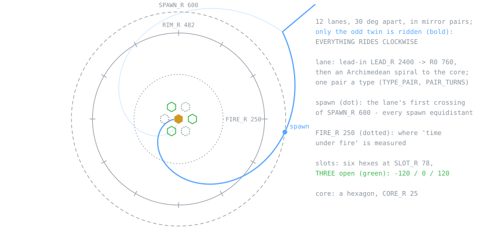
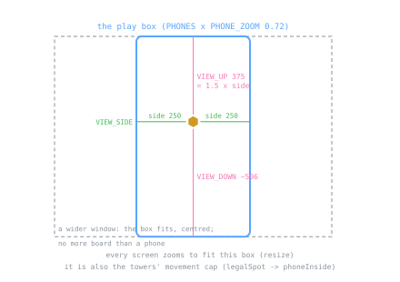
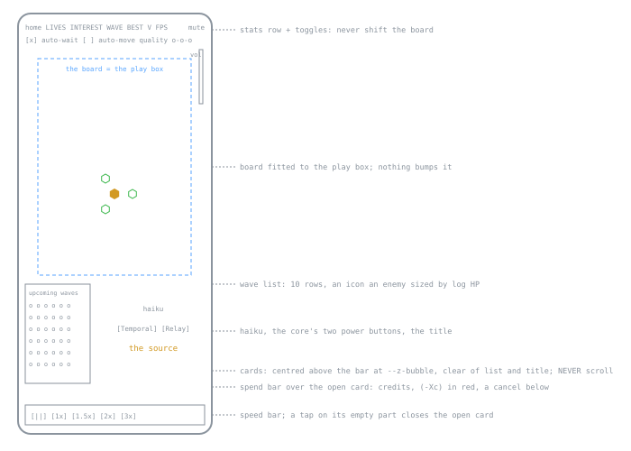

# THE SPIRE - game design

Spiral tower defence at `wai-lau.net/spire`, phone first. The CURRENT design, verified
against the code at 4.4.2 (2026-10-15). **The code holds the numbers.** The tuned values at
this version (its §12), every superseded one, the measurements and the incidents behind the
traps are in **ARCHAEOLOGY.md** (same section numbers). The pre-rewrite text:
`git show f00d730:ARCHITECTURE.md`.

| Reading note | |
|---|---|
| "the owner" | Wai (she/her); a quoted owner rule is the reason for a design |
| `ARCHITECTURE.md §22` in code, the sim README, the parent's CLAUDE.md | this whole file (the game lived in exec-fn's §22 until 2026-10-14) |
| a bare `§N` in an exec-fn context | exec-fn's ARCHITECTURE.md (its §1e serves this app) |
| names | files and ids `aspira-*`; players see THE SPIRE; the title reads `the source`, `ascendant` after a win, or the boss's name |
| units | world units = the 1000 x 1000 chart; "s" = real seconds at 1x; "game s" follows the speed setting |

## 1. Overview and pillars

| # | Pillar (an owner rule) | What it fixes | Where |
|---|---|---|---|
| 1 | **Phone first** | one fixed play box every standard phone shares; no zoom, no pan; verify at 430x932 and 382x700 | §2.2, §7.1 |
| 2 | **Three towers, six kinds** | `MAX_TOWERS` 3 on three open slots; every trio of kinds must be winnable except the designed deaths (§4.6d) ("for every combination of 3 towers, it is possible to win"), so no kind is required | §4, §10.4 |
| 3 | **Towers move by hand** | drag any tower any time inside its leash, firing all the while; nothing moves itself except Auto-move (a win unlocks it; it disqualifies the game) | §4.3 |
| 4 | **Every upgrade is a choice** | three axes a tower, four buys an axis, ONE capstone a tower; no tier lowers a stat | §4.2 |
| 5 | **Only behaviour is told** | card words change only when behaviour changes; a number moving changes the stat row | §7.3 |
| 6 | **Counters, not a best tower** | each enemy type has two main counters and two helpers | §4.6 |
| 7 | **3D is a view, never a rule** | ranges, hits and timing are 2D; 3D only draws the same game | §8.1 |
| 8 | **Waves are fixed** | type, lane split and drops hash from the wave number; only crits, swarm jitter and speed jitter are random | §5 |
| 9 | **Honour-system leaderboard** | a browser game proves nothing; TOP PLAYERS guards shape and rate only | §9.1 |

## 2. Board

### 2.1 Geometry (fixed, never random)

| Rule | Design |
|---|---|
| one pair a type | `TYPE_PAIR` / `PAIR_TURNS`: armor the most direct, swarm almost straight, fast a curve, shield and boss ellipses (`ELLIPSE` 0.7); the type fixes the path, every enemy walks it at one base speed |
| winding | pitch-driven (`TANGENT_Q`, `LANE_SOFT_R`): no hook off the lead-in, a gentle coil at the core; the drawn lane runs on under the core, the walked path ends at `CORE_R` |
| copies | a wave rides rotated copies of its lane: swarm 20/24, fast 3/5, shield 2/3, armor 2, boss 1 (Lovers 2 opposite, Devil 6), Judgement's escorts 12, **never exactly four** (`NO_LANES`); the set turns to keep the most lane on THIS screen, nearest the wave's usual angle (`laneBestTurn`) |
| lit | a lane lights only with live enemies (`alive / sent`, `LANE_FADE_IN_MS`); a boss lane is wider, haloed, and waits for the sky (§5.5); Roman numerals on `LABEL_R` 430 never overlap (`placeLabels`); lit layers rebuild at most every `LIT_MIN_MS` |
| footprint | a tower is a hex of `TOWER_K` cells, `towerGap()` from another, blocked by the core only where outlines touch (`coreKeep`); building on a lane is allowed (towers and enemies never collide); `CORNER_SLOTS` is empty (dormant, §4.8) |

### 2.2 The play box (pillar 1)

`PHONES` lists standard phone page sizes; at `PHONE_ZOOM` 0.72 the tightest gives the box
(`aspira-positioning.js`). **Every screen zooms to fit it** (`resize`, centred on the
other axis) and it is the towers' **movement cap** (`legalSpot` -> `phoneInside`): a
desktop gets no more board than a phone; in 3D it is the same rectangle on the screen. Its
outline shows only as three thin lines on an edge holding a tower back for no visible
reason.

### 2.3 Shields as segments

One segment a point in the shape's own outline, ring r holding `sides x r` (a hex core: 6,
12, 18 ...; `LIFE_RINGS` 5). Lose one: a random segment goes; gain one: enters innermost
and pushes the rest out. Rings dim outward, breathe with the core (`shieldPulse`), and a
lost core segment flashes the boss red.

## 3. Economy and flow

| Lever | Design |
|---|---|
| start | `START_MONEY` 120, **18 lives** (two full rings, `LIFE_STEP` 6), interest 2% |
| interest | `floor(money x rate)` on the credits held when a wave is SENT, **uncapped**; a boss drop may add +1%; the owner keeps tuning it down ("97% of a run's money was interest") |
| bounty | `bountyBase(w) x type bounty x BOUNTY_MUL`, `w` the 10-cycle equivalent wave (§5.2): linear to eq 30, a gentler slope after, x1.1 early; fractional, shown floored; a kill's credits **fly home** as a gold dot and bank on landing |
| prices | a tower `cost` 40, **x1.5 per tower standing** (40, 60, 90), shown in each free slot; upgrades are multiples of the build price (§4.2); **sell** returns 95%, on a second tap |
| leaks | an enemy costs its `leak`: swarm 2, boss 10 (= game over, the boss named in the title), others 1 |
| lives back | a boss drop: +6 lives OR +1% interest (half and half by `fixedRand`); **score** blocks of +6 at 50,000 then every 100,000, earned any time but **paid when the wave's last boss falls** (`G.lifeOwed`: "all rewards should come after boss levels") |
| score | `round(bounty x 10)` a kill, +1000 a life left on a win; never shown (BEST = the furthest wave) |
| speeds | 1 / 1.5 / 2 / 3x (keys 1-4), 10x for the owner (5); the sim steps 0.02 s; Temporal Drive always runs at 1x |

**Wave gating** (`bossUp` includes `G.fleetQ`):

**Auto-wait** (on by default; only ever slows): x0.5 / 0.25 / 0.125 of the chosen speed
when a live enemy is 6 / 2 / 1 game s from the core; a stage is left past 1.25x its line,
and a slower speed holds 1.5 s real before speeding up.

| Pauses (`towersFrozen` while paused and while the sky turns) | Pauses | On close |
|---|---|---|
| tower card, core card, upgrade chooser, an armed Relay | yes | restores the previous pause |
| build dialog | yes | **always unpauses** (built or cancelled) |
| focus loss | no | a hidden tab just gets no frames; the slow logs ignore it |

## 4. Towers

### 4.1 The six kinds

| | ARC | FRZ | SOL | ACD | GRV | ATC |
|---|---|---|---|---|---|---|
| design | hit-scan chain lightning | an aura, no shots | a focused ray with locks | continuous jets and pools | a nova that leaves a black hole (§4.6b) | a carrier launching interceptors (§4.6c) |
| colour | orange | cyan | pink | chatsubo green | violet | electric blue |
| default targeting | Near | Fresh | Biggest | Biggest | Near | Near |
| main counter of (`GOOD_VS`) | swarm | fast | armor, bosses | shield, bosses | swarm, armor | fast, shields |
| helps against (`HELPS_VS`) | fast, shields | swarms, armor | fast, shields | swarms, armor | nothing | nothing |
| weak to | armor (grounds the arc) | shields (cannot be slowed) | swarms (one lock) | fast and shields (cold jets) | fast and shields (the slow skips them; pellets pop few) | swarms and armor (one target a volley; small bolts) |
| leash (`MOVE_BASE`) | medium (200) | long (240) | short (74) | longest (280) | medium (200) | long (240) |

Ids `arc frz sol acd grv car` (`KINDS`; `car` is shown as ATC); range x `RANGE_BONUS`. The legacy path/form tree
(`aspira-upgrades.js`) is dormant: every kind `hasSkills`.

### 4.2 The chart (pillar 4)

Three axes a kind, each a ladder of **six table tiers** (`SKILL_TIERS`; the sixth the
capstone) sold as **four purchases**:

| shown on card, board, title | 0 | I | II | III | IV = capstone |
|---|---|---|---|---|---|
| table index (`SKILL_STOPS`) | 0 | 1 | 3 | 5 | 6 (`CAPSTONE_TIER`) |
| levels and ladder steps a buy (`stopLevels`) | | 1 | 2 | 2 | 2 (`CAPSTONE_LEVELS`) |

- Indices 2 and 4 are never rested on (an old save's 2 / 4 reads I / II); every per-tier
  table keeps 0..6 and `aspira-capstone.js` appends index 6 to every one in one place
  (`CAPSTONE_NUM`).
- Price: `SKILL_STEP_COST` x the build price, one ladder step a level (17 steps; a full chart
  ~39,460c). The capstone costs "the same as increasing the level by 2".
- **One capstone a tower** (`axisCap`, `capstoneHolder`; the card says "One capstone per
  tower · X IV holds it"). A tower's shown level is its purchases (`shownLevel`).
- **The basket**: a tap pulls an axis to its next (or last) stop, the card previews the
  result, one priced button locks it in. Below the locked tier is refused with a note; the
  bank never limits a pull (unaffordable = red cost, disabled button); a card closed
  unbought drops its pull.

### 4.3 Moving (pillar 3)

| Rule | Design |
|---|---|
| drag | follows the finger at once, firing; not while placing, with the Relay armed, paused, or during the sky turn; two fingers move two towers |
| leash | a circle round its own slot (`MOVE_BASE x slide`, slide capped `SLIDE_MAX`), clear of the core, other towers and the play box; no legal spot = it stays put; shown 4 s after a build or a growth |
| coast (`aspira-fling.js`) | released with speed it coasts and bounces off leash, neighbours, core and box; a tower that cannot stay glides home |
| home slot | a moved tower leaves a faint hex there; a slot another tower sits on cannot be built (`canPlace`) |
| pick | by the whole drawn shape at `PICK_GROW` (3D: the prism's screen outline, `aspira-pick.js`) |
| tiers | slide tiers grow the leash, range tiers the range (`SKILL_MOVE`) |
| **Auto-move** | a checkbox **only after a win** (`best.ascended`): `bestSpot` picks, the tower glides at `HUMAN_V` in GAME time; a second tap arms it; **any time on = "(DQ)" from TOP PLAYERS** |

**Targeting** (a card slider; ties go to the furthest along the spiral; ARC's jumps, bursts
and SOL's hops use the tower's own mode, `chainPick`): **Fresh** = no debuff first, then
nearest the core · **Biggest** = most HP left (a boss always) · **Near** = nearest the CORE,
not the tower.

**Positioning** (`bestSpot`; the simulator and Auto-move): every half second score 36 spots
(3 rings x 12 angles) on predicted positions 5 s ahead, weighted by urgency (x1 at entry ..
x7 at the core) and the tower's targeting; move only for a spot 10% better.

**Look**: the level is the hex's glow and rings; the stat triangle on the hex grows a ring a
purchase; an affordable buy flashes an up-chevron; labels are three letters.

### 4.4 What each axis buys

**ARC** - a strike hits, then forks; a jump never goes back up its own branch; damage falls
by `arcFall` a jump. **Armor grounds the arc** (`ARC_GROUND`): a strike on armor > 0 stops
there; armor stripped to <= 0 lets arcs through again.

| axis | buys |
|---|---|
| Conductivity | the branching: strikes x jump layers x forks, and jump reach; from III a bolt may return to a struck enemy (3 hits a tree at 0, 40 at the capstone); range |
| Voltage | raw power: the hit, and what each jump keeps of the hit before it (above 1 from the third buy: jumps out-hit the strike); range |
| Capacitance | charges left on the enemy; the next hit **from anything**, or its death, bursts them all (`ARC_BURST_R`) and slows; bursts never charge or chain; slide |

**FRZ** - everything inside the aura is slowed (only while inside) and takes a quiet tick;
**armor bites the tick**, and it hurts by the enemy's slow (`FRZ_CHILL_K`: "the colder, the
harder", so fast enemies take most). **Weakness: shields** - a shielded enemy cannot be
slowed (no chill, no Brittle, a Permafrost pulse does nothing); a tick on it pops one charge.

| axis | buys |
|---|---|
| Sublimation (id `temp`) | a colder aura, a faster tick, **Brittle** (a slowed enemy takes more from EVERY tower, credited to the FRZ); range |
| Permafrost (id `rime`) | rings pulsing to the aura's edge, each leaving a permanent stacking slow and frost that takes armor past zero; at full frost the rime spreads to the nearest enemy; slide |
| Moons | weaker copies of the aura orbiting the tower (separate slow sources, so they multiply), with moonlets from the third buy |

**SOL** - locks a target (a lock holds out to `SOL_HOLD`), charges the whole reload, fires;
a target dying mid-charge restarts the charge; a lost lock hands its charge only to a new
target inside the Refraction cone. Armor cuts SOL like any other. **Weakness: swarms**.

| axis | buys |
|---|---|
| Focus | more beams a shot, each a full hit popping more shield charges; range |
| Refraction | the shot bends FORWARD on to more enemies in a cone from the first struck, pointed where it holds the most (third buy: all ahead, then out of sight; capstone: two opposite cones), hops hitting harder; range |
| Breach (SOL's own) | armor stripped **for good, below zero**; bigger crits; a breached death fires shrapnel; slide |

**ACD** - jets whose burn ramps while held (doubling, capped), each tick a real hit; a jet
resets when its enemy dies or leaves (no carry at the base), jets never share an enemy;
pools from the start. **Weakness: fast and shields** (a bare ACD is a tank killer).

| axis | buys |
|---|---|
| Corrosion | a tick strips a share of its damage from armor, **below zero without limit** (jets only); eaten armor drips as **goo** that homes on the next enemy, strips twice its value and burns |
| Flow (id `spray`) | more jets; a jet keeps its ramp when its enemy dies **or escapes** (the fast answer) and slows what it burns; range |
| Contagion | bigger, longer, hotter, more frequent pools; from the first buy an enemy killed in a pool leaves a pool; slide |

### 4.5 Rules every axis obeys

| Rule | |
|---|---|
| no tier lowers a stat | pillar 4; `SOL_FOCUS_DMG`, `ACD_SPRAY_MUL` floored at 1 |
| a tier's words | change only when behaviour changes (§7.3) |
| debuff credit | damage a debuff adds goes to the tower that caused it (`damageCredit`) |
| negative armor | a flat bonus on every later hit from every tower (Breach, Corrosion, goo, Rime frost) |
| tier names | one a tier (Transfer .. Hyperstorm, Chill .. Zero Point, ...), used on the end screen, never on the card; ARCHAEOLOGY §12 |

### 4.6 The counter matrix (pillar 6)

| enemy \ tower | ARC | FRZ | SOL | ACD | GRV | ATC | the lever |
|---|---|---|---|---|---|---|---|
| **swarm** | MAIN | help | weak (one lock) | help | MAIN | weak (one target a volley) | branching hits; bursts; a hole that feeds on a crowd |
| **fast** | help | MAIN | help | weak (cold jets) | weak (no time to feed) | MAIN | the chill bite doubles on fast; interceptors outrun them |
| **armor** | weak (grounds the arc) | help | MAIN | help | MAIN | weak (small bolts) | strip below zero = a flat bonus; armor scales with HP |
| **shield** | help | weak (no slow) | help | MAIN | weak (the slow skips them) | MAIN | pops a hit: ACD one a tick, SOL by Focus, ATC one a bolt |

The matrix is DATA: `COUNTERS` in `aspira-defs.js`: each type has a `main` that is a LIST of two kinds (swarm `[arc, grv]`,
fast `[frz, car]`, armor `[sol, grv]`, shield `[acd, car]`) and a `help` list of two (swarm `[frz, acd]`, fast `[arc, sol]`,
armor `[acd, frz]`, shield `[arc, sol]`). The build card derives from it: `GOOD_VS` / `HELPS_VS` (SOL and ACD add bosses,
`BOSS_KILLERS`), and the symbol marks (`VS_MARKS`, §7.2) come from a `countermx` run, so the card can never disagree with it. `scripts/aspira-sim/countermx.mjs`
measures it.

### 4.6b GRV, the gravity tower (spec, 2026-10-15 - being built)

The fifth tower (owner's design, 2026-10-15; one of the two new ones - PSY the other). In the six-tower square every tower
is strong against a PAIR of enemy types and weak to the other two; GRV takes the diagonal **swarm + armor**, weak to
**fast + shield**. Reach: **mid**, about ARC's.

**The attack.** Every fire, a **nova** comes into being at the target enemy's spot - no projectile. Its **yellow front**
expands quickly (~0.25 s to its radius); enemies take the nova's hit as the front reaches them. It leaves a **black sphere
with a purple outline** at its centre, and a **purple aura** expands from it at the front's speed until the aura's size
(it keeps going after the yellow front stops, or stops first if smaller) - it reads as blown out by the nova.

**The sphere's MASS** drives everything: the sphere's drawn size, the aura's radius, the aura's slow, its damage, and the
pellet rate (capped at x3 the starting mass).
- **Gains** mass from the DAMAGE the sphere deals (nova, aura, pellets): a crowd feeds it fast (swarm); armor is stripped by
  the aura (below), so damage - and growth - climbs on armor; SHIELDS soak hits (little damage, little growth); FAST pass
  quickly (few ticks, little growth).
- **Loses** a LINEAR share of its starting mass every second (an unfed sphere lasts ~5 s); gone at zero.
- **The aura**: a DoT, a SLOW, and an ARMOR STRIP like Corrosion (a multiplier on damage dealt, biting only positive armor).
  Shielded enemies are NOT slowed; the nova and every aura tick pop a shield charge. Drawn as a radial gradient band -
  clear at the sphere, 30% at mid-radius, clear at the edge. Its damage numbers drift INWARD, toward the sphere.
- **Radiation**: every sphere sprays PELLETS around it from the start, more the bigger it is; each pellet a small hit (and
  one shield charge, like any hit - kept sparse, ~2 a second at starting mass, so GRV stays weak to shields).

**Axes** (purchases I-IV, IV the capstone; one capstone a tower):
| axis | buys | capstone (IV) |
|---|---|---|
| **Void** | a bigger aura, a stronger slow | **Event Horizon**: near-total slow (90%) in a full-grown sphere, unshielded only |
| **Supernova** | a bigger nova - the swarm answer | **Hypernova**: the nova strips a chunk of armor at once - a sphere starts heavy |
| **Radiation** | more pellets per mass, harder pellets | **Hawking**: a sphere whose mass runs out evaporates in a last burst of pellets |

Colours: violet (aura, outline) and yellow (nova) - new palette colours are allowed for /spire (owner, 2026-10-15).
Numbers start as guesses and are fitted with the sims to "strong vs swarm and armor, weak vs fast and shield".

**Aura rework (owner, 2026-10-15):** the aura deals NO damage - it slows (never the shielded) and strips positive armor
(`GRV_AURA_K` x `GRV_STRIP` a second, x mass). Its SIZE comes from the nova: `st.auraR` x sqrt(the nova's damage in tower hits;
a kill counts the whole hit, a hit a shield swallowed nothing), clamped `GRV_GROW_MIN`..`GRV_GROW_MAX`. The slow is two rings:
the CORE (inner `GRV_CORE_FRAC`, the hot bands) slows `GRV_CORE_MUL` x the outer ring. Mass now grows from nova + pellets only.
The nova's numbers fly into the sphere (`grvFloat`).

### 4.6c CAR (shown ATC), the carrier (2026-10-15, `web/aspira-car.js`)

The owner's StarCraft carrier, electric blue (`--asp-blue-hsl`, 225°): long reach (260), **strong vs fast + shield, weak to
swarm + armor** (`COUNTERS.main` fast `[frz, car]`, shield `[acd, car]`). It never fires itself. Its INTERCEPTORS launch
ONE BY ONE (`CAR_GAP` 0.2 s), each to its own enemy (`carTarget`: one no other interceptor holds), circle it firing `ammo`
shots at the tower's damage and rate (retargeting if it dies, letting go past `CAR_LEASH` x reach), fly home, reload
(`CAR_RELOAD` by Launch tier, 1.5 s bare to 0.3 s at Warp) and go again. TOWERS dmg 9 / rate 4 are a SHOT and an interceptor's shots a second (solo.mjs: a lone
CAR loses 2 lives on wave 9 and the Star; every CAR pair clean on 1-12).

| Axis | Buys | Capstone (VI) |
|---|---|---|
| Hangar | interceptors, PRIMES from 5: bare 5, I 7, II 11, III 13 | Full Wing: 17 |
| Launch | TEMPO: interceptor speed, reach and a shorter reload | Warp: they teleport to the target and home |
| Armament | DEPTH: a far harder hit (`CAR_SHOT_MUL` to x11), more shots a sortie | Autopilot: out of ammo, an interceptor bursts into `CAR_BURST_N` pellets that hit the first enemy they touch or miss, and is rebuilt at home after the normal reload |

**Balance pass (2026-10-15).** The hit is SPREAD like ARC's: Armament `CAR_SHOT_MUL` (VI x15), Hangar + Launch `CAR_SIDE_DMG`
(VI x5.1 each) - steeper than ARC's because an interceptor spends ~40% flying and reloading (a mid build on ARC's tables dealt
2192/s on fast at wave 61; ARC 17449, SOL 22899). Each axis's own mechanic: Hangar FOCUS FIRE (`CAR_FOCUS`: each other
interceptor looping the same target adds that share to every shot), Launch the STRAFING PASS (`CAR_RAM` x base damage x
speed/400 on arrival; Warp `CAR_WARP_V`) and the reload, Armament the hit + ammo. A shot is THREE bolts (`CAR_BOLTS`) of a third of the hit each
(armor cuts each - ATC's armor weakness); every shot SLOWS (`CAR_SLOW` 0.2 for 0.6 s, one a tower; fast 30% -> 6% leaked); rate 8, ammo 8..16, speed 600..1080 (owner: three bolts, less ammo, faster).
`CAR_LEASH` 3: a locked interceptor PURSUES. `carTarget` SENDS ENOUGH: the first enemy whose HP beats the ammo x hit already
committed to it. Counter matrix 61-69 (3 ATC, 8 pts, % leaked swarm/fast/shield/armor): spread 1/6/0/0, Launch 0/6/0/64,
Armament 3/52/0/23.

**Weakness pass (2026-10-15).** GRV pellets passed shielded enemies for one build (88% of shields leaked; owner: they pop shields, only the slow skips the shielded) and the strip is x3
(`GRV_STRIP` 1.5). ATC after a kill hops only to an enemy within `CAR_HOP` 40 of the interceptor, else home. Counter matrix
61-69 spread (% leaked swarm/fast/shield/armor): GRV 2/26/88/14, ATC 41/29/0/4, then with three bolts, less ammo, x1.5 speed 29/30/0/30 (ATC's armor weakness grows later: armor 982 a
bolt at wave 90 vs ~1750).

The Orbital Relay triples the wing (`relayStats`). No new 3D primitives: darts are filled triangles, firing lines and pellets
single strokes (the board's path context takes no gradient stroke - §11).

### 4.6d Trio scale (2026-10-16)

Owner, 2026-10-15: "scale all trios up and down for each winning group they are in for a factor of how much better/worse they
are". Every trio played to wave 120 by the smart saver (perfect play, both powers, 2 seeds); a trio's score = 120 + lives left
on a win, else the wave reached. A designed death (ARC+FRZ+ATC, SOL+ACD+ATC, ARC+ACD+GRV, FRZ+SOL+GRV) that DIES is neutral;
one that wins counts like any other. A kind's factor = the geometric mean, over the trios it is in, of (mean score / trio
score) - applied to `TOWERS[k].dmg`, squared to converge faster. Two rounds: ACD 23 -> 30.03, ATC 9 -> 12.5, FRZ 15 -> 15.52,
SOL 73 -> 68.61, GRV 30 -> 24.38; ARC left at 24 (its factor was x0.99; 22.96 lost the Star with ARC+ARC). A third round was
noise (2 seeds swing a trio a whole game). Left: ARC+ACD+ATC and FRZ+ACD+ATC lose every round - a coverage hole (swarm / armor),
not tower power.

### 4.7 The core and its two powers

The core is **free**: no price, no tiers. Bosses hand its powers out outright at full
strength (`CORE_GRANTS`); the pick flow is dormant. Buttons above the title
(`aspira-powers.js`) with a recharge bar; **cooldowns count waves sent**.

| Power | Granted | Use | Effect | Rules |
|---|---|---|---|---|
| **Temporal Drive** | 2nd boss (wave 24) | hold the core, or the button | every enemy stops dead (a 100% slow, `core:time`) for 6 game s; cooldown 3 waves | holds the wave clock and spawns; needs a live board and ends when it empties; Strength ignores it |
| **Orbital Relay** | 4th boss (wave 48) | the button then a tower, or drag the core onto one | that tower acts as three (`RELAY_MUL`: ARC 3x attacks, SOL 3x locks, ACD 3x jets, FRZ 3x moons and tick) for 11.25 s; cooldown 4 waves | **stays on that tower**; arming pauses the game |

### 4.8 Dormant code (kept on purpose; nothing reaches it)

| What | Where |
|---|---|
| the path/form tree | `aspira-upgrades.js`, `LVL_*`, `STEP_COST`, the `UPGRADES` chooser branch (`sim.mjs` still builds on `UPGRADES`) |
| corner slots | `CORNER_SLOTS`, `G.opened`, `drawSlotFlash` |
| the core's pick flow | `CORE_PICKS`, `grantPick`, `pickPower` |
| the old power bar | `POWERS`, `usePower`, `G.charge` |
| Kepler moon orbit | `MOON_ECC` 0 = a circle |
| boss trait tables | `BOSS_ARMOR` / `BOSS_SPEED` / `BOSS_SHIELD*`, neutral except Justice's speed |

## 5. Enemies and waves

### 5.1 Types (dice)

| type | die | pace | leak | design |
|---|---|---|---|---|
| swarm | d6 | fast-ish | 2 | many small bodies; wanders; HP, size and speed jittered per body |
| shield | d8 | slow | 1 | charges that each eat one hit whatever its size; **holds off every slow** |
| armor | d10 | slowest | 1 | a flat bite off every hit (floor 10% of the hit), scaling with HP; negative armor adds |
| fast | d4 | fastest | 1 | a long tracer; takes every slow double |
| boss | d20 | base | 10 = game over | §5.4 |

Globals `ENEMY_HP_MUL` and `BOUNTY_MUL` scale the table (ARCHAEOLOGY §12). An enemy shrinks
with its HP and grows with log HP; dead enemies become invisible **ghosts** that drift on
so beams can follow them, removed at the core with no life lost.

### 5.2 Scaling (the curves)

Most curves read a wave as its **10-cycle equivalent** `eqWave(n) = n x 10/12` (the boss
cycle was 10 when they were tuned); `WAVE_COUNT_MUL` keys are real waves.

| Curve | Shape |
|---|---|
| HP | geometric growth to a knee at eq 20 (`HP_GROWTH`), on at `HP_LATE`, easing past eq 80 (`HP_END`: towers are built by then); x the type's hp |
| plain HP | steps up at waves 12 and 24 (`plainHpMul`), divided by the speed curve, with a **mid-game hump** on waves 48-72 (`MID_HP`); early shields lighter, early armor heavier, both x1 by eq 30; swarm waves x1.5 total |
| speed | an S-curve over waves 12..84 (`speedGrow`), a slow ramp after; every enemy +0.2% a wave past 49 (`speedRamp`) |
| shields / armor | charges a steep curve to a small power (`SHIELD_EXP`), HP compensating; armor the HP curve to a power (`ARMOR_EXP`), then tracking HP growth past 49 |
| late traits (49+) | swarms bring more bodies, fast run faster; **hybrids** from 97: swarms carry a little shield, fast a little armor (outline in that type's colour) |
| counts | a base of `10 + eqWave/2`, swarm x6, all /2, x `WAVE_COUNT_MUL` (waves 1-11 hand-tuned so one L1 tower clears them) x `TYPE_COUNT_MUL`; swarms double from eq 11 and again over eq 11-60; a swarm WAVE never under `SWARM_WAVE_MIN` 12; rounded to whole formations. EARLY (2026-10-15): /`EARLY_X` 4 the bodies at x4 HP and x4 bounty through wave 24, easing to x1 by 36 (`earlyX`, `earlyHpX` - a wave the formations round back up gets that much less HP each); bosses untouched |
| order | swarm, shield, armor, fast on waves 1-4; from 5 a type by hash, never the same as the wave before |

### 5.3 Spawning and formations

Each lane copy spawns in order (swarm bodies close together, other types 0.8 s apart,
formations at once); a boss arrives 2 s into its wave with its voice line. A formation is a
sideways offset and a head start laid across the lane at its heading, fading inside
`FORM_FADE_R` of the core.

| type | formation |
|---|---|
| fast | side-by-side pairs, **spinning flat about their midpoint** |
| shield | Vs of 5, then a V of 3, then singles; counts round up to fill lanes |
| armor | one tight lattice 3 abreast, a short last row centred; always whole rows over 2 lanes |
| swarm | none: a wander (`e.jit`) that funnels in near the core |

### 5.4 Bosses

Waves 12, 24 .. 120 (`ARCANA`, each with a haiku above the title): the boss plus its fleet,
a little shield, armor 0, a size a step bigger than the last. HP = the wave's bonus HP x
`BOSS_HP` x `BOSS_HP_K` x `BOSS_FAR` (ARCHAEOLOGY §12).

| wave | boss | trick | escorts |
|---|---|---|---|
| 12 | Star | none (needs two towers or an upgrade) | fast, x3, behind and tight |
| 24 | Empress | sheds a brood of swarmers each fifth of HP lost | shield |
| 36 | Strength | no slow touches her, Temporal Drive included | armor |
| 48 | Chariot | sprints x3 for 1 s every 4 s, fleet with her | fast |
| 60 | Lovers | a pair on opposite lanes; kill one and the other heals full and runs x1.5 | swarm |
| 72 | Temperance | regenerates 6% HP a second | shield |
| 84 | Devil | six full bosses on six lane copies; the reward paid once by the last | swarm |
| 96 | Justice | no hit takes more than 2% of her HP; slowed | armor, fewer |
| 108 | Judgement | rises once at 50% HP; her swarm spreads over 12 lanes | swarm |
| 120 | Death | none: a juiced-up Star | all four |

**Fleets**: ONE plain wave's worth (`FLEET_MUL`) of escorts at plain HP and bounty, in
formation round the boss at its pace; **20% of every escort's HP moves onto its boss**
(`FLEET_TO_BOSS`; not Temperance); the fleet enters one unit at a time (`G.fleetQ`) and the
sky holds until all of it dies. **Rewards**: +6 lives or +1% interest, the pending score
lives, the core's powers at 24 / 48.

### 5.5 The boss sky

A colour **inversion** spreads from the core over 3 s when a boss warps in and collapses
back after the last boss-kin dies; the game **holds still while it turns**. The title
becomes the boss's name, its HP a long line along the horizon (`drawBossBar`); the next
wave waits for the sky to close. It costs nothing per pixel: 2D draws the frame in the
inverted palette (`withPalette`), 3D blends one triangle in GL (`warpFlip`); only the
spreading circle is a fill (`skyFlip`). **Towers keep their own colours.**

## 6. Damage model and statuses

`damage(e, amt, tower, quiet, crit, st)`, in order:

| # | Step | Rule |
|---|---|---|
| 1 | charges | this hit sets off any charge on `e` (ARC Capacitance) |
| 2 | **shield** | takes the whole hit, pops `st.shieldPop` charges (a quiet hit bounces off); nothing else applies |
| 3 | bleed crit | inert |
| 4 | marks | damage-taken x `shredMul` |
| 5 | **Brittle** | x while slowed |
| 6 | **armor** | minus `trunc(armor - frost)`, never below 10% of the hit; **negative armor adds**; EVERY hit, quiet ones too; a boss's armor floors at minus its wave's reference |
| 7 | `bossHitCap` | Justice |
| 8 | floor | a **whole number, at least 1 if it landed** |

| Rule | Design |
|---|---|
| whole numbers | HP, armor and hits are integers; card numbers real values floored; flashes and widths scale by `VIS_DMG` |
| slows | PER SOURCE with a shape: `refresh` (times out) · `once` (permanent) · `stack` (every hit adds); sources combine **multiplicatively**, then the total is **shaped**: linear to `SLOW_KNEE`, easing toward `SLOW_CAP` without reaching it; a tower slow alone caps at `TOWER_SLOW_MAX` |
| fast | takes every slow double, shaped toward `fastSlowCap()` so a fully slowed fast enemy is no slower than any other |
| full stop | only Temporal Drive; shields block all slows; Strength shrugs all of them |
| armor loss | permanent, may go negative |
| quiet hits | ticks, pools, splash: no flash; pool hits past `POOL_LOD` show one summed number an enemy |
| numbers | crits marigold; sized by the hit before armor, greyed by armor's share; a shield-soaked "0" in cyan; they hold, shrink and fly away from the tower (`DMG_FLY`) |

## 7. Interface

### 7.1 Layout (phone first, 430x932)

| Rule | Design |
|---|---|
| page | full screen, **no nav bar, no CRT stack**; the board refits only when the canvas resizes; **nothing on the page shifts the board** (no overlay insets) |
| cards | at `--z-bubble`, above bar, list and spend bar; **never scroll** (`fitPop` shrinks the chart); landscape >= 700 px puts description and control side by side; under 700 px the wave list drops to icons |
| spend bar | one place on every spending screen: credits above the open card, `(-Xc)` in red, one cancel below |
| close | the tower card's close is a square **X right of the upgrade button**: with points pulled it drops them, else closes |
| chooser open | paused AND the board stops redrawing (`frame` skips `render`), so the blur and darken cost nothing a frame |

### 7.2 Gestures and keys

| Gesture | Result |
|---|---|
| tap an empty open slot | four tower cards (name, price, "good vs", flavour; keys 1-4) and a cancel; too poor = the card shakes and stays |
| tap a tower, its home slot, or the core | its card |
| a press moving under `DRAG_PX` | a tap; more on a tower = a move (§4.3) |
| unaffordable | tappable but dimmed (`.poor`): a tap shakes it and says "need Nc more" |
| before the first tower | the free slots flash, a white triangle bobs over the top-left one |

Keys: 1-4 speeds (5 = 10x, owner), Space pause, M mute, U lock in the basket, Esc cancel;
with a chooser open 1-4 pick a card. No build shortcuts (by choice).

### 7.3 The tower card (pillar 5)

| Part | Design |
|---|---|
| description | ONE prose a tower composed from its chart (`aspira-desc.js` `DESCRIBE`): one template where each axis swaps a few words; **only behaviour is told**; pulled points show as **track changes** (`wordDiff`); thematic words (acid: "jets", "pools", never heat). `docs/spire-descriptions.md` is the generated graph of every chain (`scripts/aspira-desc-graph.mjs`): rebuild after editing a sentence or a number |
| control | three `[-] pips [+]` steppers (axis name and tier, `0->II` while pulled; pips filled = locked, half = pulled, hollow = to buy, the last orange, red once another axis holds the capstone) beside the chart; the + flashes while the bank covers a buy |
| confirm | the tower's name and purchases with the cost (`Arc II (-440c)`), bold when affordable, pulsing while a basket waits; sell smaller under it; the targeting slider small |
| stats | key rows left and bigger (`KEY_STATS`), the rest right and small; each `now -> next`, worse in red (`LOWER_BETTER`); rows the tower lacks left out; kills and damage live |

### 7.4 Wave list, HUD, end screens

| Surface | Design |
|---|---|
| wave list | ten rows: live waves plus upcoming (at least 3), one icon an enemy sized by log HP, long rows tessellating; live waves in one green box; "warped in" / "warping in..." with the countdown, hidden while a boss holds the timer |
| threat | a mark on the three closest enemies within 4 s of the core; a leak's ring bounces out from the core with the lives left |
| end screen | one overlay for loss and win: the title (`ascendant`, the breaching boss's phrase, or `core breached`), the furthest wave, a line a tower ranked by damage and named by its two strongest axes' tier names (`aspira-endstats.js`), the waves that TOOK lives, "Play again", then TOP PLAYERS (§9.1): the entry form on a win or a loss past wave 10 |

## 8. Rendering, audio, performance

### 8.1 Views and quality (pillar 7)

A three-stop slider (`spire.quality`): **low / high / 3D**, 3D the default.

| Stop | Draws |
|---|---|
| high | the 2D picture |
| low | half resolution, no `shadowBlur`, decoration skipped at its draw sites (`lowQ`); a new pure-decoration draw site checks `lowQ` |
| 3D (`aspira-warp.js`) | the same game as a **flat board under a perspective camera** on a WebGL canvas; the 2D canvas still takes every pointer event. Towers and the core are **hexagonal prisms** (taller with level), enemies **real dice** rolling nose-forward (`aspira-solids.js`), shields lines on the floor, text flat; everything below the floor fades (`aspira-fog.js`); the light comes from the core; taps map back through `unwarp` |

Adaptation: while no quality is pinned a slow machine **steps down** 3D -> high -> low; the
3D **far-detail radius** shrinks on slow frames. **Never lower resolution or reallocate the
big canvases during play** (§11).

### 8.2 The 3D pipeline

| Principle | How |
|---|---|
| two layers | the **board** (background, graticule, lanes) is redrawn at most every `WARP_STAT_MS`; what **moves** is drawn every frame on a half-size layer the shader lays over it |
| one batch | hits, sparks, flashes, rings are GPU instances (`aspira-fxgl.js`); `aspira-glctx.js` is a 2D-context stand-in turning fills and strokes into instances, so nothing on the moving layer falls back to canvas |
| one density read | `canvasDpr()`, capped `RES_CAP` |
| text stamped once | `aspira-textcache.js`, a pixel budget with least-recently-used eviction, evicted canvases zeroed so iOS frees them |
| caps | damage numbers, sparks, pools a tower, goo drops (ARCHAEOLOGY §12) |

### 8.3 Draw order and other visuals

2D, bottom to top: background -> damage numbers -> board -> tower ranges -> stars (over
range fills) -> tethers / acid / aims / shots -> the core's beams -> leash rings and box
lines -> towers -> goo / coins / chevrons / threats -> placement ghost -> the core and its
credits -> **enemies** (over towers and core) -> core HUD -> pop-ups -> banner. In 3D the
towers, core, enemies, shields and text are flat layers over the floor (`warpEntities`);
only the board, ranges, beams and effects ride the picture. Enemy tracers taper along the
lane; beam width is log of the hit; the screen shakes on a core hit.

### 8.4 Audio

Synthesised WebAudio through a limiter (`aspira-sfx.js`), created on the first gesture:
voice-limited, per-sound gaps, **at most 3 copies of a tower's sound at once**, density kept
at any speed. Mute and volume persist. Optional **Brood War samples** from the owner's own
install live only in this repo's `data/aspira-sfx/` (gitignored: the repo is public), served to the
guest tier by `/aspira-sfx/{file}`, replacing the synth sound of the same name. Each boss
has a voice line.

## 9. Meta

### 9.1 TOP PLAYERS (`spire_board.py`, `/api/spire/ascendants`; pillar 9)

| Rule | Design |
|---|---|
| who posts | a **win**: three letters, lives left, the team, the wave; a **loss from wave 11 on**: lives 0 |
| guards | shape checks and `ASC_MAX` posts an IP an hour (in memory); auto-move bars the form client-side; honour otherwise |
| ranking | the Ascendants (wins, gold) by lives left; then everyone else (green) by wave, then lives; ties to the earlier; 10 rows shown, `SHOW_MAX` returned; rows render with `textContent` |
| **never lose an entry** | an append-only fsynced journal (`spire_ascendants.jsonl`) is written FIRST, then the board JSON rewritten atomically from journal + old board; a missing or corrupt board is REBUILT from the journal; a torn tail cannot swallow the next line; nothing is trimmed |
| the owner's games | hidden from guests before `OWNER_SHOWN_FROM` (2026-10-14; the `owner` flag + `spire_ascendants_owner.json`), shown after; `python spire_board.py mark-owner ...` / `hide ...` marks or hides without touching the journal |
| version | a post carries `ver` (the page's `.asp-ver`, kept when it is `N.N[.N]`); the board's faint last column. Rows from before 2026-10-16 got theirs through the corrections file: the version file at the post time, else that day's changelog version |
| corrections | `spire_ascendants_fix.json`, `[ts, initials, {field: value}]` rows applied by `visible()`; `python spire_board.py fix <ts> <initials> lives=<n>` - e.g. JUU 84 -> 78 and SMD 49 -> 43 (2026-10-16): before 4.4.14 the Lovers' pair paid wave 50's +6 lives once a body |

### 9.2 Slow logs (`spire_perflog.py`, `aspira-perflog.js`)

Every 3 min of unpaused play a session posts a frame-time and audio summary (buckets,
worst frames, sim / draw / 3D / GL splits, GPU, quality, canvas pixels, text-stamp memory,
version + build). POST is guest tier and rate-limited; GET is owner-only. Files in
`data/spire-perflog/` (**survives deploys**, capped). Failures are swallowed: it must never
be in the game's way.

### 9.3 Saves

| Store | Holds |
|---|---|
| localStorage | `aspira.best` `{score, wave, ascended}`, `spire.quality` / `qpick` / `autowait` / `automove`, `aspira.mute` / `vol` |
| IndexedDB (`aspira-autosave.js`) | the whole `G` as each wave starts, cleared when a game ends; on load **resume wave N** or **new game** (a resumed run may still sign TOP PLAYERS); **everything in `G` must be structured-cloneable** |
| server | nothing beyond §9.1-9.2; no accounts |

### 9.4 Version and changelog

`web/aspira-version.txt` is hand-kept `major.minor.tiny` (a new changelog day = the next
minor; every deploy bumps tiny); `spire_build()` stamps the newest file mtime; both go into
the template and every slow log. The changelog card (`aspira-changelog.js`, tap the version)
lists each day's player-visible changes as facts in three groups (Buffs, Nerfs, Perf/UI):
add a line with every change a player would notice.

## 10. Tech

### 10.1 Files and load order

The template's `<script>` order (the truth is `templates/aspira.html`), one shared global scope,
files capped at 500 lines (exec-fn's pre-commit) and so split by seam:

| Stage (in order) | Scripts |
|---|---|
| data and state | `defs` (geometry, tables, `towerStats`), `sfx`, `upgrades` (dormant), `game` (`G`, combat, damage, slows) |
| waves | `formations`, `floats` (numbers, coins), `waves`, `bosses`, `positioning` (+ the play box) |
| towers | `towers` (ARC, SOL, moons, leash), `acid`, `skills` (the charts, ARC), `frz`, `desc`, `capstone` (index 6 on every table), `chart`, `stats`, `sliders` (the card) |
| core and meta | `core`, `core-fx`, `powers`, `endstats`, `ascend` |
| draw (2D) | `quality` (`lowQ`, just before draw), `threat`, `draw`, `textcache`, `effects`, `enemies`, `lanes`, `camera`, `fling`, `fog` |
| draw (3D) | `warp`, `warplayers`, `fxgl`, `glctx`, `pick`, `solids`, `walls` |
| UI and tail | `chooser`, `wavelist`, `ui` (HUD, input, the frame loop), `perflog`, `changelog`, `autosave` |

| Piece | Where |
|---|---|
| stylesheets | `aspira.css` (page, chart, cards), `aspira-endstats.css`, `aspira-ascend.css`, `aspira-changelog.css` |
| colours | **never in JS**: hidden `.asp-sw` swatches in the template, styled from exec-fn's `chrome.css` tokens, read once by `resolveColors()` into `COL`; a new colour or alpha is exec-fn's palette lint's call |
| python | `api/routes_aspira.py` (page, redirect, sfx, ascendants, perflog), `spire_board.py`, `spire_perflog.py` (stdlib-only), `templates/aspira.html` |
| diagrams | `docs/arch/*.mmd` is the mermaid source, rendered to the `.svg` beside it by exec-fn's pre-commit (`scripts/render-mermaid.py`) whenever a `.mmd` is staged; `geometry`, `play-box`, `layout` are hand-written SVGs. The doc embeds the SVGs: the app's markdown viewer does not render a mermaid fence |

### 10.2 exec-fn integration

A git **submodule** at `apps/spire` mirroring exec-fn's layout (exec-fn ARCHITECTURE.md
§1e). Commit INSIDE this repo; exec-fn's hook pushes it and bumps the pointer; lints and
hooks are exec-fn's (the shim `scripts/pre-commit`).

| Route | Tier | What |
|---|---|---|
| `GET /spire` | guest (Turnstile) | the page: `full_height`, no nav, no CRT; `data-owner` on a full session (the 10x speed) |
| `GET /aspira` | public | 301 to `/spire` |
| `GET /aspira-sfx/{file}` | guest | the sound samples |
| `GET` / `POST /api/spire/ascendants` | guest | §9.1 |
| `POST` / `GET /api/spire/perflog` | guest / owner | §9.2 |

The guest page set lives in three places in the parent (`_GUEST_NEXT_ALLOWED`, the 401
handler's guest prefixes, the router tier); `/spire` is in all three.

### 10.3 Tests and the smoke

| Check | What |
|---|---|
| `tests/test_spire_board.py`, `test_spire_perflog.py` | stdlib units |
| `tests/test_spire_sliders_browser.py` | WebKit, exec-fn's fixtures: the stepper rules and the card grids at 1280x800 and 430x932 |
| `node scripts/spire-smoke/smoke.mjs` | every script the template loads, in order, in one node vm over a fake DOM (`dom.mjs`) whose canvas RECORDS calls; drives the real frame loop and checks things **draw**: boot, every quality, each kind built, a fought wave, the sky, towers keeping their colours, a capstone (a second refused), Temporal Drive, two-finger moves, a fling, lives left, game over / a loss past 10 / a win and the Ascendants, play again. exec-fn's pre-commit runs it when a game file is staged; a new browser global needs a `dom.mjs` stub |

### 10.4 Simulator and balance tooling (`scripts/aspira-sim/`, README there)

Runs the REAL game code (`sim.mjs` `FILES`: the logic scripts up to `core`) in a Node vm
with drawing, sound and input stubbed, every tick as fast as it can, with scripted players
(opening, kind mix, upgrade appetite, interest reserve, axis per point, core use).
`ASPIRA_WEB=<dir>` pins a run to a snapshot; a `patch` file changes numbers or redefines a
function without touching the game. Run one at a time with `nice -n 19` on the droplet.

| Question | Script |
|---|---|
| the curve; real trio games per type and boss | `waverep`, `curve`, `rand`, `late` |
| every trio / combo / solo kind | `trios`, `combos`, `solo`, `wave1`, `swap`, `eval`, `style` |
| the counter matrix | `countermx` |
| an axis tier's value; a buy's payoff | `isolation`, `tierfit`, `chartvalue`, `payoff` (each buy alone: gain, price, gain a credit), `buildlog` (purchases by wave) |
| bosses and fleets | `bossbal`, `bossfleet`, `bossvs` |
| type and wave counts | `typebal`, `wavebal` |
| the core | `corevalue`, `corepower` |
| gliding players never stuck | `stuck` |
| a worker pool (resumable `out.jsonl`) | `pool`, `playjob` |

| Balance rule the owner set (keep when changing numbers) | Checked by |
|---|---|
| a lone L1 tower of any kind clears waves 1-11 | `solo`; `WAVE_COUNT_MUL` |
| the Star (wave 12) needs two towers or an upgrade (SOL and ACD may solo it) | `wave1`, `waverep` |
| every trio of kinds is winnable by the scripted styles (no kind required) | `trios` |
| no tier lowers a stat; each kind has a niche | `countermx`, `isolation`, `payoff` |
| players held to `MAX_TOWERS` (`strategy.towerCap` lifts it for test teams) | the simulator |

## 11. Traps (every one load-bearing; the stories: ARCHAEOLOGY §11)

| Area | Trap |
|---|---|
| code | **no mid-line `//` comment** in the game JS or in a GLSL expression line; use `/* */` (it swallows the rest of the line; `lint-swallowed.py` flags it) |
| code | one global scope, ESLint `no-undef` off: a dropped `const` throws at run time; verify placement in a browser or the smoke after touching `placeTower` |
| code | UI-only code that logic reaches needs a `typeof X === "function"` guard; a new logic script goes in `sim.mjs` `FILES`; a browser global needs a `dom.mjs` stub |
| code | every per-tier table has exactly 6 entries before `aspira-capstone.js` loads; a new table or axis needs a `CAPSTONE_NUM` entry and a `CAPSTONE_TIERS` name |
| code | `fixedRand(wave, salt)`, never `Math.random`, for anything shaping a wave (a changed salt changes the sequence for everyone and every sim seed) |
| code | whole numbers: HP, armor, hits floored, a landed hit >= 1, fractions banked; a spawned enemy never has 0 HP |
| code | `G` stays structured-cloneable: no functions, DOM nodes or closures (autosave) |
| code | boss rules read `document` / `ui` only behind guards: the simulator never waits for the Challenge button or the sky |
| code | never set `G.lives` huge in a test (a segment a life freezes the page) |
| code | cooldowns count WAVES; durations are game s; timers that must not follow the speed use real time (`stepFloats`, flings, the sky) |
| view | **3D is a view, never a rule**: no game logic reads a projected position; taps go back through `unwarp` / `pickAt` |
| view | **never lower resolution or resize the big 3D canvases during play** (380-540 ms hitches, iPhone crashes); only the far-detail radius adapts; keep text stamps on budget, zero evicted canvases |
| view | every density read through `canvasDpr()`; new pure-decoration draws check `lowQ` |
| view | Safari has no canvas `filter`; a NaN gradient aborts the overlay's frame: skip tracers with non-finite ends |
| view | no `backdrop-filter` / blend layer over animated content (a full-canvas `difference` makes the GPU copy the canvas) |
| view | the ACD pool and goo loops are bucketed (`POOL_CELL`) and capped; never all-enemies x all-pools |
| view | damage numbers age in REAL time while the game runs up to 10x: keep `DMG_MAX` |
| view | headless WebKit renders ~1 fps: a screenshot before the first frame is blank, not a bug |
| UI | `.asp-ov[hidden] { display:none }` is load-bearing (`.asp-ov { display:flex }` beats the UA `[hidden]` rule) |
| UI | `--fs-xs` does NOT exist in chrome.css: use `--fs-2xs` |
| UI | cards never scroll and sit at `--z-bubble`; the build dialog always unpauses on close, every other card restores the pause; a card closed unbought drops its basket |
| UI | iOS: `#asp` needs `user-select: none` AND the prefixed `-webkit-user-select` plus `-webkit-touch-callout: none`; the canvas preventDefaults `touchstart` (non-passive), `contextmenu`, `selectstart`; a power's hold survives `HOLD_SLOP`; the no-funds red uses a timer, not `animationend` |
| UI | nothing on the page may shift the board; wave-list rows are all one size; the list rebuilds 4x a second, the HUD 10x |
| rules | a shield holds off every slow; Strength shrugs all of them; Temporal Drive is the only full stop and is never shaped |
| rules | armor reductions are permanent and may go negative: a flat bonus for every tower |
| rules | `ARMOR_ONE_BLOCK` stays false (one block on one lane made armor free) |
| rules | the Relay stays on the tower it was given |
| rules | a boss wave never rides the timer; the fleet queue counts as the boss being up; a time stop holds the clock and spawns |
| rules | score lives are paid only when the wave's last boss falls |
| rules | Auto-move is for Ascendants only and disqualifies the game; arming needs a second tap |
| rules | `FLEET_TO_BOSS` is live; keep it at 0.2 (above it lost trios to the wave-120 boss) |
| repo | never commit the sound samples (public repo) or `graphify-out/` |
| process | the version and changelog are bumped by hand; `docs/spire-descriptions.md` is regenerated after any card text or number edit |
| process | a balance claim needs a simulator run (`waverep` the curve, `trios` every trio, `countermx` the matrix); change one lever at a time and say what moved |
