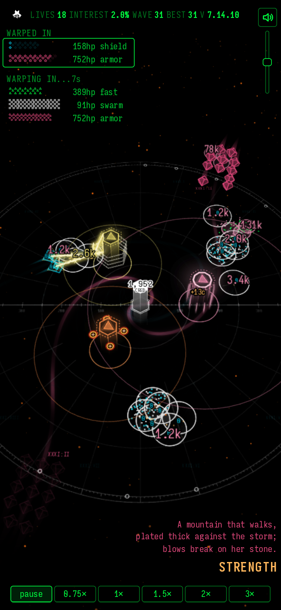
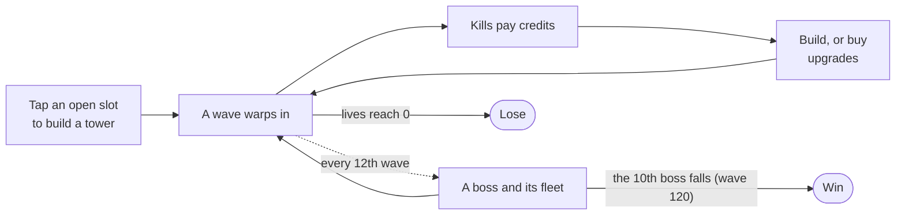

# THE SPIRE

A spiral tower defence game for the phone. You get three towers, seven kinds to choose them from, and 120 waves to survive.

**Play it at [wai-lau.net/spire](https://wai-lau.net/spire).** You need a browser with WebGL. It was built for phones and plays on a desktop too. The page asks you to pass a Cloudflare Turnstile check first.

<p align="center"></p>

## How a game goes

Enemies come down spiral lanes toward the core in the middle, and every one that reaches it costs you lives. You start with 18.



- You can have three towers at once. Each costs more than the one before, and you can sell one back for most of what you paid.
- You can drag a tower around its slot at any time, as far as its leash reaches, and it keeps firing while it moves.
- Each tower has three upgrade tracks of five tiers. It can buy 13 tiers in all, so one track reaches tier V (the capstone) and the other two stop at IV.
- Waves are fixed: wave 30 sends the same enemies in every game. Crits, stuns and the visuals are the random parts.
- The bosses are the Major Arcana. One comes every 12 waves, from The Star at wave 12 to The Devil at wave 120, and each has its own trick and a haiku that hints at it. Two of them give the core a power: Temporal Drive freezes the board for a few seconds, and Orbital Relay makes one tower fire as five.

### Towers

| Tower | What it does |
|---|---|
| Arc | chain lightning that jumps from enemy to enemy |
| Freeze | a cold aura that slows and wears down whatever walks through it |
| Sol | a ray that splits from one target to the next |
| Acid | continuous jets that leave pools behind |
| Gravity | fires voids that crush as they grow and shed pellets as they fade |
| Carrier | launches a wing of interceptors |
| Ifrit | a homing meteor that bursts into shards, fire and flares |

No tower is required. Each enemy type has two main counters and two helpers, and every team of three is meant to be winnable, apart from a few designed dead ends. The build cards mark each tower with checks and crosses against the four enemy types, so you can see what a team is missing before you build.

### Enemies

| Type | Threat |
|---|---|
| Swarm | many small bodies that wander; each one that gets through costs 2 lives |
| Shield | charges that each soak one hit, however big; slows don't touch it |
| Armor | the slowest and toughest; armor takes a share off every hit |
| Fast | the fastest, but slows hit it twice as hard |

### Controls

| Input | Does |
|---|---|
| tap an empty slot | open the build cards |
| tap a tower or the core | open its card (upgrades, targeting, sell) |
| drag a tower | move it within its leash |
| `1` `2` `3` `4` | game speed: 1x, 1.5x, 2x, 3x |
| `Space` / `M` / `Esc` | pause / mute / cancel |

The browser keeps your best wave and your current run, so you can close the tab and resume later. A win, or a loss past wave 10, can go on the TOP PLAYERS board under three initials.

## How it's built

The game is plain JavaScript with no framework and no build step: about 90 scripts sharing one global scope, loaded in the order [`api/templates/aspira.html`](api/templates/aspira.html) lists them. WebGL draws the board in 3D, with towers as hexagonal prisms and enemies as rolling dice. The rules themselves are 2D (ranges, hits, timing), and the 3D only draws them.

A small Python backend (FastAPI) serves the page and two JSON endpoints: the TOP PLAYERS board, and a performance log that each session posts every few minutes of play.

The repo runs only inside [exec-fn](https://github.com/wai-lau/exec-fn), as the git submodule at `apps/spire`. It uses exec-fn's auth, page shell, colour tokens, lints and test fixtures. Files and code still carry the game's old name, `aspira`.

| Path | What |
|---|---|
| `web/aspira-*.js`, `web/aspira-*.css` | the game, served at the site root (`/aspira-game.js`) |
| `api/templates/aspira.html` | the page and its script order |
| `api/routes_aspira.py`, `spire_board.py`, `spire_perflog.py` | the routes, the leaderboard, the performance log |
| `tests/` | Python unit tests and WebKit browser tests, run by exec-fn's pytest |
| `scripts/spire-smoke/` | the game smoke test |
| `scripts/aspira-sim/` | the headless balance simulator |
| `docs/` | the design docs |

## Development

The smoke test and the simulator need Node 18 or newer. Everything else needs an exec-fn checkout.

### Smoke test

The smoke test loads every script in page order into a Node VM with a fake DOM and canvas, then plays the game through: boot, each tower built, a wave fought, a boss, a capstone, a win, a loss and a fresh start. It also checks that the demo scene on each tower's card still shows what it claims to. exec-fn's pre-commit hook runs it whenever a game file is staged. A full run takes about 10 minutes.

```bash
node scripts/spire-smoke/smoke.mjs
```

### Python and browser tests

Run these from the exec-fn root:

```bash
.venv/bin/pytest apps/spire/tests
```

### Simulator

The simulator runs the real game code headless with a scripted player, as fast as the CPU allows. This command plays one game with Arc, Freeze and Sol up to wave 12 and prints a JSON result (waves, lives, credits, damage by tower) in about five seconds:

```bash
node scripts/aspira-sim/sim.mjs '{"mix":{"arc":1,"frz":1,"sol":1}}' 1 12
```

The balance work is done with it: the counter matrix behind the build cards' marks, every team of three, the boss fits and the economy. [`scripts/aspira-sim/README.md`](scripts/aspira-sim/README.md) lists every script.

### Committing

Commit inside this repo. exec-fn's push hook pushes the commit and moves the parent's submodule pointer. `scripts/pre-commit` is a shim that runs exec-fn's hook: a 500-line file cap, ESLint, stylelint, the palette lint and the smoke test. In a standalone clone, run `git config core.hooksPath scripts` once, and the shim fetches just the lint files.

The sound samples aren't in this repo, so a clone plays silently.

## Docs

- [ARCHITECTURE.md](ARCHITECTURE.md) is the current design, split into one file per section under [`docs/architecture/`](docs/architecture/). Read [§11, the traps](docs/architecture/11-traps.md), before you change code.
- [ARCHAEOLOGY.md](ARCHAEOLOGY.md) holds superseded designs, incidents, and the balance and performance history.
- [`docs/spire-wording.md`](docs/spire-wording.md) has the rules for the text on tower cards.
- [CLAUDE.md](CLAUDE.md) has the working rules for this repo, including the balance checks every change must pass.

## Versions

The version number lives in [`web/aspira-version.txt`](web/aspira-version.txt), and the in-game WHAT'S NEW card shows the changelog. A new tower is a major version, a balance pass is a minor one, and anything else is a patch. TOP PLAYERS keeps a separate board for each major version.
