## 1. Overview and pillars

| # | Pillar (an owner rule) | What it fixes | Where |
|---|---|---|---|
| 1 | **Phone first** | one fixed play box every standard phone shares; no pan, and no zoom but a desktop wheel's (the view only, §2.2); verify at 430x932 and 382x700 | §2.2, §7.1 |
| 2 | **Three towers, seven kinds** | `MAX_TOWERS` 3 on three open slots; every trio of kinds must be winnable except the designed deaths (§4.9) ("for every combination of 3 towers, it is possible to win"), so no kind is required | §4, §10.4 |
| 3 | **Towers move by hand** | drag any tower any time inside its leash, firing all the while; nothing moves itself except Auto-move (a win unlocks it; it disqualifies the game) | §4.4 |
| 4 | **Every upgrade is a choice** | three axes a tower, five buys an axis (tiers I-V), 13 buys a tower, ONE capstone (V) a tower; no tier lowers a stat | §4.2 |
| 5 | **Only behaviour is told** | card words change only when behaviour changes; a number moving changes the stat row | §7.3 |
| 6 | **Counters, not a best tower** | each enemy type has two main counters and two helpers | §4.8 |
| 7 | **3D is a view, never a rule** | ranges, hits and timing are 2D; 3D only draws the same game | §8.1 |
| 8 | **Waves are fixed** | type, lane split and drops hash from the wave number; what stays random is crits, stun chance, swarm jitter (size, speed, wander) and the visuals (sparks, spin, number scatter) | §5 |
| 9 | **Honour-system leaderboard** | a browser game proves nothing; TOP PLAYERS guards shape and rate only | §9.1 |

