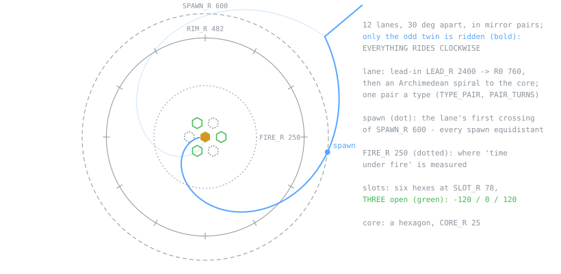
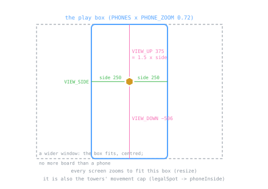

## 2. Board

### 2.1 Geometry (fixed, never random)

| Rule | Design |
|---|---|
| one pair a type | `TYPE_PAIR` / `PAIR_TURNS`: armor the most direct, swarm almost straight, fast a curve, shield and boss ellipses (`ELLIPSE` 0.7); the type fixes the path, every enemy walks it at one base speed. The chart's dotted 250 u ring is where the pairs' "time under fire" was measured when they were solved (`FIRE_R` in `aspira-defs.js`: declared, read by nothing, kept as the record) |
| winding | pitch-driven (`TANGENT_Q`, `LANE_SOFT_R`): no hook off the lead-in, a gentle coil at the core; plus the CORE TWIST (owner, 2026-10-22, in place of auto-wait): extra winding at rate `(1 - r/TWIST_R)^TWIST_P / r` inside `TWIST_R` 420 (softened at the core by `TWIST_SOFT`), tightest at the core, each lane `TWIST_S` 3.5 s x its rider's speed longer (`PAIR_RIDER`, `PAIR_V`; solved by bisection), sampled `TWIST_SUB` x finer there; the per-section twist sets the difficulty curve (§5.6); the drawn lane runs on under the core, the walked path ends at `CORE_R` |
| copies | a wave rides rotated copies of its lane: swarm 20/24, fast 3/5, shield 2/3, armor 2, boss 1 (Lovers 2 opposite, Devil 6 on 3, her host on the same 3), **never exactly four** (`NO_LANES`); the set is turned by `laneBestTurn` (rule in §2.2: most even copies, then most total lane, then nearest the usual turn; turned 90 degrees in landscape) |
| lit | a lane lights only with live enemies (`alive / sent`, `LANE_FADE_IN_MS`); a boss lane is wider, haloed, and waits for the sky (§5.5); Roman numerals on `LABEL_R` 430 never overlap (`placeLabels`); lit layers rebuild at most every `LIT_MIN_MS`; in 3D the lit lanes are drawn by the bell shader (§8.2), the 2D layers only off it; a finished wave's lanes go dark the frame its last enemy dies, whatever wave is up next (`laneHold` keeps a lane only while a live lane of its wave `u.n` runs) |
| footprint | a tower is a hex of `TOWER_K` cells, `towerGap()` from another, blocked by the core only where outlines touch (`coreKeep`); building on a lane is allowed (towers and enemies never collide); `CORNER_SLOTS` is empty (dormant, §4.11) |

### 2.2 The play box (pillar 1)

`PHONES` lists standard phone page sizes; at `PHONE_ZOOM` 0.72 the tightest gives the
box (`aspira-positioning.js`). **Every screen zooms to fit it** (`resize`, centred on the
other axis) and it is the towers' **movement cap** (`legalSpot` -> `phoneInside`): a
desktop gets no more board than a phone. Its outline shows only as three thin lines on an
edge holding a tower back for no visible reason.

| Rule | What |
|------|------|
| centred core | the core sits in the middle of the box: `BOX_SHORT` either side across the short axis, `BOX_LONG` along the long one |
| two shapes | portrait (`BOX_HX` short, `BOX_HY` long) and landscape, the same box turned 90 degrees; `boxWanted()` follows the window, `setPlayBox(wide)` applies it and `turnSlots(wide)` turns the cells and built towers with it |
| switch | only on a clear field with no lane preview (`boxSwitchIfIdle`, checked before each step), so a turn never lands under live enemies |
| lane copies | a wave's lanes turn to the angle whose copies are on screen about equally long (`laneBestTurn`, within `LANE_EVEN_SLACK`), then the most lane on screen, then nearest the usual turn (the usual turn is itself turned 90 degrees in landscape, so a landscape pick is the portrait pick plus a quarter turn) |
| wave list | `fitWaveList` drops trailing rows until the list clears the core and the open starting slots; phone rows are `WAVE_ROW_H_PHONE` high |
| desktop zoom | a fine pointer's wheel zooms the VIEW (`viewZoom` x the fit, 0.5-1.5, start 0.7, about the core's fitted spot, no pan; `zoomApply`, aspira-draw.js; a resize keeps it); touch stays at 1. The GAMEPLAY box is the fit's at any zoom: `phoneInside` runs under `fitView` (the fit camera + `warp.pFit`, made once a frame), so enemySeen, `legalSpot`, flings, lane turns and the boss bar never move; the outline draws that box's floor footprint through the zoomed view (`fitMap`) |
| landscape tilt | the 3D box is a screen rectangle, so the floor it covers grows with the camera tilt: landscape solves `tiltWide` (bisect, `fitTiltWide`, after a switch or resize) so `boxFloorArea()` equals `portraitFloorGoal()` (tilt 0.2-0.7, settled 200 ms after a resize) (the floor portrait covers on this screen turned, at tilt 0.55); every reader of the tilt uses `warpTilt()` |

### 2.3 Shields as segments

One segment a point in the shape's own outline, ring r holding `sides x r` (a hex core: 6,
12, 18 ...; `LIFE_RINGS` 5). Lose one: a random segment goes; gain one: enters innermost
and pushes the rest out. Rings dim outward, breathe with the core (`shieldPulse`), and a
lost core segment flashes the boss red.

