## 3. Economy and flow

| Lever | Design |
|---|---|
| start | `START_MONEY` 120, **18 lives** (two full rings of 6), interest 2% |
| interest | `floor(money x rate)` on the credits held when a wave is SENT, **uncapped**; a boss drop may add +0.5% (lives back, below); the owner keeps tuning it down ("97% of a run's money was interest") |
| bounty | `bountyBase(w) x type bounty x BOUNTY_MUL`, `w` the 10-cycle equivalent wave (§5.2): linear to eq 30, a gentler slope after, x1.1 early; fractional, shown floored; a kill's credits **fly home** as a gold dot and bank on landing |
| prices | a tower `cost` 40, **x1.5 per tower standing** (40, 60, 90), shown in each free slot; upgrades are multiples of the build price (§4.2); **sell** returns 95%, on a second tap |
| leaks | an enemy costs its `leak`: swarm 2, boss 10 (= game over, the boss named in the title), others 1 |
| lives back | a boss drop ONLY: +3 lives OR +0.5% interest (half and half by `fixedRand`). **No score** (owner, 2026-10-29: "remove anything based around score"; its +6 lives per 100,000 went with it); BEST = the furthest wave |
| speeds | 1 / 1.5 / 2 / 3x (keys 1-4), 10x for the owner (5); the sim steps 0.02 s; Temporal Drive always runs at 1x |

**Wave gating** (`bossUp` includes `G.fleetQ`):

**No auto-wait** (owner, 2026-10-22): the checkbox and the game slowdown are gone, and the per-enemy wait that briefly replaced them
too. The lanes' CORE TWIST (§2.1) gives the same time to the core instead. The threat ring keeps its 1 s line (`AUTO_WAIT3_S`).

| Pauses (`towersFrozen` while paused and while the sky turns) | Pauses | On close |
|---|---|---|
| tower card, core card, upgrade chooser, an armed Relay | yes | restores the previous pause |
| build dialog | yes | restores the previous pause - **unpauses only at game start** (the first build, `G.started` unset; owner 2026-10-27) |
| focus loss | no | a hidden tab just gets no frames; the slow logs ignore it |

