## 4. Towers

### 4.1 The seven kinds

| | ARC | FRZ | SOL | ACD | GRV | CRR | IFR |
|---|---|---|---|---|---|---|---|
| design | hit-scan chain lightning | an aura, no shots | a ray that splits from enemy to enemy | continuous jets and pools | a void a shot, with novas and an aura (§4.5) | a carrier launching interceptors (§4.5) | a homing meteor bursting into a fan of straight shards, fires and eight-beamed flares (§4.5) |
| colour | yellow | cyan | pink | green | violet | blue | orange |
| default targeting | Near | Near | Near | Near | Near | Near | Near |
| leash (`MOVE_BASE`) | medium (200) | long (240) | medium (222) | longest (280) | medium (200) | long (240) | short (120) |

What each kind beats and is weak to: the mark target, §4.8 (the one table). Ids `arc frz sol acd grv crr ifr` (`KINDS`; `crr` was `car` until 6.18.4, renamed 2026-10-29). The seven hues sit 360/7 OKLCH degrees apart (§10.1); range x `RANGE_BONUS`. The legacy path/form tree
(`aspira-upgrades.js`) is dormant: every kind `hasSkills`.

### 4.2 The chart (pillar 4)

Three axes a kind, each a ladder of **five purchases** (`SKILL_TIERS`, tier redesign 2026-10-24,
spec `docs/superpowers/specs/2026-10-24-tier-redesign-design.md`); an axis level IS the tier
shown, and every per-tier table holds exactly those six values:

| shown on card, board, title = table index | 0 | I | II | III | IV | V = capstone (`CAPSTONE_TIER`) |
|---|---|---|---|---|---|---|
| what it is | the plain tower | the axis's first hint | its growth | its growth | its growth | the axis's one big mechanic, one a tower |

- A tower's `lvl` is 1 + its purchases: **13 a tower** (`SKILL_POINTS`: one axis to V, two to
  IV), one step of `SKILL_STEP_COST` each (13 steps, a placeholder until the balance battery).
- How the tables are built (0 .. IV written, V appended by `aspira-capstone.js`, tier 0 and I set by `aspira-tier01.js`) and how saves
  from before the redesign are read: ARCHAEOLOGY §4.4.
- **One capstone a tower** (`axisCap`, `capstoneHolder`; the card says "One capstone per
  tower · X V holds it"). A tower's shown level is its purchases (`shownLevel`).
- **The basket**: a tap pulls an axis to its next (or last) tier, the card previews the
  result, one priced button locks it in. Below the locked tier is refused with a note; the
  bank never limits a pull (unaffordable = red cost, disabled button); a card closed
  unbought drops its pull.

### 4.3 The stat curve, tier 0 and tier I (`web/aspira-curve.js`, `web/aspira-tier01.js`)

A tower's damage, rate and range come from its **total level** (every purchase, any axis) on
one geometric curve per kind (`STAT_CURVE`, `curveAt`, `curveBase`): `lo` at 0 (below the old
bare tower), `hi` at 13 - placeholders measured on the old tables, fitted by the balance
battery. The axes add MECHANICS; one may nudge a stat up, never down, at most `NUDGE_MAX` 1.2 in
all (`nudge`: ARC Conductivity's rate; no axis moves range since 2026-10-26, `skillMove` gone). SOL's curve rate
is flat (its rate never rises). Per-axis raw damage tables are gone; a sub-attack's factor is
one constant (`FRZ_RIME_BITE0`, `ACD_POOL_HEAT`,
`IFR_ROUTE_K0`, `IFR_TICK_K0`; CRR's tether deals no damage) - except GRV, whose three parts are per-tier tables: the pellets (`GRV_PELLET_K`), the void's crush by Void tier (`GRV_INNER_K`; `GRV_INNER_K0` is an unused alias) and the nova's hit by Nova tier (`GRV_NOVA_RATE`, owner 2026-11-06: "2. Also yes" - it was the fire rate), and so is any factor on the tower's own damage, on from its first tier
(`SOL_CRIT_K`, `SOL_SCORCH_TOTAL`, `IFR_FIRE_HK`, `IFR_HF_FK`, ARC's `ARC_DMG_K`, ACD's `ACD_DMG_K`). A whole-tower RATE factor on the curve is one constant too: SOL `SOL_RATE_K` (with `SOL_DMG_K`, fewer, harder shots), FRZ's aura `FRZ_TICK_RATE_K` (fewer, harder ticks: the same damage a second, fewer shield pops), IFR's charge `IFR_RATE_K` (a plain rate cut, no damage back). Per-tier tables that stay hold counts, shapes, reaches and
debuffs on the enemy (FRZ Fracture, slows, armor strips). `towerLevel` counts the tower's own axes only. Each stats function sets `dmgCurve` /
`rateCurve` (the curve plus nudges) before a mechanic splits the hit.

**ARC's damage is geometric in the level** (7.1.0; owner, 2026-11-01: "Right now ARC is so insanely steep it doesnt make sense" /
"no level damage steps above 2x"): `STAT_CURVE.arc.geo` [base, step] = [1.10868, 1.9], damage = base x 1.9^level from tier 0 up to the `knee` (level 7),
x `late` 1.35 a level past it; no set-apart tier-0 hit (`curveAt` reads `geo` where a kind has it; ARC's `dmg0` is gone). **Two number rules** (owner, 2026-10-31 /
11-01): no level step multiplies damage by more than 2x, and nothing a card or table shows passes about 800% (8x the tower's damage).
Smoke pins them where a table carries them (`tiers.mjs`, ACD's goo: each value <= 8x, each step <= 2x, rising); the curve's own
steps (1.9 ARC, 1.35 past its knee) sit under 2x by construction.

**Every curve rises and each level's hit is BELOW 2x the one before** (owner, 2026-11-01: "get the early damage even lower and allow
the curve to not be exactly 1.5x / just keep it below 2x for any level" - the only curve rule; 2026-10-28's "slightly steepening" pin is
gone). SOL, GRV and IFR keep the power curve but start GEOMETRIC: `geoCap` [base, step], hit = min(base x step^level, the power curve) -
SOL [3.0616, 1.9] (a fifth of its old tier-0 hit; meets the curve at level 6), GRV [0.256, 1.9] (level 4), IFR [0.1047, 1.9] (level 6).
CRR is GEOMETRIC too: `geo` [0.8565, 1.4444], boosted early and tapering to the same level-9 hit. Smoke (`tiers.mjs`) checks every kind; its
`PENDING` list is empty and only ever shrinks.

**The card's damage unit** (`td`): ACD, FRZ and GRV count theirs `TD_UNIT` {acd 8, frz 3, grv 4} x bigger (`tdOf`, aspira-stats.js; the
card reads it through `tdU`, aspira-desc.js) - a LABEL only, the damage dealt is unchanged - so no share on a card passes 800% (FRZ's chill
top 2260% -> 753%, now capped at 800% by `FRZ_BITE_TD`, GRV Void V 3000% -> 750%, the void's crush capped at 800% by `GRV_CRUSH_TD`, ACD's ramp 1/8 to 8 td). Smoke: no card sentence names a
number over 800%, every axis of every tower at tiers 0-V, and every axis MIX 0-V (a Void V + Nova V GRV read 2325% before the cap). Burns read their share A SECOND, a CRR sortie its share A BOLT (`docs/spire-wording.md` rule 3).

| tower | tier 0 | axis 1, tier I | axis 2, tier I | axis 3, tier I |
|---|---|---|---|---|
| ARC | one hard bolt whose chain jumps twice (three enemies hit) | Conductivity (id `conductivity`): each jump keeps more of the hit (`ARC_AMP_FALL`) | Voltage: a longer chain and a farther jump (`ARC_VOLT_JUMPS`, `ARC_VOLT_REACH`); one fork from I | Shock (id `capacitance`): every hit strips armor and marks its target Shocked |
| SOL | one tracking beam held on its first target, hitting only it (`SOL_SPLIT[0]` 0) | Scorch (id `focus`): the stacking burn | Reflection (id `refraction`): one split, piercing | Breach: armor stripped a tick, the splits' carry |
| CRR | eight interceptors, one bolt a volley, four volleys a sortie (`CRR_HANGAR`, `CRR_AMMO`) | Hangar: twelve launched, two stored in orbit | Tether: the first interceptor out tethers its target (`CRR_TETHER_N`, `carTethered`) | Armament: a harder bolt (`CRR_BOLTS_BY`, x0.65 at 0 .. x3) and more volleys |
| FRZ | a slowing circle with a light flat nip | Fracture: the real tick, more the slower | Permafrost: frost pulses (a stacking slow; no armor) | Moons: one moon |
| ACD | one ray, no pools | Corrosion: eats armor | Flow: two rays + carry | Spill: ray pools that burn, no slow; kill pools gone |
| GRV | a void a shot that crushes as it grows, shedding pellets as it decays | Void: a heavier void | Nova (id `supernova`): one nova before each void, harder by tier (`GRV_NOVA_RATE`), stripping armor | Gravity Well (id `radiation`): the aura (pull, slow) and harder pellets |
| IFR | a meteor that bursts into a fan of six (`IFR_FAN_N`) | Meteor: meteors stored in orbit | Hellfire: a wall of fire lighting flares | Flare: a bright flare at each impact |

Tier I names: `TIER_I_NAMES` (`aspira-capstone.js`). Checks: `scripts/spire-smoke/tiers.mjs`.

### 4.4 Moving (pillar 3)

| Rule | Design |
|---|---|
| drag | follows the finger at once, firing; not while placing, with the Relay armed, paused, or during the sky turn; two fingers move two towers |
| leash | a circle round its own slot (`MOVE_BASE x slide`, slide capped `SLIDE_MAX`), clear of the core, other towers and the play box; no legal spot = it stays put; shown 4 s after a build or a growth |
| coast (`aspira-fling.js`) | released with speed it coasts and bounces off leash, neighbours, core and box; a tower that cannot stay glides home |
| home slot | a moved tower leaves a faint hex there; a slot another tower sits on cannot be built (`canPlace`) |
| pick | by the whole drawn shape at `PICK_GROW` (3D: the prism's screen outline, `aspira-pick.js`) |
| tiers | slide tiers grow the leash, range tiers the range (`SKILL_MOVE`) |
| **Auto-move** | a checkbox **only after a win** (`best.ascended`): `bestSpot` picks, the tower glides at `HUMAN_V` in GAME time; a second tap arms it; **any time on = "(DQ)" from TOP PLAYERS** |

**Targeting** (a card slider; ties go to the furthest along the spiral; ARC's jumps
and SOL's hops use the tower's own mode, `chainPick`): **Fresh** = no debuff first, then
nearest the core · **Strengths** = the enemy types this tower checks best first (its `VS_MARKS`), its worst last, then the biggest (most HP left; a boss always) - was **Biggest** till 2026-11-06 · **Near** = nearest the CORE,
not the tower.

**Positioning** (`bestSpot`; the simulator and Auto-move): every half second score 36 spots
(3 rings x 12 angles) on predicted positions 5 s ahead, weighted by urgency (x1 at entry ..
x7 at the core) and the tower's targeting; move only for a spot 10% better.

**Look**: the level is the hex's glow and rings; the stat triangle on the hex grows a ring a
purchase; an affordable buy flashes an up-chevron; labels are three letters.

### 4.5 The towers, one by one

Each tower in the same shape: its **role**, its **marks** (the target row), its **parts** where it has a rulebook, its **paths** (the three
axes, tiers I .. IV and the capstone at V; the capstone rules: §4.6) and where its **traps** are. Ids, names and the per-tier numbers: the code.

#### ARC, the arc tower (`web/aspira-arc.js`, the look `aspira-arc-body.js`)

**Role.** THE ARC REDESIGN (owner, 2026-10-29: "Hits hard, big chain, forks are limited to 1 fork per node, doesn't refork after 1
fork, cannot hit same target twice"): ONE hard strike a shot, then a chain of jumps, each leaping from the enemy it hit to the next
within its own reach (`arcRange`, not ARC's small range: close zap, conducts to a few units nearby). From Voltage I (`ARC_FORK_FROM`) the strike forks
ONCE into two chains, and nothing forks after. **One hit set an attack**: no enemy is struck twice by one attack (`fire` shares
`seen`; `skillHop`). No charges, no bursts. The axis ids stay (saves, sims, smoke); only the names changed. How it got here:
ARCHAEOLOGY §4.

**Marks.** swarm +2 · fast -2 · shield -2 · armor +2 (the mark target, §4.8; the measured marks: the build card's `VS_MARKS`)

**Paths 0 -> V.**

| axis | buys, tiers I .. IV | capstone (V) |
|---|---|---|
| Conductivity (id `conductivity`) | the carry: what each jump keeps of the hit before it (`ARC_AMP_FALL`, above 1 from tier III: jumps out-hit the strike) | **Grounding**: each chain's last jump bursts on every enemy within 40 u, at that jump's hit; a white ring (`ARC_GROUND_R`) |
| Voltage | the chain: more jumps (`ARC_VOLT_JUMPS`) and a farther reach a jump (`ARC_VOLT_REACH`); the one fork from `ARC_FORK_FROM` | **Storm**: every 5th strike forks 3 ways; the rings spin up and flash (`ARC_STORM_EVERY`, `ARC_STORM_FORK`) |
| Shock (id `capacitance`) | never slows (`ARC_RES_SLOW` all 0: the owner's ARC brief, ARCHAEOLOGY §13.7); every hit strips a share of the armor left (`ARC_RES_STRIP`, `shredPct`); from II its bolts hit harder (`ARC_RES_DMG` x1.05-1.2, on the card "Its bolts hit xN harder."); **Shocked** (owner, 2026-11-01, "1": "Shock makes shocked enemies take more damage from ARC"): each hit marks its target for `STAT_SLOW_T` (0.6 s; `shockT`, refreshed on hit), and a marked enemy takes x(1 + `ARC_SHOCK_AMP` 0/.3/.7/1.6/1.8/2) from ARC's hits (not the burn); the mark shows as a thin triangle in ARC's colour round the die (aspira-enemies.js), the card says "Shocked enemies take X% more damage from ARC."; no area zap | **Superstorm**: a Shocked enemy that dies passes its Shock (time refreshed) to every enemy within 80 u, a zap to each (`ARC_SHOCK_PASS_R`, `ARC_PASS_DEPTH`) |

**Traps.** §11, the rows naming ARC.

#### FRZ, the freeze tower (`web/aspira-frz.js`, the ice `aspira-frz-ice.js` / `aspira-frz-ice3d.js`, the moons `aspira-frz-moons.js`)

**Role.** Everything inside the aura is slowed (only while inside) and takes a quiet tick;
**armor bites the tick**, and it hurts by the speed the slow takes (`frzBite`: `FRZ_CHILL_K` x slow x the enemy's own speed / `ENEMY_BASE_SPEED`, owner
2026-11-06 "1 yes"; it reads speed, never type, so fast enemies take most), never over `FRZ_BITE_TD` (8) x td. **No armor reduction** (owner, 2026-10-29: "no armor reduction effects, more slow").
**Weakness: shields and armor** - a shielded enemy cannot be slowed (no chill, no Fracture, a Permafrost pulse does nothing);
a tick on it pops one charge.

**Marks.** swarm +1 · fast +2 · shield -1 · armor -2 (the mark target, §4.8; the measured marks: the build card's `VS_MARKS`)

**Paths 0 -> V.**

| axis | buys, tiers I .. IV | capstone (V) |
|---|---|---|
| Fracture (id `temp`; Brittle until 2026-11-06, owner: "rename it to Fracture") | a colder aura, a faster tick, more **damage taken** (a slowed enemy takes more from EVERY tower, credited to the FRZ; the card row "Damage taken"); range | **Zero Point**: the fracture lingers 2 s after an enemy leaves the aura (`FRZ_LINGER_S`) |
| Permafrost (id `rime`) | rings pulsing to the aura's edge, each leaving a permanent stacking slow (its armor crack `FRZ_RIME_CRACK` is 0 at every tier); at full frost the rime spreads to the nearest enemy; slide | **Ice Age**: a fully frosted enemy is frozen solid 0.5 s, once per 6 s each (bosses cut like slows, `bossSlowMul`) (`FRZ_DEEP_S`, `FRZ_DEEP_CD`) |
| Moons | copies of the aura orbiting the tower (separate slow sources, so they multiply), with satellites at the top tiers | **Constellation**: no mechanic (Wai: keep the moons) |

**Traps.** §11, the rows naming FRZ.

#### SOL, the sun tower (`web/aspira-sol.js`, the beam `aspira-solbeam.js`, the body `aspira-sol-body.js`)

**Role.** One TRACKING BEAM, held on its first target while that target lives and stays in range (owner, 2026-11-04: "SOL 0: fire a
single tracking beam at a target ... It lasts as long as the first target is alive, the first target must be in range"). Armor cuts it like any
other tower. Its checks and weak spots are measured, not designed: the build card's marks (`VS_MARKS`, §4.8). The code: `web/aspira-sol.js`
(`stepSolTrack`); the look: `solTrackBeams` (aspira-effects.js); how it got here: ARCHAEOLOGY §4 (the band model it replaced).

**Marks.** swarm -3 · fast +1 · shield +1 · armor +1 (the mark target, §4.8; the measured marks: the build card's `VS_MARKS`)

**Parts.**

| part | principle |
|---|---|
| lock | the first enemy `pickTargets` gives; the beam holds it until it dies or leaves `st.range`, then locks again. A NEW lock aims `SOL_AIM` s before it may fire (a lock that struck at once killed a swarmer a frame). A target killed under the aim by anything but SOL's own shot - another tower, SOL's own burn or reflections - KEEPS the lock: the next shot fires on schedule at that spot and its reflections split from there, then the lock goes (owner, 2026-11-13: "SOL should not choose a new target if the target it was aiming at is killed during the aim, this is because the reflections can be good, and there's a possibility that SOL keeps picking targets that are about to die and never fires") |
| pulses | damage per second = the curve's (`st.dmg` x `st.rate` x `SOL_TRACK_DMG`), dealt as PULSES (owner, 2026-11-05: "fire, pause, fire, pause"): a shot every 1 / (`st.rate` x `SOL_PULSE_K`) s carrying that second's share, through `damage()` - a number a shot, one shield charge a shot. Big and rare (`SOL_PULSE_K` 0.35, 2026-11-13): with the aim rule a shot's overkill on a weak swarm enemy is SOL's swarm weakness |
| first beam | hits only its target - it never pierces (owner: "SOL 0 no pierce") |
| splits (Reflection) | as a volley starts, `st.split` splits from the first target to the nearest enemies within `st.range` OF THAT TARGET; each split is a line from the first target THROUGH its own enemy on to the play box's edge (`solLinkHits`, `solOutLen` - the same in the sim; owner: "all secondary beams fly off to edge of screen"), PIERCING every enemy on it in order, and ends when its own enemy dies |
| carry (Breach) | a split's damage x `SOL_TRACK_HOP[Breach]` at each enemy it reaches, compounding (the swarm weakness: owner, "pierce damage reduction is applied each time it passes through an enemy") |
| breach (Breach) | every hit takes a fixed % of the armor left (`bleed` -> `shredPct`, `SOL_BREACH_ARMOR`); no parallel beams (owner: "no parallel beams") |
| scorch (Scorch) | a pulse lays `SOL_SCORCH_M` / `SOL_PULSE_K` burn stacks at once (2; four before 2026-11-13, when SOL popped every shield at 13 points) on every enemy it hits, each a share of its hit (`solTickHit`, `pulse`; owner, 2026-11-05: "scorch is what pops shields" - the stacks a second held), each stack on its own clock, one pop a tick (`solScorchTick`); every live stack slows its enemy `SOL_SCORCH_SLOW`, summed and capped at `TOWER_SLOW_MAX`, never a shielded one (`solScorchTick`, `applySlow` tag `scorch`; owner, 2026-10-31: "Make SOL scorch slow"); Scorch V doubles a stack's ticks at half each - a longer burn, more shield pops (`v`: the doubled ring) |
| drawing | `t.solB` at its live ends, never an fx entry: a pulse's FLASH (`SOL_PULSE_FLASH` 0.15 s, fading; dark between shots), the splits a segment an enemy, each dimmer by its carry. A beam that stops at its enemy (the main, a split without Breach) is THIN (`SOL_THIN_W` 0.3 x its hit's width); one that PIERCES (the main at Reflection 0 + Breach, a split with Breach, on to the edge: `solShowLen`) is full width (`SOL_PIERCE_W`) - owner, 2026-11-05: "primary beam way thinner (thicker with pierce)". Between shots the AIM LINE: a thin plain line to the lock, alpha 0.4 -> 0.8 as the next shot comes (over a new lock's `SOL_AIM` or the gap; "I want the aiming visual effect back"). No prism, no rod |

**Paths 0 -> V.**

| axis | buys, tiers I .. IV | capstone (V) |
|---|---|---|
| Scorch (id `focus`) | a LONGER burn (`SOL_SCORCH_N` ticks), never a hotter one; at V twice the ticks at half each | **Solar Flare**: each shot's first enemy hit leaves an IFR flare in SOL's colour, burning as IFR's untaken flare; at most 4 live a tower (`SOL_FLARE_SHARE`, `SOL_FLARE_MAX`) |
| Reflection (id `refraction`) | the splits (`SOL_SPLIT`, none at tier 0) | **Corona**: 8 splits, splitting no further (`SOL_SUB_SPLIT` 0; owner, 2026-11-13: "either 2 subsplits with tighter restrictions or none at all" - none; if sub-splits come back, never under 2: "min 2 subsplits") |
| Breach | the armor a hit strips (`SOL_BREACH_ARMOR`, none at tier 0) and the splits' carry (`SOL_TRACK_HOP`) | **Starfire**: look only: the Breach marker drawn as a blade |

**Traps.** §11, the rows naming SOL.

#### ACD, the acid tower (`web/aspira-acid.js`, the look `aspira-acid-draw.js` / `aspira-acd-body.js`)

**Role.** Jets whose burn ramps while held (doubling, capped), each tick a real hit; jets never share an enemy; a jet resets
when its enemy dies or leaves, unless Flow carries its ramp on. Tier 0 is one jet and no pools. Its checks and weak spots: the build
card's marks (`VS_MARKS`, §4.8). The code: `web/aspira-acid.js`, the look `aspira-acid-draw.js`; how it got here: ARCHAEOLOGY §4.

**Marks.** swarm -1 · fast -3 · shield +2 · armor +2 (the mark target, §4.8; the measured marks: the build card's `VS_MARKS`)

**Paths 0 -> V.**

| axis | buys, tiers I .. IV | capstone (V) |
|---|---|---|
| Corrosion | a tick takes a fixed % of the armor left (`shredPct`, `ACD_CORRODE` per tier; the jets only); eaten armor drips as **goo** that homes on the next enemy; a picked-up drop strips `ACD_GOO_STRIP` of the picker's CURRENT armor (15-75% at I-V) and deals `ACD_GOO_DMG` x the dropping ACD's td (2-8x) (7.1.4, owner 2026-11-01 picked "1"; it was the armor lost x 2.6-9.2) | **Oblivion**: a corroded enemy takes x1.2 from EVERY tower for 0.5 s after its last acid (one timer, never stacking) (`ACD_CORR_TAKE`, `ACD_CORR_TAKE_S`) |
| Flow (id `spray`) | more jets (`ACD_LINES`); a jet keeps part of its ramp when its enemy dies **or escapes** (`ACD_FLOW_CARRY`, the fast answer); range | **Monsoon**: no mechanic (the table's leap: 11 jets) |
| Spill | the jets drip slimy acid pools that burn and do NOT slow (owner, 2026-10-29: "Increase ACD pools so that swarm gets caught, no slows"; `ACD_POOL_SLOW` 0) - bigger and more often by tier; a kill leaves no pool; slide | **Extinction**: a pool that drops over another joins its LAKE: x1.25 burn within 149 u of the lake's first pool; drawn as one body (`drawLake`) (`ACD_LAKE_K`, `ACD_LAKE_R`) |

**Traps.** §11, the rows naming ACD.

#### GRV, the gravity tower (`web/aspira-grv.js`, the look `aspira-grv-draw.js`)

**Role.** Its target (the mark target, §4.8): a help against swarm, fast and armor, weak to shields; mid reach (about ARC's); its measured checks and weak spots are the build card's marks (`VS_MARKS`,
§4.8). Palette: a violet aura and outline, a yellow nova (`--asp-violet-*`, `--asp-bh-*`). There is no projectile: everything
happens where it fires. The numbers and how it got here: ARCHAEOLOGY §4.6b.

**Marks.** swarm +1 · fast +1 · shield -3 · armor +1 (the mark target, §4.8; the measured marks: the build card's `VS_MARKS`)

**Parts.**

| part | principle |
|---|---|
| void (tier 0) | every shot leaves a VOID where its target will be a moment on (`GRV_LEAD_S`, along its lane at its pace, slows counted), so the enemy walks into it; the void crushes what is inside, harder the heavier it is, as it grows, never over `GRV_CRUSH_TD` (8) x td (the Nova factor rides on the void) |
| mass | a void IS its mass: its size is the root of its mass; it gains mass from the damage it deals (a crowd feeds it, a shield soaks hits and feeds it little, fast enemies pass before it feeds), up to a cap |
| decay | it evaporates by its circumference - a big or merged void burns out sooner - and it is gone by `EFFECT_MAX_S` from its oldest part's birth whatever it eats |
| pellets (tier 0) | a void sheds pellets as it decays, paced by the mass it loses: each flies out at random and hits the first enemy it touches or nothing; each pops one shield charge; past `GRV_PEL_SOFT` in flight they bundle (perf) |
| pull and merge | open voids (any GRV's) drift toward each other by the other's mass; touching, the bigger takes the other in (`grvMerge`) - masses, caps and areas add |
| novas (Nova) | ONE nova (`GRV_NOVA_N` 1, owner 2026-11-06; three until then) implodes on the best spot before each void (`grvNovaSpot`: the reach holding the most enemies) over `GRV_NOVA_T` 0.8 game s - the three's time, so at the base rate two rings overlap briefly - its front hitting what it passes once (x `GRV_NOVA_RATE` by tier) and stripping armor; it sets the void's size |
| aura (Gravity Well) | an aura round the void, never past twice its size: it slows (never the shielded), harder inside the void and on an enemy already past it, and every enemy in it glides across its lane toward the lane's centre line (`GRV_LAT_V`, easing back after); it deals no damage |
| look | the void's black centre is logarithmic in its size (`grvCoreR`), touching disks join; the aura is a radial band clear at both ends; every GRV damage number flies into its void (`grvFloat`) |

**Paths 0 -> V.**

| axis | buys | capstone |
|---|---|---|
| **Void** | a bigger void, a harder crush, more pellets | **Event Horizon**: a void twice as heavy; each enemy its crush kills grows it x1.1, to x1.5, fading over 3 s (§4.6) |
| **Nova** (id `supernova`) | the novas before each void, faster by tier, their armor strip (`GRV_NOVA_STRIP`) | **Hypernova**: the most strip; every 4th nova rings twice, the 2nd ring x1.5 the reach (§4.6) |
| **Gravity Well** (id `radiation`) | the aura (pull and slow), its size and strength; the pellets' damage and range | **Undertow**: an enemy in the aura nearer the core than the tower is reeled back to the void, each at most once every 4 s (§4.6) |

**Traps.** §11, the rows naming GRV.

#### CRR (id `crr`), the carrier (`web/aspira-crr.js`)

**Role.** The owner's StarCraft carrier, electric blue (`--asp-blue-hsl`), its target (the mark target, §4.8) checks on fast and shield; its measured checks and weak
spots are the build card's marks (`VS_MARKS`, §4.8). It never fires itself; its **interceptors** do. The constants (wing sizes,
speeds, volley counts, reloads) and every superseded number are in ARCHAEOLOGY §4.6c-bis and §4.6c-ter.

**Marks.** swarm -2 · fast +2 · shield +1 · armor -1 (the mark target, §4.8; the measured marks: the build card's `VS_MARKS`)

**Parts.**

| Part | Rule |
|---|---|
| launch | the tower's range only LAUNCHES: an enemy inside it sends out every ready interceptor at once, the longest-waiting (`i.heldAt`, FIFO) taking the first target |
| target | each interceptor then picks its own from everything within the interceptors' reach (`CRR_LEASH` x the range, about 960), in the tower's targeting order. `carTarget` sends enough: the first enemy whose HP (and shield) outweighs the damage already committed to it by interceptors on it. The carrier itself moves inside a leash of 240 |
| hold | EVERY ready interceptor waits in orbit round the carrier (`s.hold` = the whole wing at every tier), at a jittered distance and size, carried with the carrier as if fixed to it, and launches from where it circles |
| flight | ONE speed out, back and home (`CRR_SPEED_V` 500; owner, 2026-11-02), circling at `CRR_ORBIT_V`; a heading with a capped turn rate, steered onto an orbit circle round the target (`CRR_ORBIT`, each interceptor's radius breathing by `CRR_ORBIT_JIT`); it steers round the core and the towers (`carAvoid`) and leads nothing. On arrival it makes a strafing pass (the ram) |
| volleys | `CRR_AMMO` volleys a sortie (11 .. 40; no cap - owner, 2026-11-07: "Ok no ammo limit", lifting the 2026-11-01 30), each ONE bolt carrying the volley's damage, x `CRR_BOLTS_BY` by Armament (owner, 2026-11-05, "C10"; it was the bolts fired at once until then - the history: ARCHAEOLOGY §4), then `CRR_VOLLEY_K` / rate to the next volley. A volley's bolt goes at the ONE enemy it began on, even if it dies; a bolt whose target is gone flies on only `CRR_BOLT_ON` s, hitting the first enemy it touches or nothing. An interceptor fires ONLY once on the circle round its target (`i.orb`), never on the way out. Bolts do not slow; only tethers do |
| tether | with Tether, the first interceptors out (`CRR_TETHER_N`: one at I, all from II) tether their target: slowed, and taking more damage per tether (`CRR_TETHER_SLOW` x `CRR_TETHER_K`, at most `CRR_TETHER_MAX` a tether; `CRR_TETHER_AMP`), tethers STACKING on one target (each slow modest, so several matter); from tier II (`CRR_CHAIN_FROM`) a tether runs on to one more enemy nearby. Drawn as a thin ARC-style chain of links in CRR's light blue (`fxGlChain` / `drawChain2D`, links `CRR_TETHER_W` 0.4 of ARC's - kept thin, 2026-11-06), never under `CRR_TETHER_A0` 0.7 alpha; a pulse flashes it brighter and wider |
| after a kill | no leash: an interceptor stays on its target till it dies or its ammo runs out; then `carHop` (`CRR_HOP`) picks again or sends it home. Home, it reloads in proportion to the ammo it used (`i.used`, the PARTIAL RELOAD) |
| numbers | a bolt's damage goes to `dmgSum` with CRR's own window, `CRR_NUM_WIN` 0.1 s (every other tower's stream sums over `DMG_SUM_S` 0.5): an enemy under a volley shows a number every ~0.1 s, not every half second; a number a bolt was ~65x as many, unreadable (`carNum`, `CRR_NUM_HITS` 1) |
| draw | a volley flies as a V (`carBoltV`, draw only): each wing bolt `CRR_V_W` out and `CRR_V_B` back of its game spot, opening over `CRR_V_IN` and closing inside `CRR_V_SHUT` of its target; a carrier's darts are ONE path, one fill and one stroke; trails stay ROUND-joined - bevel + butt drew them ~3x slower in WebKit (2.5 -> 7.5 ms at 3 x 17); trails are the CRR's draw cost (~60 segments an interceptor) |
| look | hairline trails (`carTrails`); darts sized by Armament, drawn at `CRR_DART_DRAW` 0.375 (owner, 2026-11-05: "Halve interceptor sizes", then 2026-11-06: "1,5x all interceptor sizes"; the draw only); the tether a thin ARC-style chain in light blue, never under 0.7 alpha; drawn in `skyKeep` so a boss sky does not invert them. No new 3D primitives: darts are filled triangles, firing lines and pellets single strokes (the board's path context takes no gradient stroke, §11) |

**Paths 0 -> V.**

| Axis | Buys | Capstone (V) |
|---|---|---|
| Hangar | WIDTH: more interceptors (`CRR_HANGAR`), all waiting in orbit | **Warp Drive**: the biggest wing (41); each flies out at `CRR_WARP_V` (3000 u a second), faded out, and drops out of warp `CRR_WARP_END` orbit radii short of its target, just before it turns to face it, fading back in; no retarget at any tier, a target's death sends it home (§4.6) |
| Tether (id `launch`) | the tether: more interceptors tethering, a harder slow, more damage per tether | **Anchor**: the hardest slow and most damage per tether |
| Armament | DEPTH: a harder bolt (`CRR_BOLTS_BY`), more volleys a sortie | **Autopilot**: an interceptor bursts into 10 pellets (x1.125 td each) WHENEVER it heads home - out of volleys or target lost - and is rebuilt at home after the normal reload (§4.6) |

The Orbital Relay multiplies the wing by `RELAY_MUL` (`relayStats`).

**Traps.** §11, the rows naming CRR.

#### IFR, Ifrit (`web/aspira-ifrit.js`, the look `aspira-ifrit-draw.js`)

**Role.** The fire aeon of FFX (the owner's design), orange, designed for **swarm + shield**; its measured checks and weak spots are the
build card's marks (`VS_MARKS`, §4.8). **Each axis owns one part of the meteor's life and its own damage** - every hit is
`TOWERS.ifr.dmg` x that axis's table, none multiplies another's. Design and reasons:
`docs/superpowers/specs/2026-10-20-ifrit-axes-redesign-design.md` (on the 2026-10-19 spec); the numbers: the code.

**Marks.** swarm +2 · fast -1 · shield +2 · armor -3 (the mark target, §4.8; the measured marks: the build card's `VS_MARKS`)

**Parts.**

| Part | Rule |
|---|---|
| charge | ONE charge at the tower's centre, drawn before the prism (the tower always covers it); fills over the charge time and waits; Meteor keeps more meteors stored in orbit (`IFR_STORE`) |
| launch | full + an enemy in range: ONE meteor, LOCKED onto that enemy from any distance, steering at its LED spot (`ifrLead`) - never culled by the view while it hunts, and out of time it bursts where it is (it never goes silently); if the enemy dies it flies on to the CORPSE (its last spot) and bursts there as if it had hit - a fan meteor whose enemy dies just goes when it gets there |
| first impact | the first enemy its body touches takes the meteor's hit; there a FLARE (as every meteor's landing), the FIRE (Hellfire), and a 360-degree FAN of meteors (`IFR_FAN_N`; `IFR_FAN_CAP` at Meteor's capstone), evenly spread, each released after a bell-curve delay that spreads wider with a bigger fan |
| secondary and tertiary meteors (mines) | smaller and slower than the meteor (`IFR_FAN_R`, `IFR_FAN_V`; a yellow core), straight in their fan, never homing (owner, 2026-11-04: "Non-homing shards"); each flies to its FUSE and LANDS there as a MINE (owner, 2026-11-12: "secondary and tertiary meteors should be mines that take some time to arm"): nothing in flight hits; dim until armed (`IFR_MINE_ARM_S`), then lit with a faint ring of its reach, it goes off when an enemy comes within `IFR_MINE_REACH` (60 u; the owner's pick 2026-11-13 - touch mines lost Ifrit its shield check) and fades if none comes (`IFR_MINE_LIFE_S`). A secondary mine makes its fire circle (burning hotter by Meteor tier, `IFR_SHARD_FIRE_K`, lighting no flares) and throws its tertiaries (`IFR_RESPLIT`, Meteor II+), which land as mines too; a tertiary mine makes its hit and a small circle 40 u across (owner, 2026-11-10: "just visually, tertiary meteors should show a small 40u circle on hit as well"), the tertiaries drawn x2 (owner, 2026-11-10: "visual, double size of ifr secondary and tertiary meteors") |
| fire (Hellfire) | its RING hits each enemy it reaches once; no burn of its own: an area opening at the meteor's size and growing to its max (never under `IFR_FIRE_FLOOR` x the meteor) that lights short-lived FLARES inside it, more by Hellfire's density, all soon after the impact; its circle is drawn faint until its last flare is out; its max size rises one ratio a Hellfire tier, 150 u at I to 300 u at V (x 2^(1/4), `IFR_FIRE_R`; owner, 2026-11-12: "gradual slope with geometric/exponential shape"), never over 600 u across (owner, 2026-11-12: "without making it bigger than 600 units"); every fire from tier I up is full size in 0.25 s (`IFR_FIRE_V`), so the flares it lights while it grows stay even over it (owner, 2026-10-21: "change the positional randomness to not prefer the center") |
| flare | a big + over a tiny x, a random size; every tick burns what touches a spoke; its glow brightens with its hit (`ifrFlareI`), a meteor's brighter than the fire's (`IFR_FLARE_MAIN_K`) |
| look | the meteor: a black disc, an inner glow from 30% at the outline to 0 at 30% of the radius in, the outline glow - drawn x1.25 a Meteor tier in flight, with its trail and shards (`IFR_METEOR_DRAW_K`; the orbiting charges at x1); in 3D the spokes are GPU glow lines (`fxGlGlowLine`); no gradients on the board context. Flares GLOW LIKE FIRE (owner, 2026-11-05): a meteor's white-hot core, orange round it, an ember-red halo (`IFR_MAIN_COL`; the fire's own flares stay red), each flickering on its own (`ifrFlick`: brightness +-22%, size +-6%, phase hashed from its spot). In 2D (the card demo, the 2D view) a flare is a STAMP (`ifrSpriteDraw`): each look stroked once, then one drawImage (§11). Hellfire's circle: x3 alpha while it rides its enemy, fading out over 0.4 s once grown when it rides nothing (the fire lives on to light its flares) |

**Paths 0 -> V.**

| axis | buys | good against (owner) | capstone (V) |
|---|---|---|---|
| Meteor | the meteor's hit (`IFR_METEOR_HK`), its speed and size, the fan and its re-splits, the secondary mines' fire (`IFR_SHARD_FIRE_K`); meteors stored in orbit - NOT the charge time (owner, 2026-11-10: "this way, meteor won't need to increase fire rate, only direct hit damages and shard counts / this way, we can decouple meteor levels from the other abilities") | all-rounder | **Impact**: a bigger fan (`IFR_FAN_CAP`); every 3rd charged meteor is big (drawn x2), its first hit x4 (§4.6) |
| Hellfire | the fire: max size, growth speed, flare density | shield and swarm | a fire 600 u across (the cap) with IV's flare count; while a fire follows an enemy, TWO burning chain rings circle it - one inside its circle, one on it in the plain ring's place - turning opposite ways, each burning what it touches like a flare (`IFR_HF_RINGS`, `IFR_CHAIN_K`; owner, 2026-11-07: "make it 2 rings, one inside and the other outside, have them both rotating in opposite directions slowly") |
| Flare (id `firaga`) | the flares: size, damage, burn time (`IFR_BURN_S`; a flare's ticks never step over 2x a tier); the flare tick (`IFR_TICK_K0`) carries most of IFR's damage, the meteor's hit (`IFR_ROUTE_K0`, IFR's td) the rest | shield and swarm | ONE flare a landing plus a flare ring 60% up its spokes, the ring its own hit; flares at most 300 across (§4.6; two flares 2026-10-31 .. 11-06) |

**Traps.** §11, the rows naming IFR.

