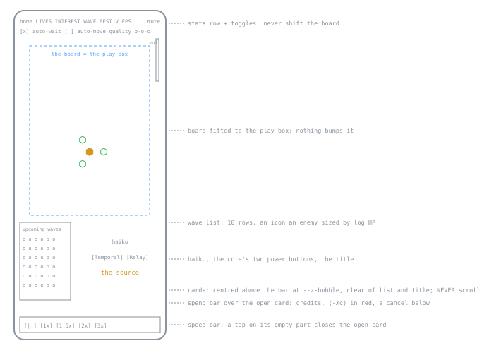

## 7. Interface

### 7.1 Layout (phone first, 430x932)

| Rule | Design |
|---|---|
| page | full screen, **no nav bar, no CRT stack**; the board refits only when the canvas resizes; **nothing on the page shifts the board** (no overlay insets) |
| cards | at `--z-bubble`, above bar, list and spend bar; **never scroll** (`fitPop` shrinks the chart); landscape >= 700 px puts description and control side by side; under 700 px the wave list drops to icons |
| spend bar | one place on every spending screen: credits above the open card, `(-Xc)` in red, one cancel below |
| close | the tower card's close is a square **X right of the upgrade button**: with points pulled it drops them, else closes |
| chooser open | paused AND the board stops redrawing (`frame` skips `render`), so the blur and darken cost nothing a frame |

### 7.2 Gestures and keys

| Gesture | Result |
|---|---|
|  tap an empty open slot | **seven tower cards** in two columns (`aspira-chooser.js`: name, price, the four enemy symbols each with its checks and x's, flavour; no numbers; keys 1-4 pick the first four) and a cancel (more below) |
| tap a tower, its home slot, or the core | its card |
| a press moving under `DRAG_PX` | a tap; more on a tower = a move (§4.4) |
| unaffordable | tappable but dimmed (`.poor`): a tap shakes it and says "need Nc more" |
| before the first tower | the free slots flash, a white triangle bobs over the top-left one |

- **tap an empty open slot**: building the THIRD tower, a card's x's on a type neither built tower has a check on are boxed red (`vsGaps`); too poor = the card shakes and stays. The order is shuffled ONCE per browser and kept (`spire.buildOrder` in localStorage), so a key is whatever card sits in that place. The marks (`VS_MARKS`) come from a `countermx` run (SPREAD_ONLY, 9 points, waves 101-109 and 111-119 - CLAUDE.md has the command), so they follow the matrix (§4.8): each type's leak is taken against the SEVEN-TOWER mean for that type, then against the tower's own mean - a table whose every row AND column sums to 0 - scaled to one mark per 20 points and rounded so the sums stay 0 (owner, 2026-10-23: "Col and row need to sum to 0"; dashes fine, no fixed count); two towers with the same marks are flagged (`marks.py`). THE BALANCE TARGET is `scripts/aspira-sim/mark-target.json` (owner, 2026-10-29: "save super important! priority #1"; the file is the truth and CLAUDE.md quotes it - no copy here, a copy here went stale): every type column +2 +2 +1 +1 -1 -2 -3, rows and columns sum to 0, every tower two checked types or more; `marktarget.py` finds the nearest such table to the measured marks, and balance moves the towers to it

Keys: 1-4 speeds (5 = 10x, owner), ~ 0.75x (no button; owner, 2026-10-19), Space pause, M mute, U lock in the basket, Esc cancel;
with a chooser open 1-4 pick the first four of its cards instead (the build chooser shows all seven, so the last three are tap only). No key opens the build chooser or builds without it (by choice).

### 7.3 The tower card (pillar 5)

| Part | Design |
|---|---|
| description | ONE prose a tower composed from its chart (`aspira-desc.js` `DESCRIBE`): one template where each axis swaps a few words; **only behaviour is told**; pulled points show as **track changes** (`wordDiff`); thematic words (acid: "jets", "pools", never heat); **every wording rule: `docs/spire-wording.md`** (`X%td`, no hit counts, nothing unbought, defaults unsaid). `docs/spire-descriptions.md` is the generated graph of every chain (`scripts/aspira-desc-graph.mjs`): rebuild after editing a sentence or a number |
| control | three `[-] pips [+]` steppers (axis name and tier, `0->II` while pulled; pips filled = locked, half = pulled, hollow = to buy, the last orange, red once another axis holds the capstone) beside the chart; the + flashes while the bank covers a buy |
| confirm | the tower's name and purchases with the cost (`Arc II (-440c)`), bold when affordable, pulsing while a basket waits; sell smaller under it; the targeting slider small |
| stats | in SECTIONS, one a mechanic (`STAT_SECTIONS`, `aspira-sliders.js`), a row no section names under "Tower" first; each `now -> next`, worse in red (`LOWER_BETTER`); rows the tower lacks left out; kills and damage live |
|  demo | a live scene of the tower at work in the description box (`aspira-demo*.js`; the text behind the i): a layout per tower tier 0 and per axis (`DEMO_LAYOUTS`, shares of the live range) (more below) |
| buy-card demo | the same scene for a random 5-point build of a kind, opened by the i on its buy card: one panel, the demo over the triangle, a close button; any click closes (`aspira-demo-buy.js`) |
| fit | **every section shows at every reasonable size, no scroll** (owner, 2026-11-06): `fitPop` shrinks the chart, then `fitTight` takes in order tight spacing + stats in two columns, the demo shrunk to 72 px, the content zoomed to 0.75, and only then a scroll; pinned over 10 sizes x 7 towers by `tests/test_spire_cardfit_browser.py` in exec-fn's real page shell |

- **demo**: each lane sends rows THREE WIDE, each slot filled at 50% by a seeded hash, rows about the number gap apart (`demoPlace0` / `demoLatStep`; SOL's layouts twice the rows); its own flat 3D camera, the range's far edge as far from the box's right edge as the tower is from its left, but **never zoomed in past the board's own tower size at its default zoom** (`demoBoardK`). A layout may set its own lane offset (`dy`, x the range; Nova's 0.2). Its CORE is the box's left exit level with the tower (`G.demoCore` - never `G.core`, the board's power state): rules that measure to the core read `coreXY()` (aspira-defs.js), never raw `CX`/`CY`. Draws that must fit the box read `demoDrawing` (true while a scene draws): Hypernova's rings scale by one factor so the widest stays in the canvas (`grvNovaFit`); the board never scales. Walkers carry the health of the wave the tower's points reach (`demoWave`: 30 + 7 a point, to 119), drawn at a wave-30 body's size; the scene holds one inert spawn so it never sends a real wave (a gap between rows read as a clear field) - the smoke's "demo late builds" pins both

### 7.4 Wave list, HUD, end screens

| Surface | Design |
|---|---|
| wave list | top-left under the header stats (`--head-h`); the live waves plus the next 3 (`WAVE_NEXT`), one icon an enemy sized by log HP, long rows tessellating; live waves in one green box; "warped in" / "warping in..." with the countdown, hidden while a boss holds the timer |
| wave card | a tap on a wave's icons or name (`data-n`) opens its stats (`aspira-wavecard.js`): units, lanes, HP each / in all, shields, armor, speed, time to core, credits, a late trait - read off ONE sample enemy made by `spawnEnemy` and taken back out (RNG held at 0.5), rows of 0 / N/A hidden; pauses like the changelog |
| auto-challenge | a box under "Challenge the X" (owner, 2026-11-08: "under \"challenge the X\" / add a checkbox for auto-challenge"); ticked, the game calls `challengeNext()` the moment the button would show (`CHALLENGE_DELAY` after the sky turns back) and the box moves under the wave list's heading, always there to untick ("move auto-challenge checkbox below wave indicator when checked"); per viewer (`aspira.autochal`, default off); a resumed run shows the Challenge screen and, ticked, challenges once the resume card is gone and the game runs (`autoChalBox`, aspira-wavelist.js) |
| threat | a mark on the three closest enemies within 4 s of the core; a leak's ring bounces out from the core with the lives left |
| end screen | one overlay for loss and win: TOP PLAYERS (§9.1) first, taking the spare height: the entry form on a win or a loss past wave 10; on a PORTRAIT screen "Play again" comes next, above the title (`order`, `aspira-endstats.css`); then the title (`ascendant`, the breaching boss's phrase, or `core breached`), the furthest wave, a line a tower ranked by damage and named by its two strongest axes' tier names (`aspira-endstats.js`), "Play again", then the waves that TOOK lives, most lives first, three rows tall (scrolls). The overlay pads by `--foot-h` so the list clears the speed bar; on the wide two-column layout the tower stats shrink and scroll first, and the leak list keeps its head and three whole rows (owner, 2026-10-31: "Ensure at least top 3 lives lost are fully visible") |

